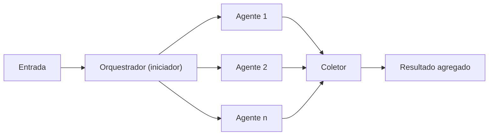

# Concurrent Orchestration

## Descrição

O Concurrent Orchestration executa vários agentes de IA ao mesmo tempo sobre a mesma tarefa, de modo que cada um traga uma análise independente a partir da sua perspectiva ou especialização. Um orquestrador (iniciador e coletor) distribui a entrada, aguarda os agentes e reúne as saídas intermediárias.

Os agentes trabalham de forma independente e não repassam resultados uns aos outros. O orquestrador precisa conhecer os agentes registrados e pode chamar todos de forma determinística ou escolher dinamicamente quais invocar conforme a tarefa. A agregação é opcional: quando necessária, a estratégia depende da tarefa, como votação ou maioria para classificação, mesclagem ponderada para recomendações com pontuação, ou um resumo sintetizado por um modelo de linguagem para reconciliar os resultados. Cada agente também pode atuar por conta própria, por exemplo atualizando repositórios de dados diferentes em paralelo.

Também é conhecido como *parallel*, *fan-out/fan-in*, *scatter-gather*, *map-reduce* ou, na terminologia do Google Cloud, *Multi-Agent Parallel* (parallel pattern). Na visão do Google, um agente de fluxo de trabalho paralelo controla quando e como os subagentes rodam, sem orquestração por modelo; um exemplo é a análise de feedback de clientes, em que sentimento, palavras-chave, categorização e urgência são avaliados ao mesmo tempo e um agente final mescla as saídas.

## Problemas que resolve

- Necessidade de perspectivas ou abordagens diversas sobre o mesmo problema (técnica, de negócio, criativa).
- Latência alta quando análises independentes são executadas uma após a outra.
- Cobertura incompleta do problema quando um único agente tem apenas um ponto de vista.
- Decisões que se beneficiam de brainstorming, raciocínio em conjunto (ensemble reasoning) ou votação por quórum.

## Quando usar

- Tarefas paralelizáveis, com um conjunto fixo de agentes ou com agentes escolhidos dinamicamente segundo os requisitos.
- Tarefas que ganham com múltiplas perspectivas independentes ou especializações diferentes: brainstorming, ensemble reasoning e decisões por quórum ou votação.
- Coleta de dados de várias fontes ou avaliação simultânea de várias opções.
- Cenários sensíveis a tempo, em que o processamento paralelo reduz a latência.

### Quando evitar

- Os agentes precisam construir sobre o trabalho uns dos outros ou exigem contexto cumulativo em sequência.
- A tarefa exige ordem específica de operações ou resultados determinísticos e reproduzíveis numa sequência definida.
- Restrições de recursos, como cota de modelo, tornam o paralelismo ineficiente ou inviável.
- Os agentes não conseguem coordenar com segurança mudanças em estado compartilhado ou sistemas externos ao mesmo tempo.
- Não há estratégia clara de resolução de conflitos para resultados contraditórios.
- A lógica de agregação é complexa demais ou piora a qualidade do resultado.

## Trade-offs

| Ganho | Custo / Risco |
| --- | --- |
| Menor tempo total, pois os agentes rodam em paralelo | Pico de consumo de modelo e risco de rate limiting ou estouro de cota |
| Cobertura ampla, com perspectivas independentes e especializadas | Resultados podem se contradizer e exigem resolução de conflitos |
| Falha de um agente pode ser tolerada com degradação graciosa | A agregação adiciona complexidade e pode reduzir a qualidade |
| Latência fim a fim em geral menor que a de uma abordagem sequencial | Maior consumo imediato de recursos e de tokens, o que eleva o custo operacional |
| Agentes isolados, fáceis de adicionar ou trocar | Estado mutável compartilhado gera inconsistência transacional |

- **Síntese:** a etapa de mesclagem pode exigir lógica complexa para reconciliar resultados conflitantes, com sobrecarga de desenvolvimento e manutenção; pese o ganho de latência contra o custo e essa complexidade.
- **Custo:** o paralelismo aumenta a vazão, mas multiplica as chamadas simultâneas ao modelo; use modelos menores nos agentes de tarefas simples.
- **Confiabilidade:** defina timeout, retry e o que fazer se um ou mais agentes falharem; evite pontos únicos de falha compartilhados (por exemplo, um único endpoint de modelo).
- **Estado:** evite estado mutável compartilhado entre agentes concorrentes.
- **Observabilidade:** acompanhe tokens e latência por agente e por execução para achar gargalos.

## Diagrama

O orquestrador envia a mesma entrada a todos os agentes ao mesmo tempo, e o coletor combina, compara ou seleciona as saídas intermediárias.

## Padrões relacionados

- [Sequential Orchestration](/ai/agent-orchestration/deterministic-workflows/sequential-orchestration) — alternativa quando há dependência entre estágios; é comum usar sequencial para o pré-processamento e concorrente para a análise paralela.
- [Group Chat Orchestration](/ai/agent-orchestration/dynamic-orchestration/group-chat-orchestration) — também reúne várias perspectivas, mas em conversa, com os agentes reagindo uns aos outros.
- [Magentic Orchestration](/ai/agent-orchestration/dynamic-orchestration/magentic-orchestration) — um gerente pode paralelizar tarefas de forma dinâmica num plano adaptativo.
- [Scatter-Gather](/architecture/eip/message-routing/scatter-gather) — equivalente em integração: distribui a requisição e reúne as respostas.
- [Aggregator](/architecture/eip/message-routing/aggregator) — correlaciona e combina as saídas dos agentes.
- [Recipient List](/architecture/eip/message-routing/recipient-list) — seleção de destinatários, análoga à escolha dinâmica de agentes.
- [Circuit Breaker](/cloud/cloud-design-patterns/resiliency/circuit-breaker) — protege dependências dos agentes contra falhas em cascata.

## Referência

- [AI agent orchestration patterns — Concurrent orchestration (Azure Architecture Center)](https://learn.microsoft.com/en-us/azure/architecture/ai-ml/guide/ai-agent-design-patterns#concurrent-orchestration)
- [Choose a design pattern for your agentic AI system — Parallel pattern (Google Cloud Architecture Center)](https://docs.cloud.google.com/architecture/choose-design-pattern-agentic-ai-system#parallel-pattern)
