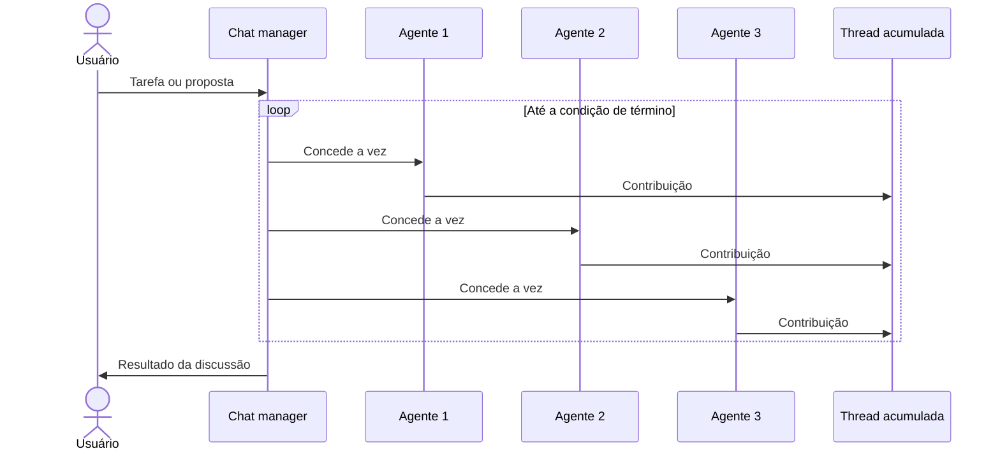

# Group Chat Orchestration

## Descrição

Vários agentes de IA resolvem um problema, tomam uma decisão ou validam um trabalho participando de uma única conversa compartilhada. Um **chat manager** coordena o fluxo: decide qual agente pode responder a seguir e controla o modo de interação, de um brainstorming livre a revisões formais com papéis fixos e portões de aprovação.

Todos os agentes (e os humanos, se houver) escrevem em uma única thread acumulada, que serve de contexto para os próximos turnos e de resultado final. Os agentes costumam ficar em modo somente leitura: discutem com base em conhecimento e modelos, sem usar ferramentas que alterem sistemas em execução. Um humano pode atuar como observador, participante ou até assumir o papel de chat manager.

Também é conhecido como *roundtable*, *collaborative*, *multiagent debate* ou *council*. O [Maker-Checker Loop](/ai/agent-orchestration/dynamic-orchestration/maker-checker-loop) é um subtipo dele.

## Problemas que resolve

- Decisões que se beneficiam de debate, contra-argumentação e construção de consenso entre perspectivas diferentes.
- Problemas multidisciplinares que exigem diálogo entre especialistas, sem um fluxo predeterminado.
- Refinamento iterativo de uma proposta por meio de discussão.
- Necessidade de transparência e auditoria: toda contribuição fica registrada em uma thread única.
- Controle de qualidade e conformidade que exigem várias visões de especialistas e separação entre criação e validação.

## Quando usar

- Brainstorming criativo em que agentes com perspectivas e fontes de conhecimento distintas constroem sobre as contribuições uns dos outros.
- Decisões que pedem debate, consenso ou refinamento iterativo.
- Garantia de qualidade com revisão estruturada e iteração, incluindo [maker-checker loops](/ai/agent-orchestration/dynamic-orchestration/maker-checker-loop).
- Validação de conformidade e regulatória com múltiplos pontos de vista de especialistas.
- Cenários com participação ou supervisão humana em tempo real (human-in-the-loop).

### Quando evitar

- Delegação simples de tarefas ou um pipeline linear já resolve o problema.
- O processamento é em tempo real e o custo da discussão é inaceitável.
- Uma decisão hierárquica clara ou um fluxo determinístico, sem discussão, é mais adequado.
- O chat manager não tem um critério objetivo para decidir que a tarefa terminou.
- Há muitos agentes: o controle da conversa e a prevenção de loops infinitos ficam difíceis. A fonte sugere limitar o padrão a três agentes ou menos.

## Trade-offs

| Ganho | Custo / Risco |
| --- | --- |
| Qualidade e robustez das decisões pelo confronto de perspectivas | Conversas podem entrar em loop e ficam difíceis de controlar com muitos agentes |
| Transparência e auditabilidade em uma thread única | O contexto cresce a cada turno, aumentando custo em tokens e risco de degradação |
| Supervisão humana natural, como observador ou gerente | Latência alta pela sobrecarga da discussão |
| Flexibilidade para modos livres ou estruturados | Depende de um critério claro de término, definido pelo chat manager |

- **Contexto:** compacte ou resuma a thread entre turnos e persista o estado em armazenamento durável em conversas longas.
- **Controle:** defina limite de turnos e condição de parada explícita.
- **Participação humana:** decida se a entrada humana é opcional ou obrigatória; portões obrigatórios tornam o passo síncrono, então persista o estado no checkpoint.
- **Segurança:** como os agentes são tipicamente somente leitura, o risco de efeitos colaterais é menor do que em padrões com ferramentas.

## Diagrama

O chat manager escolhe quem fala a cada turno; todas as contribuições se acumulam na mesma thread, que alimenta os turnos seguintes e produz o resultado.

## Padrões relacionados

- [Maker-Checker Loop](/ai/agent-orchestration/dynamic-orchestration/maker-checker-loop) — subtipo de group chat com turnos formais, critérios de aceitação e limite de iterações.
- [Magentic Orchestration](/ai/agent-orchestration/dynamic-orchestration/magentic-orchestration) — extensão do group chat em que um gerente monta um plano e os agentes usam ferramentas para agir em sistemas externos.
- [Handoff Orchestration](/ai/agent-orchestration/dynamic-orchestration/handoff-orchestration) — também dinâmico, mas com um único agente ativo e transferência total de controle.
- [Sequential Orchestration](/ai/agent-orchestration/deterministic-workflows/sequential-orchestration) — alternativa determinística quando um pipeline linear basta.
- [Concurrent Orchestration](/ai/agent-orchestration/deterministic-workflows/concurrent-orchestration) — análises independentes em paralelo, sem debate entre os agentes.
- [Process Manager](/architecture/eip/message-routing/process-manager) — coordenação central de um processo com vários participantes, mas com fluxo definido.

## Referência

- [AI agent orchestration patterns — Group chat orchestration (Azure Architecture Center)](https://learn.microsoft.com/en-us/azure/architecture/ai-ml/guide/ai-agent-design-patterns#group-chat-orchestration)
