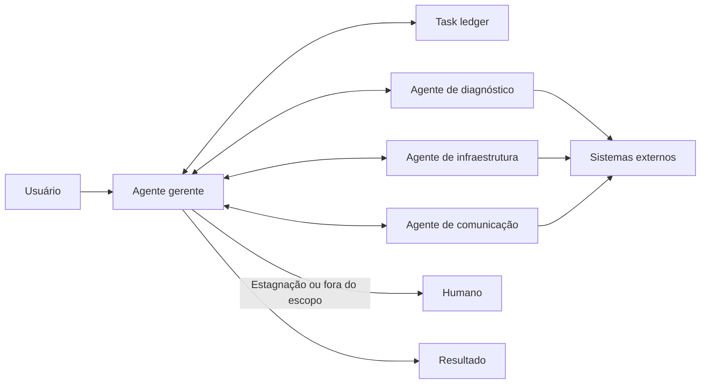

# Magentic Orchestration

## Descrição

Voltado a problemas abertos e complexos, sem plano de abordagem predeterminado. Um **magentic manager agent** constrói e refina um **task ledger**, o registro do plano com objetivos e subobjetivos, conversando diretamente com agentes especializados para coletar informação. Ele itera, volta atrás e delega quantas vezes for preciso até ter um plano executável, que então segue e acompanha.

Os agentes costumam ter ferramentas que alteram sistemas externos, então o foco é tanto construir e documentar a abordagem quanto executá-la. O gerente verifica regularmente se o pedido original foi atendido ou travou e ajusta o ledger. O ledger é uma trilha de auditoria e permite que um humano revise o plano antes ou depois da execução. A abordagem é inspirada no Magentic-One.

Também é conhecido como *dynamic orchestration*, *task-ledger-based orchestration* ou *adaptive planning*. Em certo sentido, estende o [Group Chat Orchestration](/ai/agent-orchestration/dynamic-orchestration/group-chat-orchestration): em vez de só discutir com conhecimento próprio, o foco é um agente que planeja enquanto os demais agem com ferramentas.

## Problemas que resolve

- Não há um caminho de solução conhecido de antemão, e o plano precisa emergir da colaboração entre especialistas.
- Gerar um plano de abordagem completo que um humano possa revisar e aprovar antes de agentes com ferramentas agirem.
- Replanejar quando novas informações mudam a situação (adicionar, remover ou reordenar tarefas).
- Manter uma trilha de auditoria do plano e dos passos executados.

## Quando usar

- Casos complexos ou abertos sem caminho de solução predeterminado.
- Necessidade de considerar a entrada e o feedback de vários agentes especializados para chegar a um caminho válido.
- Necessidade de um plano de abordagem completo para revisão humana antes ou depois da implementação.
- Agentes com ferramentas que interagem com sistemas externos, consomem recursos ou alteram sistemas em execução, em que o plano documentado pode ser apresentado ao usuário antes de liberar as tarefas.

### Quando evitar

- O caminho de solução é, ou deve ser, determinístico.
- Não há necessidade de produzir um ledger.
- A tarefa tem baixa complexidade e um padrão mais simples a resolve.
- O trabalho é sensível ao tempo: o padrão prioriza construir e debater planos viáveis, não velocidade.
- Esperam-se travamentos frequentes ou loops infinitos sem saída clara.

## Trade-offs

| Ganho | Custo / Risco |
| --- | --- |
| Resolve problemas abertos sem fluxo predefinido | Lento para convergir |
| Plano explícito e auditável no task ledger | Pode travar em objetivos ambíguos |
| Replanejamento contínuo conforme o contexto evolui | Maior consumo de tokens por replanejar e consultar vários agentes |
| Revisão e aprovação humana do plano antes de agir | Agentes com ferramentas aumentam o risco de efeitos colaterais |

- **Controle:** o gerente deve detectar estagnação e evitar loops de remediação infinitos; defina limites e escalonamento para humanos.
- **Segurança:** ao agir em sistemas reais, exija portões de aprovação e permissões mínimas para cada agente.
- **Observabilidade:** o ledger e o histórico de execução dão transparência para revisões posteriores.
- **Estado:** persista o ledger em armazenamento durável para retomar após interrupções.

## Diagrama

O gerente constrói e atualiza o task ledger consultando os agentes especializados, que usam ferramentas em sistemas externos; ao travar ou exceder o escopo, escala para um humano.

## Padrões relacionados

- [Group Chat Orchestration](/ai/agent-orchestration/dynamic-orchestration/group-chat-orchestration) — padrão base que este estende, com foco em planejar e agir com ferramentas.
- [Handoff Orchestration](/ai/agent-orchestration/dynamic-orchestration/handoff-orchestration) — delegação dinâmica sem gerente nem plano global.
- [Maker-Checker Loop](/ai/agent-orchestration/dynamic-orchestration/maker-checker-loop) — ciclo de verificação que pode ser usado dentro de uma tarefa do plano.
- [Sequential Orchestration](/ai/agent-orchestration/deterministic-workflows/sequential-orchestration) — ordem fixa, quando o plano é conhecido de antemão.
- [Process Manager](/architecture/eip/message-routing/process-manager) — coordenador central que mantém o estado do processo e decide o próximo passo.
- [Scheduler Agent Supervisor](/cloud/cloud-design-patterns/distributed-coordination/scheduler-agent-supervisor) — coordenação e supervisão de tarefas distribuídas com recuperação de falhas.

## Referência

- [AI agent orchestration patterns — Magentic orchestration (Azure Architecture Center)](https://learn.microsoft.com/en-us/azure/architecture/ai-ml/guide/ai-agent-design-patterns#magentic-orchestration)
