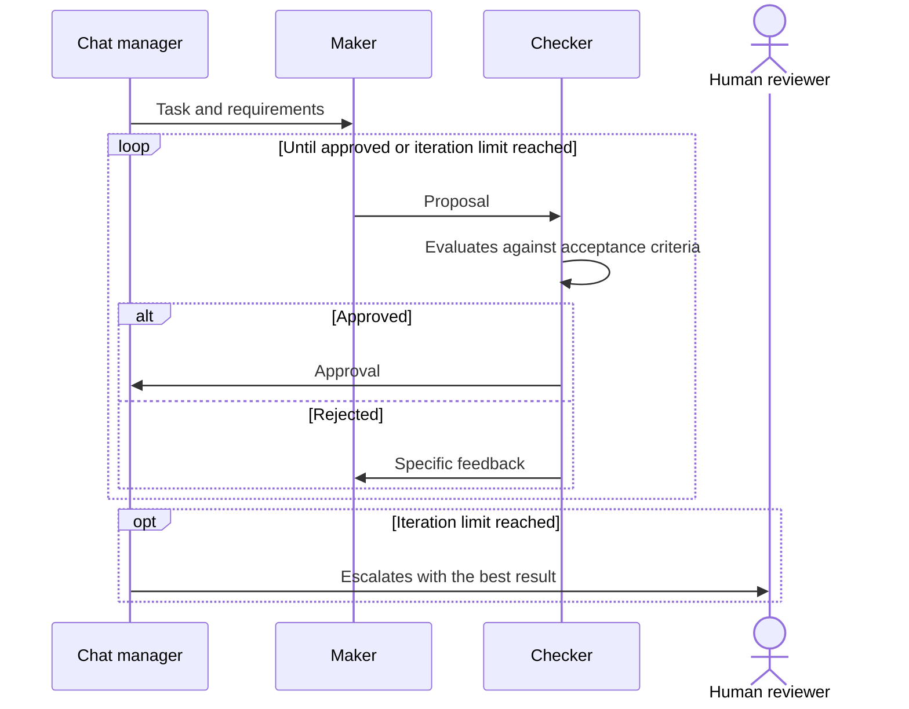

# Maker-Checker Loop

## Descrição

Um agente, o **maker**, cria ou propõe algo, e outro agente, o **checker**, avalia o resultado contra critérios definidos. Se o checker encontra lacunas ou problemas de qualidade, devolve a conversa ao maker com feedback específico. O maker revisa a saída e a reenvia. O ciclo se repete até o checker aprovar ou até atingir o número máximo de iterações.

É um tipo específico de [Group Chat Orchestration](./group-chat-orchestration.md). Enquanto o group chat geral não exige que os agentes falem por turnos, o maker-checker exige uma sequência formal de turnos conduzida pelo chat manager, com papéis fixos (criar e avaliar) e uma condição de parada objetiva. Por isso é mais previsível que um group chat livre.

Também é conhecido como *evaluator-optimizer*, *generator-verifier*, *critic loops* ou *reflection loops*. No Google Cloud é o **Review and Critique** (também chamado *generator and critic*): um agente gerador produz a saída e um agente crítico a avalia contra critérios como precisão factual, formato ou segurança, aprovando, rejeitando ou devolvendo com feedback. O Google o trata como uma implementação do [Multi-Agent Loop](../../agentic-ai/iteration/multi-agent-loop.md), geralmente em um fluxo sequencial; o [Iterative Refinement](../../agentic-ai/iteration/multi-agent-iterative-refinement.md) é a outra implementação, em que os agentes alteram progressivamente um resultado no estado da sessão.

## Problemas que resolve

- A saída de um agente de IA pode ter erros ou não atender requisitos, e precisa de verificação independente antes de ser aceita.
- Separar criação e validação em papéis distintos, evitando que o mesmo agente avalie o próprio trabalho.
- Refinamento iterativo guiado por feedback específico, em vez de uma única tentativa.
- Exigir verificação dedicada para saídas que precisam ser muito precisas ou obedecer restrições rígidas (por exemplo, um crítico que audita segurança do código gerado ou confere se os testes passam).
- Garantir que um resultado só avance quando passar em critérios de aceitação consistentes.

## Quando usar

- Criação de conteúdo com revisão editorial e separação clara entre produzir e validar.
- Garantia de qualidade e conformidade com critérios de aceitação explícitos (aprova ou reprova).
- Cenários que combinam refinamento iterativo com revisão humana como checker ou como fallback.
- Quando é possível escrever critérios objetivos para que o checker decida de forma consistente.

### Quando evitar

- Não há critérios de aceitação claros: o checker não consegue decidir de modo consistente.
- Uma única passada já atende à qualidade necessária, tornando o ciclo custo sem ganho.
- O tempo de resposta é crítico e as iterações são inaceitáveis.
- Não há limite de iterações nem comportamento de fallback definidos, o que arrisca loops infinitos de refinamento.

## Trade-offs

| Ganho | Custo / Risco |
| --- | --- |
| Qualidade maior e verificável por critérios explícitos | Cada iteração adiciona latência e consumo de tokens |
| Comportamento mais previsível que um group chat livre | Critérios mal definidos geram aprovações ou reprovações inconsistentes |
| Papéis separados de criação e validação | Risco de loop infinito de refinamento sem limite de iterações |
| Ponto natural para escalonar a um humano | Maker e checker podem compartilhar vieses se usarem o mesmo modelo |

- **Custo do crítico:** o crítico adiciona ao menos uma chamada de modelo, e cada revisão soma custo e atraso.
- **Critérios de aceitação:** devem ser claros para o checker emitir decisões de aprova ou reprova consistentes.
- **Limite de iterações:** defina um teto e o que acontece ao atingi-lo.
- **Fallback:** escale para um revisor humano ou entregue o melhor resultado possível com um aviso de qualidade.
- **Participação humana:** o humano pode ser o checker, ou o fallback; decida se a resposta dele é aprovação ou feedback que volta ao maker.

## Diagrama

O chat manager conduz turnos formais entre maker e checker; o ciclo termina com aprovação ou, ao atingir o limite, com fallback para um humano.

## Padrões relacionados

- [Group Chat Orchestration](./group-chat-orchestration.md) — padrão geral do qual este é um subtipo, com turnos formais e critérios de aceitação.
- [Sequential Orchestration](../deterministic-workflows/sequential-orchestration.md) — uma passada criar-depois-revisar sem repetição, quando um único ciclo basta.
- [Magentic Orchestration](./magentic-orchestration.md) — o gerente também verifica se o pedido foi atendido ou travou, mas num plano aberto.
- [Multi-Agent Loop](../../agentic-ai/iteration/multi-agent-loop.md) — padrão do Google do qual este é uma implementação.
- [Multi-Agent Iterative Refinement](../../agentic-ai/iteration/multi-agent-iterative-refinement.md) — outra implementação do loop, em que os agentes melhoram um resultado no estado da sessão até um limiar de qualidade, sem papel de aprovador.
- [Circuit Breaker](../../../cloud/cloud-design-patterns/resiliency/circuit-breaker.md) — o limite de iterações com fallback lembra a interrupção de tentativas repetidas que não avançam.

## Referência

- [AI agent orchestration patterns — Maker-checker loops (Azure Architecture Center)](https://learn.microsoft.com/en-us/azure/architecture/ai-ml/guide/ai-agent-design-patterns#maker-checker-loops)
- [Choose a design pattern for your agentic AI system — Review and critique pattern (Google Cloud Architecture Center)](https://docs.cloud.google.com/architecture/choose-design-pattern-agentic-ai-system#review-critique-pattern)
