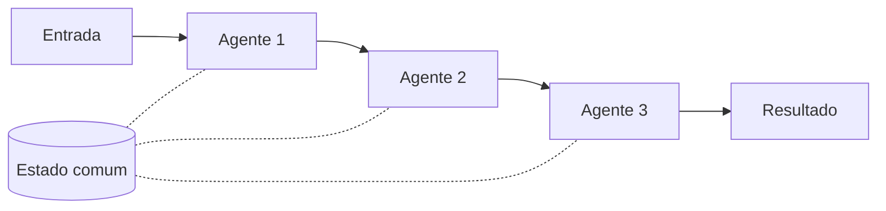

# Sequential Orchestration

## Descrição

O Sequential Orchestration encadeia agentes de IA numa ordem linear predefinida. Cada agente recebe a saída do agente anterior, processa e passa o resultado adiante, formando um pipeline de transformações especializadas. O resultado final é a saída do último agente.

A ordem é definida no fluxo de trabalho (código ou configuração), não pelos agentes: a escolha de qual agente é invocado em seguida nunca é delegada a um deles. O contexto passa de estágio em estágio, na forma bruta ou compactada (por exemplo, um resumo das saídas anteriores), e um estado comum pode ser mantido ao longo da cadeia.

Também é conhecido como *pipeline*, *prompt chaining*, *linear delegation* ou, na terminologia do Google Cloud, *Multi-Agent Sequential* (sequential pattern). Nessa visão, um agente de fluxo de trabalho sequencial segue lógica predefinida e nenhum modelo de IA orquestra os subagentes, como numa pipeline de dados com agentes de extração, limpeza e carga. Lembra o padrão Pipes and Filters, com agentes de IA no lugar de componentes de processamento codificados à mão.

## Problemas que resolve

- Tarefas de várias etapas em que cada estágio depende do resultado do anterior.
- Refinamento progressivo de uma saída (rascunho, revisão, polimento) sem sobrecarregar um único prompt.
- Prompts e conjuntos de ferramentas grandes demais para um agente só, que ficam mais simples quando divididos por especialidade.
- Necessidade de um fluxo previsível e fácil de depurar, em que se sabe qual agente produziu qual parte do resultado.

## Quando usar

- Processos de vários estágios com dependências lineares claras e progressão previsível.
- Pipelines de transformação de dados em que cada estágio agrega valor de que o próximo depende.
- Estágios que não podem ser paralelizados.
- Refinamento progressivo, como fluxos *rascunho, revisão, polimento*.
- Processos estruturados e repetíveis em que a ordem das etapas nunca muda.
- Sistemas em que se conhecem a disponibilidade e o desempenho de cada agente, e em que falhas ou atrasos de um agente são toleráveis para a tarefa como um todo.

### Quando evitar

- Estágios que são paralelizáveis sem perda de qualidade nem disputa por estado compartilhado.
- Poucos estágios que um único agente resolve bem.
- Estágios iniciais podem falhar ou gerar saída ruim e não há como impedir que os seguintes processem esse erro acumulado.
- Os agentes precisam colaborar, e não apenas passar o trabalho adiante.
- O fluxo exige retrocesso ou iteração.
- É preciso roteamento dinâmico com base em resultados intermediários.

## Trade-offs

| Ganho | Custo / Risco |
| --- | --- |
| Fluxo previsível, com ordem fixa e dependências explícitas | Sem paralelismo: a latência é a soma dos estágios |
| Cada agente se especializa, com prompt e ferramentas enxutos | Falhas e saídas ruins dos primeiros estágios se propagam pelos seguintes |
| Fácil de testar e depurar por estágio | Fluxo rígido: não suporta retrocesso nem desvios dinâmicos |
| Refinamento progressivo melhora a qualidade da saída | Custo de tokens se acumula a cada etapa |
| Latência e custo operacional menores que padrões orquestrados por modelo | Difícil pular etapas desnecessárias: uma etapa lenta soma-se à latência total |

- **Flexibilidade:** a eficiência vem ao custo da flexibilidade; escolha o padrão só quando o fluxo for realmente fixo.
- **Contexto:** a janela de contexto cresce a cada transição; compacte (resumo ou poda) entre estágios e passe só o que o próximo agente precisa.
- **Confiabilidade:** valide a saída de cada agente antes de passá-la adiante e use timeout e retry; falhe de forma explícita em vez de esconder o erro.
- **Estado:** em fluxos longos, persista o progresso em armazenamento durável para retomar após interrupções.
- **Observabilidade:** instrumente cada estágio e monitore tokens e latência por agente.

## Diagrama

O fluxo segue uma ordem fixa: cada agente transforma a saída do anterior, e um estado comum opcional acompanha a cadeia.

## Padrões relacionados

- [Concurrent Orchestration](/ai/agent-patterns/deterministic-workflows/concurrent-orchestration) — alternativa quando os estágios são independentes e podem rodar em paralelo; os dois podem ser combinados.
- [Maker-Checker Loop](/ai/agent-patterns/iteration/maker-checker-loop) — acrescenta iteração e revisão, que o fluxo sequencial não suporta.
- [Handoff Orchestration](/ai/agent-patterns/dynamic-orchestration/handoff-orchestration) — também passa o trabalho entre agentes, mas quem decide o próximo é o agente, não o fluxo.
- [Pipes and Filters](/architecture/cloud-design-patterns/messaging/pipes-and-filters) — padrão de nuvem em que o Sequential se inspira, com agentes no lugar de filtros.
- [Routing Slip](/architecture/eip/message-routing/routing-slip) — define a sequência de passos por mensagem, análogo a uma cadeia de agentes predefinida.
- [Retry](/architecture/cloud-design-patterns/resiliency/retry) — tratamento de falhas transitórias em cada estágio.

## Referência

- [AI agent orchestration patterns — Sequential orchestration (Azure Architecture Center)](https://learn.microsoft.com/en-us/azure/architecture/ai-ml/guide/ai-agent-design-patterns#sequential-orchestration)
- [Choose a design pattern for your agentic AI system — Sequential pattern (Google Cloud Architecture Center)](https://docs.cloud.google.com/architecture/choose-design-pattern-agentic-ai-system#sequential-pattern)
