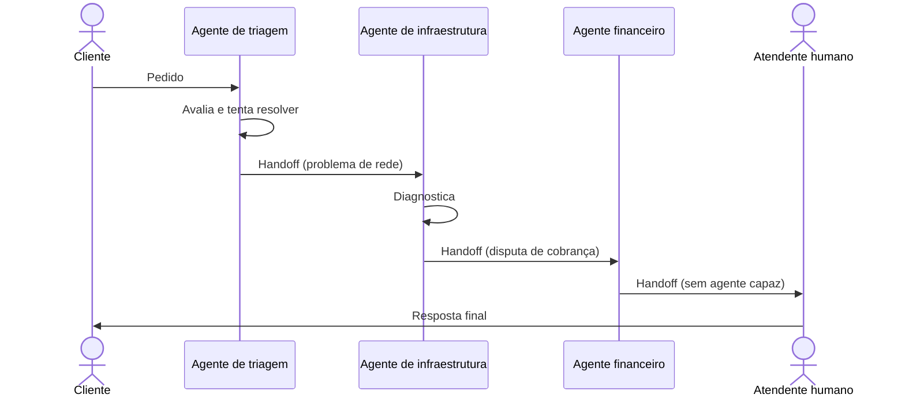

# Handoff Orchestration

## Descrição

Delegação dinâmica de tarefas entre agentes especializados. Cada agente avalia a tarefa e decide se a resolve sozinho ou a transfere para um agente mais adequado, de acordo com o contexto e os requisitos que surgem durante o processamento. Não há um orquestrador central decidindo a ordem: o próprio agente ativo escolhe o próximo.

Apenas um agente opera por vez, e o controle total passa de um para outro, em geral levando a conversa e o contexto relevantes. A cadeia de handoffs produz um único resultado. Qualquer agente pode encerrar a conversa quando considera o objetivo atingido ou quando nenhum outro agente agregaria valor, e alguns podem transferir para um humano.

Também é conhecido como *routing*, *triage*, *transfer*, *dispatch* ou *delegation*.

## Problemas que resolve

- O agente ideal para a tarefa não é conhecido de antemão.
- Os requisitos de especialização só ficam claros durante o processamento.
- Problemas de vários domínios que exigem especialistas atuando um de cada vez.
- Levar a tarefa ao agente mais capaz sem codificar todas as rotas possíveis.

## Quando usar

- Tarefas que exigem conhecimento ou ferramentas especializadas, mas cujo número e ordem de agentes não podem ser predeterminados.
- Necessidades de especialidade que emergem durante o processamento, levando a roteamento dinâmico por análise de conteúdo.
- Problemas multidomínio resolvidos por especialistas que operam um por vez.
- Sinais e relações lógicas predefinidos que indicam quando um agente chegou ao limite e qual deve assumir.

### Quando evitar

- O agente certo, ou a sequência de agentes, é identificável pela entrada inicial: use roteamento determinístico ou um dispatcher simples que classifica e encaminha sem participar do processamento.
- O roteamento é determinístico e baseado em regras, sem interpretação dinâmica de contexto.
- Decisões de roteamento ruins gerariam uma experiência ruim ou frustrante para o usuário.
- Várias operações precisam rodar em paralelo.
- É difícil evitar loops infinitos de handoff ou idas e vindas excessivas entre agentes.

## Trade-offs

| Ganho | Custo / Risco |
| --- | --- |
| Especialistas certos acionados sem plano rígido | Caminhos de roteamento imprevisíveis |
| Cada agente tem escopo e ferramentas menores e focados | Loops de handoff e bouncing entre agentes |
| Controle descentralizado, sem gerente central | Um roteamento ruim pode degradar a experiência do usuário |
| Saída para um humano quando nenhum agente resolve | Sem paralelismo, e cada salto soma latência |

- **Contexto:** decida o que passa no handoff (contexto bruto completo ou um resumo) para limitar o crescimento da janela.
- **Controle:** defina limite de transferências e detecte ciclos.
- **Observabilidade:** registre a cadeia de handoffs para depurar rotas inesperadas.
- **Participação humana:** um humano pode ser o destino final de escalonamento.

## Diagrama

Cada agente decide se resolve ou transfere o controle; só um está ativo por vez e a cadeia termina em uma resposta única, eventualmente por um humano.

## Padrões relacionados

- [Group Chat Orchestration](/ai/agent-patterns/dynamic-orchestration/group-chat-orchestration) — vários agentes numa conversa gerenciada, em vez de um agente ativo por vez.
- [Magentic Orchestration](/ai/agent-patterns/dynamic-orchestration/magentic-orchestration) — um gerente planeja e delega, em vez de os agentes decidirem a transferência.
- [Sequential Orchestration](/ai/agent-patterns/deterministic-workflows/sequential-orchestration) — ordem fixa e predefinida, ao contrário da ordem dinâmica do handoff.
- [Dynamic Router](/architecture/eip/message-routing/dynamic-router) — roteamento cuja decisão muda conforme o contexto em tempo de execução.
- [Content-Based Router](/architecture/eip/message-routing/content-based-router) — equivalente determinístico quando a rota sai do conteúdo da entrada inicial.
- [Choreography](/cloud/cloud-design-patterns/distributed-coordination/choreography) — sem coordenador central, cada participante decide o próximo passo.

## Referência

- [AI agent orchestration patterns — Handoff orchestration (Azure Architecture Center)](https://learn.microsoft.com/en-us/azure/architecture/ai-ml/guide/ai-agent-design-patterns#handoff-orchestration)
