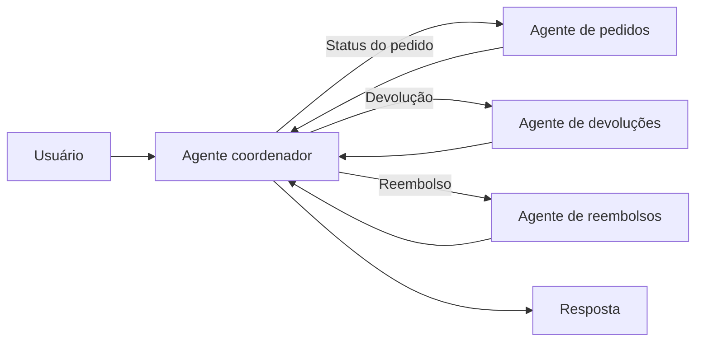

# Multi-Agent Coordinator

## Descrição

Um agente coordenador central analisa o pedido do usuário, divide-o em subtarefas e despacha cada uma para um agente especializado (por exemplo, um que consulta um banco de dados ou chama uma API). O coordenador usa um modelo para rotear as tarefas dinamicamente em tempo de execução, em contraste com o padrão paralelo, cuja lógica de despacho é fixa no código.

O caso típico é o atendimento ao cliente: o coordenador classifica o pedido como consulta de status, devolução ou reembolso e o envia ao agente correspondente. Os agentes especializados devolvem seus resultados e o coordenador monta a resposta. Também é conhecido como *coordinator pattern*.

Diferente do [Magentic Orchestration](/ai/agent-patterns/dynamic-orchestration/magentic-orchestration), que constrói e refina um task ledger para problemas abertos sem plano, o coordenador aqui roteia processos de negócio estruturados e não mantém um plano auditável iterativo. Em relação ao [Handoff Orchestration](/ai/agent-patterns/dynamic-orchestration/handoff-orchestration), o controle permanece com o coordenador, em vez de passar de agente em agente.

## Problemas que resolve

- Entradas variadas que exigem roteamento adaptativo, impossível de codificar em regras fixas.
- Processos de negócio estruturados que envolvem vários especialistas.
- Rigidez dos fluxos fixos diante de pedidos de tipos diferentes.

## Quando usar

- Automatizar processos de negócio estruturados com roteamento adaptativo para entradas variadas.
- Pedidos que precisam ser classificados antes de serem tratados por um especialista.
- Qualidade que se beneficia do raciocínio do modelo na escolha do caminho.

## Quando evitar

- O roteamento é fixo e previsível: fluxos sequenciais ou paralelos evitam chamadas extras ao modelo.
- Custo e latência são restrições rígidas.

## Trade-offs

| Ganho | Custo / Risco |
| --- | --- |
| Lida com mais variedade de entradas e adapta o fluxo em tempo de execução | Mais chamadas ao modelo que um agente único: mais tokens, custo e latência |
| Raciocínio do modelo tende a gerar resultados de maior qualidade | Custo de cada chamada se acumula entre coordenador e especialistas |
| Especialistas independentes e substituíveis | O coordenador é ponto único de falha e erro de roteamento |

- **Confiabilidade:** valide a classificação do coordenador e defina um caminho de fallback para pedidos não reconhecidos.
- **Observabilidade:** registre decisões de roteamento para auditar e ajustar.
- **Evolução:** avalie primeiro se um fluxo determinístico basta.

## Diagrama

O coordenador classifica o pedido, roteia para o especialista adequado e consolida o resultado.

## Padrões relacionados

- [Single Agent](/ai/agent-patterns/dynamic-orchestration/single-agent) — ponto de partida quando um só agente ainda dá conta.
- [Multi-Agent Hierarchical Task Decomposition](/ai/agent-patterns/dynamic-orchestration/multi-agent-hierarchical-task-decomposition) — implementação em vários níveis do coordenador.
- [Multi-Agent Parallel](/ai/agent-patterns/deterministic-workflows/concurrent-orchestration) — despacho fixo no código, sem decisão do modelo.
- [Multi-Agent Sequential](/ai/agent-patterns/deterministic-workflows/sequential-orchestration) — ordem fixa de agentes.
- [Magentic Orchestration](/ai/agent-patterns/dynamic-orchestration/magentic-orchestration) — planejamento aberto com task ledger, distinto do roteamento do coordenador.
- [Handoff Orchestration](/ai/agent-patterns/dynamic-orchestration/handoff-orchestration) — o controle passa entre agentes, sem coordenador central.
- [Process Manager](/architecture/eip/message-routing/process-manager) — coordenador central que decide o próximo passo.

## Referência

- [Choose a design pattern for your agentic AI system — Coordinator pattern (Google Cloud Architecture Center)](https://docs.cloud.google.com/architecture/choose-design-pattern-agentic-ai-system#coordinator-pattern)
