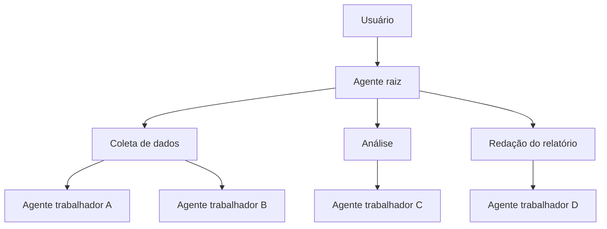

# Multi-Agent Hierarchical Task Decomposition

## Descrição

Os agentes se organizam em uma hierarquia de vários níveis. Um agente raiz divide uma tarefa complexa em subtarefas e as delega a subagentes de nível inferior; cada nível decompõe o trabalho recebido e delega mais adiante, até que um agente trabalhador no nível mais baixo execute a tarefa diretamente. A fonte o descreve como uma implementação do [Multi-Agent Coordinator](/ai/agent-patterns/dynamic-orchestration/multi-agent-coordinator).

É indicado para problemas ambíguos e abertos que exigem raciocínio em várias etapas, como pesquisa, planejamento e síntese. Em um projeto de pesquisa, por exemplo, o raiz divide o objetivo em coleta de dados, análise e redação do relatório, e subagentes especializados concluem ou decompõem ainda mais cada tarefa.

## Problemas que resolve

- Problemas complexos e ambíguos demais para um único nível de roteamento.
- Necessidade de decompor sistematicamente o trabalho até unidades executáveis.
- Resultados mais abrangentes do que os de padrões mais simples.

## Quando usar

- Problemas ambíguos e abertos com raciocínio em várias etapas: pesquisa, planejamento e síntese.
- Tarefas que se decompõem naturalmente em subtarefas, por sua vez decomponíveis.
- Quando a qualidade e a abrangência pesam mais que custo e latência.

### Quando evitar

- Problemas mais simples, em que as camadas extras só acrescentam complexidade.
- Latência e custo são críticos, pois o número de chamadas ao modelo é alto.
- Um coordenador simples já atende.

## Trade-offs

| Ganho | Custo / Risco |
| --- | --- |
| Decompõe sistematicamente problemas muito complexos | Difícil de projetar, depurar e manter |
| Resultados mais abrangentes e de maior qualidade | Várias camadas de delegação elevam muito latência e custo |
| Especialização por nível | Erros de decomposição se propagam para baixo |

- **Desafio central:** decompor a ambiguidade; defina critérios claros para quando parar de dividir.
- **Controle:** limite a profundidade e o número de subagentes para conter custo.
- **Observabilidade:** trace a árvore de delegação para depurar falhas.
- **Evolução:** avalie antes se um coordenador simples basta.

## Diagrama

O agente raiz delega a subagentes intermediários, que decompõem e delegam até os agentes trabalhadores executarem.

## Padrões relacionados

- [Multi-Agent Coordinator](/ai/agent-patterns/dynamic-orchestration/multi-agent-coordinator) — padrão de que este é uma implementação em vários níveis.
- [Single Agent](/ai/agent-patterns/dynamic-orchestration/single-agent) — ponto de partida mais simples.
- [Multi-Agent Swarm](/ai/agent-patterns/dynamic-orchestration/multi-agent-swarm) — colaboração sem hierarquia nem supervisor central.
- [Magentic Orchestration](/ai/agent-patterns/dynamic-orchestration/magentic-orchestration) — planejamento adaptativo com task ledger para problemas abertos.
- [Scheduler Agent Supervisor](/cloud/cloud-design-patterns/distributed-coordination/scheduler-agent-supervisor) — supervisão de tarefas distribuídas.

## Referência

- [Choose a design pattern for your agentic AI system — Hierarchical task decomposition pattern (Google Cloud Architecture Center)](https://docs.cloud.google.com/architecture/choose-design-pattern-agentic-ai-system#hierarchical-task-decomposition-pattern)
