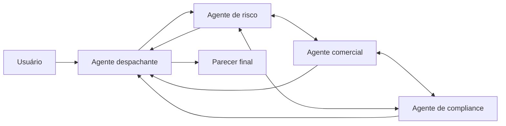

# Multi-Agent Swarm

## Descrição

Agentes especializados se comunicam entre si em todas as direções (all-to-all) e refinam iterativamente uma solução para um problema complexo. Um agente despachante envia o pedido ao agente mais apto a começar; a partir daí os agentes compartilham descobertas, criticam propostas e passam o trabalho uns aos outros. Não há supervisor central: o despachante apenas facilita a comunicação entre o enxame e o usuário.

É preciso definir uma condição de saída explícita, como número máximo de iterações, limite de tempo ou consenso. Em um comitê de crédito, agentes de risco, comercial e compliance debatem trade-offs e convergem para um parecer.

Comparado ao [Group Chat Orchestration](/ai/agent-patterns/dynamic-orchestration/group-chat-orchestration), que costuma ter um gerente de chat controlando os turnos, o swarm é totalmente descentralizado. Aproxima-se da [Choreography](/architecture/cloud-design-patterns/distributed-coordination/choreography): sem controlador central, cada participante reage aos demais.

## Problemas que resolve

- Problemas ambíguos ou muito complexos que se beneficiam de debate e múltiplas perspectivas.
- Soluções que dependem da crítica mútua entre especialistas.
- Ausência de um plano único que um coordenador possa impor.

## Quando usar

- Problemas ambíguos ou altamente complexos em que o debate entre perspectivas melhora o resultado.
- Decisões como o parecer de um comitê de crédito, que equilibram requisitos concorrentes.
- Quando qualidade e criatividade importam mais que custo e previsibilidade.

## Quando evitar

- Custo e latência precisam ser previsíveis.
- Uma resposta mais simples basta.
- Não é possível construir a lógica de controle exigida.

## Trade-offs

| Ganho | Custo / Risco |
| --- | --- |
| Simula uma equipe de especialistas; soluções criativas e de alta qualidade | Padrão multiagente mais complexo e caro |
| Sem ponto central de falha | Sem supervisor, risco de loops improdutivos ou de não convergir |
| Refinamento por crítica mútua | Alto custo operacional e latência |

- **Controle:** projete lógica sofisticada para gerenciar a comunicação e as iterações.
- **Terminação:** defina uma condição de saída firme (iterações, tempo ou consenso).
- **Observabilidade:** registre as trocas entre agentes para entender como se chegou ao consenso.

## Diagrama

O despachante entrega o pedido a um agente; os agentes debatem entre si e o despachante devolve o resultado ao atingir a condição de saída.

## Padrões relacionados

- [Group Chat Orchestration](/ai/agent-patterns/dynamic-orchestration/group-chat-orchestration) — conversa colaborativa, em geral com gerente de chat.
- [Handoff Orchestration](/ai/agent-patterns/dynamic-orchestration/handoff-orchestration) — passagem de controle entre agentes, usada também no swarm.
- [Choreography](/architecture/cloud-design-patterns/distributed-coordination/choreography) — coordenação descentralizada, sem controlador central.
- [Multi-Agent Coordinator](/ai/agent-patterns/dynamic-orchestration/multi-agent-coordinator) — alternativa centralizada.
- [Multi-Agent Review and Critique](/ai/agent-patterns/iteration/maker-checker-loop) — crítica estruturada entre dois papéis.

## Referência

- [Choose a design pattern for your agentic AI system — Swarm pattern (Google Cloud Architecture Center)](https://docs.cloud.google.com/architecture/choose-design-pattern-agentic-ai-system#swarm-pattern)
