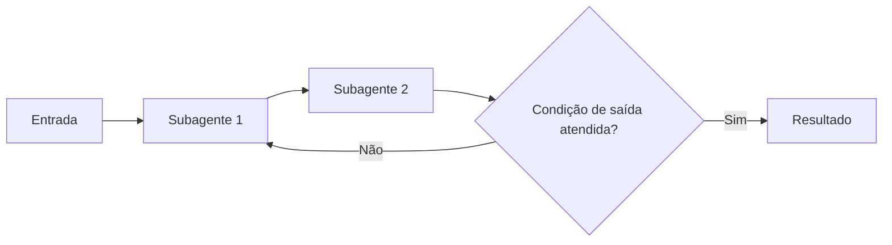

# Multi-Agent Loop

## Descrição

Um agente de loop executa uma sequência de subagentes e, em seguida, verifica uma condição de saída. Se a condição não foi atendida, repete a sequência. A lógica é predefinida e não depende de um modelo para orquestrar; a verificação pode ocorrer em qualquer ponto do fluxo.

O estado compartilhado carrega o resultado de uma volta para a seguinte. O resultado final é o estado no momento em que a condição de saída é satisfeita. [Review and Critique](/ai/agent-patterns/iteration/maker-checker-loop) e [Iterative Refinement](/ai/agent-patterns/iteration/multi-agent-iterative-refinement) são implementações deste padrão.

## Problemas que resolve

- Refinamento iterativo e autocorreção de um resultado ao longo de várias passadas.
- Tarefas de monitoramento ou polling que repetem uma ação até uma condição ser atingida.
- Repetição controlada sem precisar de um modelo para decidir quando continuar.

## Quando usar

- Fluxos iterativos em que agentes refinam o próprio trabalho.
- Exemplo da fonte: um agente gera conteúdo e um agente crítico o revisa até atingir um padrão de qualidade.
- Quando a condição de saída pode ser expressa como contagem de iterações ou como estado alcançado no fluxo.

### Quando evitar

- Uma única passada já atende à qualidade necessária.
- Não há condição de saída confiável nem teto de iterações.
- A latência precisa ser previsível, pois o tempo de espera pela condição varia.

## Trade-offs

| Ganho | Custo / Risco |
| --- | --- |
| Suporta fluxos iterativos complexos com autocorreção | Condição de saída mal definida pode gerar loop infinito, com custo alto e travamentos |
| Lógica predefinida, sem modelo orquestrando | Latência imprevisível enquanto espera a condição |
| Reaproveita subagentes especializados em cada volta | Cada volta consome tokens e tempo adicionais |

- **Condições de saída:** um número máximo de iterações ou um estado customizado atingido no fluxo; combine os dois.
- **Subagentes que não produzem o estado esperado:** sem o teto, o loop nunca termina.
- **Observabilidade:** registre o estado a cada iteração para entender por que o loop continuou.

## Diagrama

A sequência de subagentes se repete até que a condição de saída seja satisfeita ou o limite de iterações seja atingido.

## Padrões relacionados

- [Multi-Agent Review and Critique](/ai/agent-patterns/iteration/maker-checker-loop) — implementação do loop com gerador e crítico.
- [Multi-Agent Iterative Refinement](/ai/agent-patterns/iteration/multi-agent-iterative-refinement) — implementação do loop que melhora progressivamente um resultado no estado da sessão.
- [ReAct](/ai/agent-patterns/iteration/react) — itera, mas é o modelo que decide cada passo, sem fluxo predefinido.
- [Multi-Agent Sequential](/ai/agent-patterns/deterministic-workflows/sequential-orchestration) — a sequência de subagentes dentro de cada volta é um fluxo sequencial.
- [Scheduler Agent Supervisor](/architecture/cloud-design-patterns/distributed-coordination/scheduler-agent-supervisor) — também repete e supervisiona passos até a conclusão.

## Referência

- [Choose a design pattern for your agentic AI system — Loop pattern (Google Cloud Architecture Center)](https://docs.cloud.google.com/architecture/choose-design-pattern-agentic-ai-system#loop-pattern)
