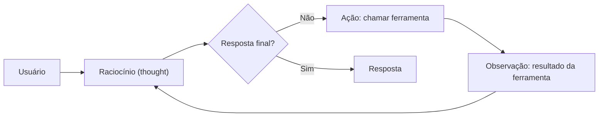

# ReAct

## Descrição

Um único agente, conduzido por um modelo, repete um ciclo de três passos: raciocina sobre a tarefa (*thought*), escolhe entre chamar uma ferramenta ou dar a resposta final (*action*) e registra o resultado da ferramenta no contexto (*observation*). A cada volta o modelo reavalia o plano com base no que acabou de observar, até concluir.

Quem decide o próximo passo é o próprio modelo, em tempo de execução, por isso o caminho não é previsível. O contexto é o histórico acumulado de pensamentos, ações e observações. Também é conhecido como *Reason and Act*.

## Problemas que resolve

- Tarefas em que o plano completo não pode ser definido de antemão e precisa ser ajustado conforme novas informações aparecem.
- Necessidade de combinar raciocínio com acesso a ferramentas e fontes externas em um mesmo fluxo.
- Depuração de decisões do agente, já que a transcrição do raciocínio fica registrada.

## Quando usar

- Tarefas complexas e dinâmicas que exigem planejamento e ajuste contínuos.
- Cenários em que um único agente basta, com custo e manutenção menores que um sistema multiagente.
- Exemplo da fonte: um agente de robótica traça um caminho até o objetivo, move um trecho, observa o ambiente e replaneja diante de novos obstáculos.

### Quando evitar

- O fluxo é conhecido e previsível: um workflow determinístico é mais barato e estável.
- A latência é crítica, pois cada volta do ciclo a aumenta.
- A qualidade do raciocínio do modelo não é confiável para a tarefa, ou as ferramentas podem devolver resultados enganosos sem validação.

## Trade-offs

| Ganho | Custo / Risco |
| --- | --- |
| Adapta o plano a cada observação | Cada iteração adiciona latência e tokens |
| Mais simples e barato de construir e manter que um sistema multiagente | A qualidade depende muito do raciocínio do modelo |
| A transcrição de raciocínio ajuda na depuração | Um resultado de ferramenta enganoso pode contaminar a resposta final |

- **Condições de saída:** o agente encontra uma resposta conclusiva, atinge um número máximo de iterações ou sofre um erro que impede continuar. Defina sempre o teto.
- **Contexto:** o histórico cresce a cada volta; considere resumi-lo ou truncá-lo.
- **Observabilidade:** registre pensamentos, ações e observações para auditar o caminho percorrido.

## Diagrama

O agente alterna raciocínio, ação e observação até decidir que já tem a resposta ou atingir o limite de iterações.

## Padrões relacionados

- [Multi-Agent Loop](/ai/agent-patterns/iteration/multi-agent-loop) — também itera, mas com um fluxo predefinido de subagentes em vez de um modelo decidindo cada passo.
- [Multi-Agent Review and Critique](/ai/agent-patterns/iteration/maker-checker-loop) — separa criação e verificação em agentes distintos, em vez de um agente que raciocina e age sozinho.
- [Magentic Orchestration](/ai/agent-patterns/dynamic-orchestration/magentic-orchestration) — planejamento dinâmico semelhante, mas com um gerente coordenando vários agentes.

## Referência

- [Choose a design pattern for your agentic AI system — Reason and act (ReAct) pattern (Google Cloud Architecture Center)](https://docs.cloud.google.com/architecture/choose-design-pattern-agentic-ai-system#react-pattern)
