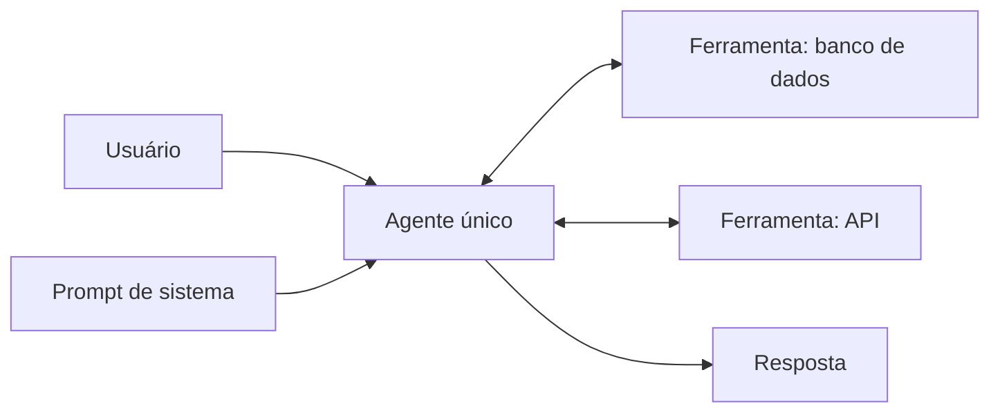

# Single Agent

## Descrição

Um único modelo, um conjunto definido de ferramentas e um prompt de sistema detalhado tratam o pedido do usuário de forma autônoma. O prompt define a tarefa central, a persona, as operações e as condições para usar cada ferramenta. O modelo interpreta o pedido, planeja a sequência de passos e escolhe as ferramentas, sem outros agentes envolvidos.

É o ponto de partida recomendado antes de qualquer arquitetura multiagente: permite refinar a lógica central, o prompt e as definições de ferramentas antes de acrescentar componentes. Técnicas de raciocínio como [ReAct](/ai/agentic-ai/iteration/react) podem melhorar o desempenho do agente sem mudar a topologia. Também é chamado de *single-agent system*.

## Problemas que resolve

- Tarefas de vários passos que exigem dados externos (consultar um banco, chamar APIs) sem a complexidade de coordenar agentes.
- Necessidade de uma base simples para validar prompt e ferramentas antes de escalar a arquitetura.
- Custo e latência mínimos em número de chamadas ao modelo.

## Quando usar

- Tarefas de vários passos que precisam de dados externos, como consultar o status de um pedido ou resumir notícias recentes via APIs.
- Início do desenvolvimento de agentes, para refinar lógica, prompt e ferramentas.
- Escopo de responsabilidade único e coeso, com poucas ferramentas.

### Quando evitar

- O agente precisa de muitas ferramentas ou enfrenta tarefas cada vez mais complexas.
- O agente deve gerenciar várias responsabilidades distintas.
- Sintomas de degradação: latência maior, seleção ou uso incorreto de ferramentas e falhas na tarefa.

## Trade-offs

| Ganho | Custo / Risco |
| --- | --- |
| Mais simples; menos chamadas ao modelo que os padrões multiagente | Desempenho cai conforme ferramentas e complexidade crescem |
| Permite refinar prompt e ferramentas antes de escalar | Um único contexto concentra todas as responsabilidades |
| Baixo custo, baixa latência e depuração direta | Seleção incorreta de ferramentas quando o catálogo cresce |

- **Evolução:** comece aqui e migre para ReAct ou para um padrão multiagente só quando surgirem problemas de desempenho.
- **Observabilidade:** mantenha traços das chamadas de ferramenta para identificar quando o agente passou do limite.
- **Segurança:** conceda apenas as ferramentas necessárias.

## Diagrama

O agente único interpreta o pedido, escolhe entre as ferramentas disponíveis, itera conforme necessário e devolve a resposta.

## Padrões relacionados

- [ReAct](/ai/agentic-ai/iteration/react) — técnica de raciocínio e ação que refina o agente único antes de recorrer a multiagente.
- [Multi-Agent Coordinator](/ai/agentic-ai/dynamic-orchestration/multi-agent-coordinator) — próximo passo quando o agente único passa a ter responsabilidades demais.
- [Multi-Agent Sequential](/ai/agent-orchestration/deterministic-workflows/sequential-orchestration) — divisão em etapas fixas quando uma só instrução não basta.
- [Handoff Orchestration](/ai/agent-orchestration/dynamic-orchestration/handoff-orchestration) — delegação dinâmica entre agentes quando o escopo se divide.

## Referência

- [Choose a design pattern for your agentic AI system — Single-agent system (Google Cloud Architecture Center)](https://docs.cloud.google.com/architecture/choose-design-pattern-agentic-ai-system#single-agent-system)
