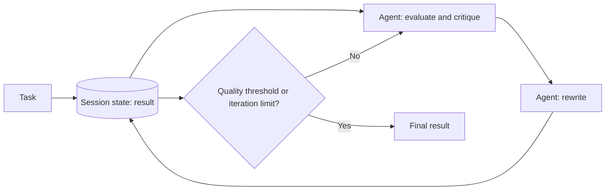

# Multi-Agent Iterative Refinement

## Descrição

Um ou mais agentes trabalham em loop, alterando a cada passada um resultado guardado no estado da sessão. Em vez de aprovar ou reprovar uma proposta, os agentes melhoram progressivamente o mesmo artefato (rascunho, plano, código) até ele atingir um limiar de qualidade ou o número máximo de iterações.

É uma implementação do [Multi-Agent Loop](./multi-agent-loop.md). A fonte também o lista entre os workflows determinísticos, para fluxos de caminho previsível, sem orquestração por modelo, que priorizam a qualidade sobre a latência.

## Problemas que resolve

- Tarefas de geração complexas ou abertas, difíceis de concluir em um único passo.
- Melhoria progressiva da saída ao longo de vários ciclos.
- Escrever e depurar código, montar um plano detalhado em várias partes ou redigir e revisar um documento longo.

## Quando usar

- A qualidade importa mais que a latência.
- O resultado pode ser avaliado por um limiar de qualidade (por exemplo, uma avaliação automática).
- Exemplo da fonte: um agente redige um post, critica fluidez e tom e o reescreve, repetindo até atingir o padrão ou o limite de iterações.

### Quando evitar

- Uma única passada produz qualidade suficiente.
- Não há critério de qualidade mensurável nem teto de iterações.
- A latência e o custo por requisição são restritos.

## Trade-offs

| Ganho | Custo / Risco |
| --- | --- |
| Saídas polidas e complexas, difíceis de obter em uma só etapa | Cada ciclo adiciona latência e custo |
| Caminho previsível, sem modelo orquestrando | Complexidade arquitetural adicional |
| Estado da sessão guarda a evolução do resultado | Condições de saída mal desenhadas causam execução descontrolada |

- **Condições de saída:** o resultado atinge um limiar de qualidade predefinido ou o loop alcança o máximo de iterações.
- **Diferença para Review and Critique / Maker-Checker:** aqui os agentes modificam o resultado compartilhado no estado da sessão a cada passada, rumo a um limiar de qualidade. No [Review and Critique](../../agent-orchestration/dynamic-orchestration/maker-checker-loop.md), um crítico distinto aprova, rejeita ou devolve feedback a um gerador que produz uma nova versão.
- **Estado:** versione ou registre cada iteração para auditar a evolução.

## Diagrama

Os agentes atualizam o mesmo resultado no estado da sessão a cada ciclo, até o limiar de qualidade ou o limite de iterações.

## Padrões relacionados

- [Multi-Agent Loop](./multi-agent-loop.md) — padrão do qual este é uma implementação.
- [Multi-Agent Review and Critique](../../agent-orchestration/dynamic-orchestration/maker-checker-loop.md) — outra implementação do loop, com gerador e crítico separados e decisão de aprovação.
- [Multi-Agent Sequential](../../agent-orchestration/deterministic-workflows/sequential-orchestration.md) — fluxo determinístico sem repetição, quando uma passada basta.
- [Maker-Checker Loop](../../agent-orchestration/dynamic-orchestration/maker-checker-loop.md) — equivalente no Agent Orchestration (Azure) do Review and Critique.

## Referência

- [Choose a design pattern for your agentic AI system — Iterative refinement pattern (Google Cloud Architecture Center)](https://docs.cloud.google.com/architecture/choose-design-pattern-agentic-ai-system#iterative-refinement-pattern)
