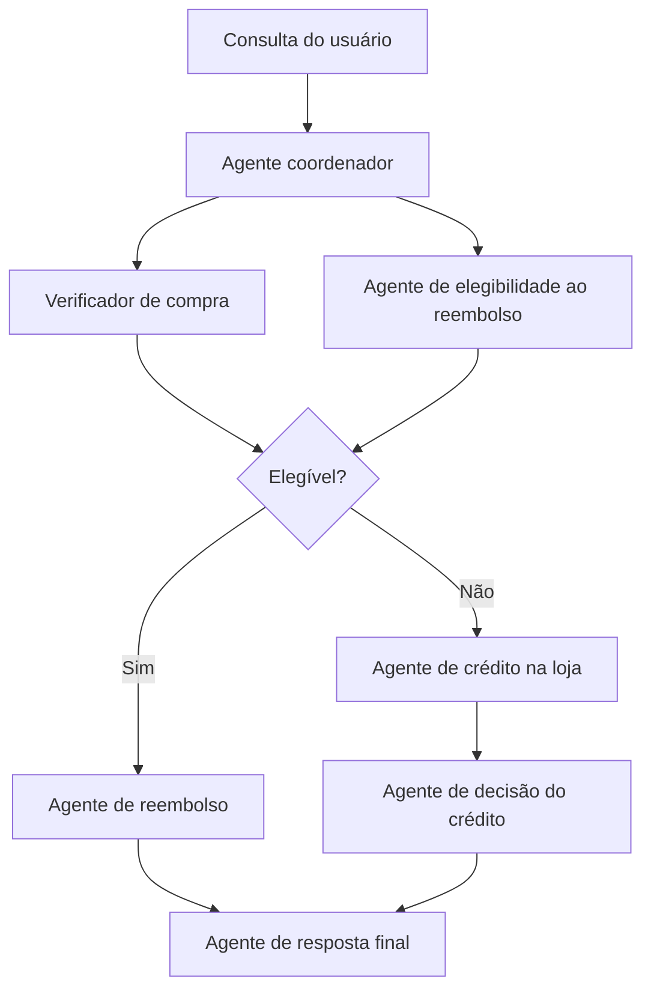

# Custom Logic

## Descrição

A orquestração é escrita em código, com instruções condicionais, laços e ramificações, em vez de usar um padrão predefinido. Dá a máxima flexibilidade e permite fluxos com vários caminhos, combinando regras determinísticas (o código decide) com raciocínio do modelo (os agentes decidem dentro de cada passo).

Cada etapa pode ser um agente, uma ferramenta ou uma verificação em código, e o próprio código decide quem roda em seguida, a partir do resultado anterior. É possível misturar padrões, como uma verificação em paralelo seguida de um ramo condicional.

## Problemas que resolve

- Fluxos que não se encaixam em nenhum dos padrões predefinidos.
- Necessidade de controle fino sobre a execução e sobre o que cada ramo faz.
- Mistura de regras de negócio fixas com decisões que exigem raciocínio do modelo.
- Composição de padrões (sequencial, paralelo, revisão) num mesmo fluxo.

## Quando usar

- Lógica complexa, com ramificações além de uma sequência linear.
- Quando é preciso combinar regras predefinidas e raciocínio do modelo.
- Quando o fluxo de trabalho não corresponde a nenhum modelo padrão.

### Quando evitar

- Um padrão predefinido, suportado pelo framework de agentes, já atende: ele reduz esforço de desenvolvimento e manutenção.
- A equipe não pode arcar com o projeto, a implementação e a depuração de todo o fluxo de orquestração.

## Trade-offs

| Ganho | Custo / Risco |
| --- | --- |
| Máximo controle sobre o desenho do fluxo | Você projeta, implementa e depura toda a orquestração |
| Combina regras fixas e raciocínio do modelo | Mais propenso a erros que os padrões predefinidos |
| Atende fluxos fora dos modelos padrão | Maior esforço de desenvolvimento e manutenção |

- **Testabilidade:** ramos determinísticos em código são fáceis de testar; isole os passos que dependem do modelo.
- **Observabilidade:** registre o ramo escolhido em cada execução para depurar.
- **Evolução:** se o fluxo convergir para um padrão conhecido, considere migrar para ele.

## Diagrama

Exemplo de um agente de reembolso: uma verificação em paralelo alimenta um ramo condicional no código (reembolso ou crédito na loja), e um agente final redige a resposta.

## Padrões relacionados

- [Multi-Agent Sequential](/ai/agent-orchestration/deterministic-workflows/sequential-orchestration) — um dos blocos que o código pode compor.
- [Multi-Agent Parallel](/ai/agent-orchestration/deterministic-workflows/concurrent-orchestration) — usado na etapa de verificação paralela.
- [Human-in-the-Loop](/ai/agentic-ai/special-requirements/human-in-the-loop) — o código define onde inserir a aprovação humana.
- [Content-Based Router](/architecture/eip/message-routing/content-based-router) — roteamento por regras sobre o conteúdo, equivalente ao ramo condicional.
- [Process Manager](/architecture/eip/message-routing/process-manager) — orquestração com estado e ramificações.
- [Scheduler Agent Supervisor](/cloud/cloud-design-patterns/distributed-coordination/scheduler-agent-supervisor) — coordenação de etapas distribuídas com supervisão.

## Referência

- [Choose a design pattern for your agentic AI system — Custom logic pattern (Google Cloud Architecture Center)](https://docs.cloud.google.com/architecture/choose-design-pattern-agentic-ai-system#custom-logic-pattern)
