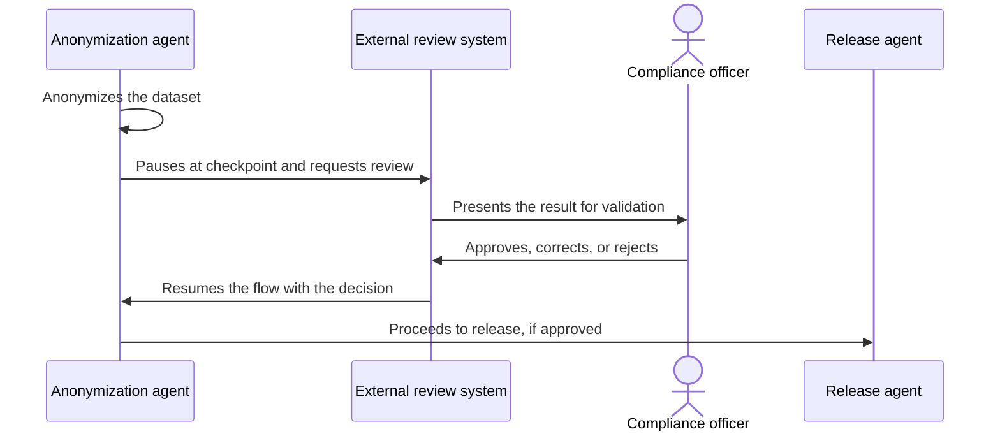

# Human-in-the-Loop

## Descrição

O agente executa o fluxo até um checkpoint predefinido e, ali, pausa e chama um sistema externo para que uma pessoa revise o trabalho. A pessoa pode aprovar uma decisão, corrigir um erro ou fornecer uma informação necessária antes de o agente continuar.

O estado da execução é preservado durante a pausa. Quando o humano responde (aprovação, rejeição, edição ou entrada adicional), o fluxo é retomado a partir do checkpoint, incorporando a resposta ao contexto. O padrão pode ser combinado com qualquer outro (sequencial, paralelo, revisão e crítica), pois é um requisito transversal sobre onde o humano entra.

## Problemas que resolve

- Ações críticas ou irreversíveis que não devem ser executadas sem aprovação.
- Tarefas de julgamento subjetivo, que o modelo não consegue validar sozinho.
- Requisitos de segurança, confiabilidade ou conformidade que exigem responsável humano pela decisão.
- Erros do modelo que precisam ser corrigidos antes de se propagarem.

## Quando usar

- Tarefas de alto risco ou subjetivas, como aprovar grandes transações financeiras, validar resumos de documentos sensíveis ou dar feedback sobre conteúdo criativo.
- Casos com exigências de conformidade, em que uma pessoa precisa aprovar a liberação do resultado.
- Fluxos em que informação faltante só um humano pode fornecer.

### Quando evitar

- Tarefas de baixo risco e alto volume, em que a revisão humana vira gargalo sem agregar segurança.
- Fluxos que precisam de resposta imediata ou rodam sem ninguém disponível para revisar.
- Quando não é viável construir e manter o sistema externo de interação com o usuário.

## Trade-offs

| Ganho | Custo / Risco |
| --- | --- |
| Mais segurança e confiabilidade, com julgamento humano nos pontos críticos | Complexidade arquitetural: é preciso construir e manter o sistema externo de revisão |
| Atende exigências de conformidade e responsabilização | Latência imprevisível, pois depende da disponibilidade de uma pessoa |
| Correção de erros antes de produzirem efeito | Vira gargalo se houver checkpoints demais |

- **Estado:** persista o contexto da execução durante a pausa e defina expiração (timeout) e o que fazer sem resposta.
- **Escolha dos checkpoints:** coloque-os apenas onde o risco justifica, para não sobrecarregar os revisores.
- **Observabilidade:** registre quem aprovou ou alterou o quê, para auditoria.
- **Segurança:** apresente ao revisor contexto suficiente para decidir, sem expor dados além do necessário.

## Diagrama

O fluxo roda até o checkpoint, entrega o trabalho a um sistema externo de revisão e só continua depois da resposta da pessoa. Exemplo: um agente anonimiza dados de pacientes e um responsável de conformidade valida antes da liberação.

## Padrões relacionados

- [Multi-Agent Review and Critique](../../agent-orchestration/dynamic-orchestration/maker-checker-loop.md) — a revisão é feita por agentes; aqui a revisão é humana.
- [Custom Logic](./custom-logic.md) — o código de orquestração define onde e quando pausar para um humano.
- [Handoff Orchestration](../../agent-orchestration/dynamic-orchestration/handoff-orchestration.md) — o handoff pode ter um humano como destino final.
- [Scheduler Agent Supervisor](../../../cloud/cloud-design-patterns/distributed-coordination/scheduler-agent-supervisor.md) — coordena etapas longas e com estado, como a espera por uma resposta externa.
- [Process Manager](../../../architecture/eip/message-routing/process-manager.md) — mantém o estado de um processo que aguarda eventos externos.

## Referência

- [Choose a design pattern for your agentic AI system — Human-in-the-loop pattern (Google Cloud Architecture Center)](https://docs.cloud.google.com/architecture/choose-design-pattern-agentic-ai-system#human-in-the-loop-pattern)
