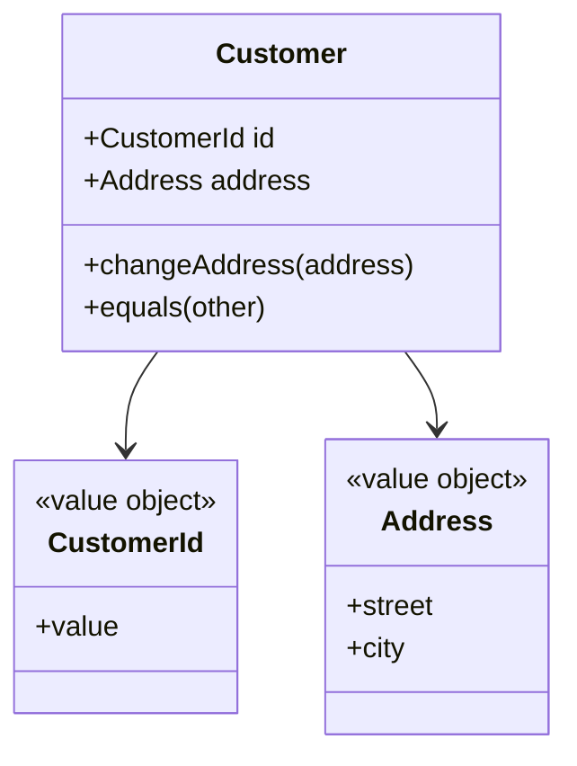

# Entity

## Descrição

Uma Entity é um objeto do modelo definido principalmente por sua identidade, e não por seus atributos. Ela permanece "a mesma" ao longo do tempo e das mudanças de estado: um cliente que troca de endereço continua sendo o mesmo cliente.

Evans destaca que é preciso definir o que significa ser o mesmo objeto, escolhendo um identificador único e estável (gerado pelo sistema ou vindo do negócio) e uma operação de comparação baseada nele. A entidade tem ciclo de vida, com criação, alterações e eventual término, e deve ter comportamento, não apenas dados.

Para manter o modelo simples, convém reduzir a entidade ao essencial: atributos e comportamento que definem sua identidade e seu ciclo de vida, delegando o restante a Value Objects associados.

## Problemas que resolve

- Confusão entre objetos que devem ser rastreados no tempo e objetos meramente descritivos.
- Duplicidade e inconsistência por falta de identidade estável.
- Comparação por atributos quando a identidade é o que importa.
- Modelos anêmicos, em que a entidade é só um saco de dados.

## Quando usar

- Quando o objeto precisa ser distinguido de outros mesmo com atributos idênticos.
- Quando o conceito tem ciclo de vida e histórico relevantes ao negócio.
- Quando o objeto é referenciado por outros ao longo do tempo.

### Quando evitar

- Quando o conceito é definido só por seus valores e é intercambiável: prefira um [Value Object](/application/poeaa/base/value-object).
- Quando rastrear identidade e ciclo de vida seria custo sem benefício.

## Trade-offs

| Ganho | Custo / Risco |
| --- | --- |
| Rastreamento claro de objetos ao longo do tempo | Exige definir e proteger a identidade |
| Comportamento e invariantes concentrados no objeto | Mais custo de persistência e de ciclo de vida que um valor |
| Linguagem do negócio refletida no modelo | Risco de entidades inchadas se tudo virar entidade |

- **Identidade:** deve ser imutável e única dentro do escopo (global ou local ao agregado).
- **Igualdade:** compare pelo identificador, nunca por todos os atributos.

## Diagrama



`Customer` é identificado por `CustomerId`. O `Address` pode mudar sem alterar quem é o cliente.

## Exemplo

Um cliente muda de endereço, mas continua sendo o mesmo cliente porque a igualdade usa o identificador.

```python
class Customer:
    def __init__(self, customer_id: str, name: str, address: "Address"):
        self._id = customer_id
        self.name = name
        self.address = address

    @property
    def id(self) -> str:
        return self._id

    def change_address(self, address: "Address") -> None:
        self.address = address

    def __eq__(self, other) -> bool:
        return isinstance(other, Customer) and self._id == other._id

    def __hash__(self) -> int:
        return hash(self._id)
```

## Padrões relacionados

- [Value Object](/application/poeaa/base/value-object) — contraparte sem identidade, usada para descrever a entidade.
- [Aggregate](/application/ddd/building-blocks/aggregate) — entidades se agrupam sob uma raiz que garante invariantes.
- [Repository](/application/poeaa/object-relational-metadata-mapping/repository) — recupera entidades pela identidade.
- [Factory](/application/ddd/building-blocks/factory) — cria entidades já com identidade e invariantes válidas.
- [Identity Field](/application/poeaa/object-relational-structural/identity-field) — armazena a identidade da entidade no banco.

## Referência

- [DDD Reference, Eric Evans (2015)](https://www.domainlanguage.com/ddd/reference/)
- [Evans Classification (bliki)](https://martinfowler.com/bliki/EvansClassification.html)
- *Domain-Driven Design: Tackling Complexity in the Heart of Software*, Eric Evans (Addison-Wesley, 2003)
