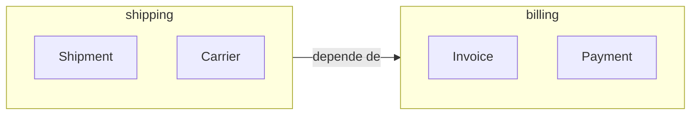

# Module

## Descrição

Um Module (pacote ou namespace) agrupa conceitos do modelo que são coesos entre si, reduzindo a carga cognitiva de quem lê o código. Para Evans, módulos fazem parte do modelo e contam uma história do domínio, e não são simples pastas técnicas.

Os módulos devem ser nomeados com a linguagem ubíqua e refletir conceitos do negócio, com alta coesão interna e baixo acoplamento entre si. Agrupar por tipo técnico (todas as entidades juntas, todos os repositórios juntos) esconde o domínio; agrupar por conceito o revela.

Quando o modelo muda, os módulos também devem ser refatorados, para continuarem expressando o entendimento atual.

## Problemas que resolve

- Código difícil de navegar, com centenas de classes em um único pacote.
- Agrupamentos puramente técnicos que escondem os conceitos do domínio.
- Dependências cíclicas e acoplamento excessivo entre partes do modelo.

## Quando usar

- Quando o modelo cresce e precisa ser dividido em partes compreensíveis.
- Quando é possível nomear cada grupo com um conceito do negócio.
- Para limitar o acoplamento entre áreas do modelo.

### Quando evitar

- Em modelos muito pequenos, onde a divisão só adicionaria cerimônia.
- Quando os módulos seriam mera cópia das camadas técnicas.

## Trade-offs

| Ganho | Custo / Risco |
| --- | --- |
| Menor carga cognitiva | Fronteiras mal escolhidas atrapalham mais do que ajudam |
| Baixo acoplamento e alta coesão | Refatorar módulos tem custo |
| Linguagem do negócio visível na estrutura | Exige manter nomes alinhados à linguagem ubíqua |

- **Evolução:** módulos são refatorados junto com o modelo.
- **Diferença de contexto:** módulo organiza dentro de um modelo; Bounded Context delimita um modelo inteiro.

## Diagrama



Os módulos `shipping` e `billing` agrupam conceitos coesos, com dependência explícita e unidirecional.

## Exemplo

Em vez de pacotes `entities`, `services` e `repositories`, o código é organizado por conceito do negócio.

```text
com.acme.shipping/
    Shipment.java
    Carrier.java
    ShipmentRepository.java
com.acme.billing/
    Invoice.java
    Payment.java
    InvoiceRepository.java
```

## Padrões relacionados

- [Bounded Context](../model-in-practice/bounded-context.md) — fronteira maior, de um modelo inteiro.
- [Ubiquitous Language](../model-in-practice/ubiquitous-language.md) — nomeia os módulos.
- [Aggregate](./aggregate.md) — costuma residir dentro de um módulo.
- [Layered Architecture](./layered-architecture.md) — organiza por camadas, enquanto o módulo organiza por conceito.
- [Standalone Classes](../supple-design/standalone-classes.md) — reduz dependências entre módulos.

## Referência

- [DDD Reference, Eric Evans (2015)](https://www.domainlanguage.com/ddd/reference/)
- *Domain-Driven Design: Tackling Complexity in the Heart of Software*, Eric Evans (Addison-Wesley, 2003)
