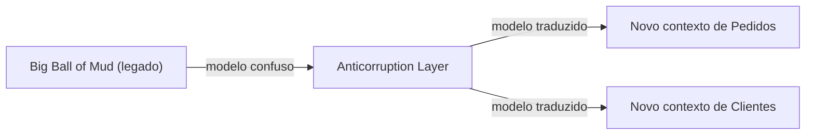

# Big Ball of Mud

## Descrição

Big Ball of Mud é o nome, cunhado por Brian Foote e Joseph Yoder, para um sistema sem estrutura perceptível: modelos misturados, fronteiras inconsistentes, dependências em todas as direções. No DDD Reference, o termo aparece como um aviso ao desenhar o Context Map: partes do sistema em que os modelos estão tão emaranhados que não faz sentido tentar aplicar ali um modelo único.

A recomendação é desenhar uma fronteira em torno da região confusa e tratá-la como um único contexto, sem tentar sofisticar o modelo dentro dela. Ao redor, os demais contextos se protegem com Anticorruption Layer para impedir que o caos se espalhe.

Reconhecer um Big Ball of Mud não é aprová-lo, e sim nomear uma realidade para decidir com lucidez onde investir esforço de modelagem e onde apenas conter o dano.

## Problemas que resolve

- Tentativas inúteis de aplicar modelagem refinada em um sistema cujo estado não permite isso.
- Contaminação de contextos novos ou bem modelados por conceitos do legado confuso.
- Falta de nome e de fronteira para uma região problemática, que impede planejamento.

## Quando usar

- Ao mapear sistemas legados e identificar regiões sem estrutura, para delimitá-las no Context Map.
- Quando é preciso explicar a fronteira entre um sistema novo e um legado emaranhado.
- Ao planejar migrações graduais, para decidir o que isolar antes de substituir.

### Quando evitar

- Como meta de design: ele descreve um problema, não uma solução a ser buscada.
- Para rotular sistemas apenas antigos ou feios; se há estrutura reconhecível, ela deve ser mapeada.
- Para justificar a falta de modelagem em contextos novos, que ainda têm chance de nascer bem estruturados.

## Trade-offs

| Ganho | Custo / Risco |
| --- | --- |
| Fronteira explícita em volta da região confusa | O interior continua confuso e caro de manter |
| Contenção do problema pela Anticorruption Layer | Camadas de tradução têm custo de desenvolvimento |
| Decisão consciente de onde investir modelagem | Pode normalizar a dívida técnica se não houver plano de saída |
| Base para migração incremental | A região segue sendo risco de operação e de mudança |

- **Contenção:** trate a região como um único contexto e proteja os vizinhos.
- **Saída:** associe o reconhecimento a um plano de substituição gradual, como Strangler Fig.
- **Esforço:** concentre a modelagem refinada no Core Domain, não em tentar consertar o todo.

## Diagrama

O legado emaranhado é cercado por uma fronteira, e os contextos novos o acessam apenas por uma camada de tradução.

## Exemplo

Uma seguradora tem um sistema de apólices com vinte anos de acréscimos, em que regras de cobrança, cadastro e sinistros estão misturadas no mesmo esquema. O time desenha o sistema como um único contexto, o "Legado de Apólices", no Context Map. Os novos contextos de Cotação e de Sinistros acessam o legado por uma Anticorruption Layer e, ao longo do tempo, assumem funcionalidades de forma incremental, até que o legado possa ser desligado.

## Padrões relacionados

- [Context Map](./context-map.md) — onde a região é delimitada como um único contexto.
- [Anticorruption Layer](../../../cloud/azure/integration-and-modernization/anti-corruption-layer.md) — protege os vizinhos do modelo confuso.
- [Bounded Context](../model-in-practice/bounded-context.md) — a fronteira desenhada em torno da região.
- [Separate Ways](./separate-ways.md) — alternativa quando não vale a pena integrar com o legado.
- [Conformist](./conformist.md) — evitar em relação a um Big Ball of Mud, para não herdar a confusão.
- [Strangler Application](../../../cloud/azure/integration-and-modernization/strangler-fig.md) — substituição incremental do legado.
- [Strangler Fig](../../../cloud/azure/integration-and-modernization/strangler-fig.md) — a mesma ideia no catálogo de nuvem.

## Referência

- [DDD Reference, Eric Evans (2015)](https://www.domainlanguage.com/ddd/reference/)
- *Domain-Driven Design: Tackling Complexity in the Heart of Software*, Eric Evans (Addison-Wesley, 2003), cap. 14
- Brian Foote e Joseph Yoder, [*Big Ball of Mud*](http://www.laputan.org/mud/) (PLoP, 1997)
- [DDD Crew: Context Mapping](https://github.com/ddd-crew/context-mapping)
