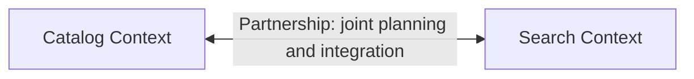

# Partnership

## Descrição

Partnership é um relacionamento entre dois Bounded Contexts, e entre os times que os mantêm, em que o sucesso de um depende do sucesso do outro. Os times coordenam o planejamento e o desenvolvimento das interfaces de forma conjunta, de modo que as duas partes evoluam juntas ou fracassem juntas.

Na prática, os times fazem integração contínua dos recursos que se cruzam, combinam datas, resolvem dependências em conjunto e se ajustam mutuamente quando uma mudança de um lado afeta o outro. Nenhum é puramente upstream ou downstream: as decisões de interface são tomadas em comum.

O padrão não aparece no livro de 2003; foi incluído no DDD Reference como uma forma explícita de nomear essa cooperação estreita.

## Problemas que resolve

- Dois contextos com funcionalidades interdependentes entregues por times diferentes, sem coordenação, gerando integrações quebradas na última hora.
- Interfaces desenhadas por um lado e descobertas pelo outro tarde demais.
- Falta de responsabilidade compartilhada pelo resultado final que depende dos dois contextos.

## Quando usar

- Dois times com objetivos de negócio fortemente acoplados, que só entregam valor juntos.
- Há boa comunicação entre os times e capacidade de sincronizar prioridades e cadência.
- Os contextos ainda estão evoluindo rapidamente e as interfaces mudam com frequência.

### Quando evitar

- Times distribuídos, com pouca comunicação ou fusos e prioridades incompatíveis.
- Quando um dos lados é um fornecedor externo ou de terceiros, sem como coordenar o planejamento.
- Quando a dependência é unilateral; Customer/Supplier ou Conformist descrevem melhor a situação.

## Trade-offs

| Ganho | Custo / Risco |
| --- | --- |
| Interfaces alinhadas e menos surpresas na integração | Custo alto de coordenação e de reuniões |
| Responsabilidade compartilhada pelo resultado | Um time atrasado atrasa o outro |
| Decisões de modelo tomadas com contexto dos dois lados | Autonomia reduzida de cada time |
| Evolução conjunta rápida enquanto o produto é incerto | Difícil de sustentar com o crescimento das organizações |

- **Acoplamento organizacional:** o acoplamento é aceito de propósito; ele deve ser reavaliado se a coordenação virar gargalo.
- **Evolução:** com o tempo, pode migrar para Customer/Supplier ou para contextos com mais independência.

## Diagrama

A seta bidirecional indica que não há upstream nem downstream: ambos os contextos coordenam mudanças e interfaces.

## Exemplo

O time de Catálogo e o time de Busca de um marketplace lançam uma nova funcionalidade de filtros por atributos. O catálogo precisa publicar atributos estruturados e a busca precisa indexá-los. Os dois times planejam o trabalho no mesmo ciclo, definem juntos o formato dos atributos, rodam testes de integração conjuntos todos os dias e só liberam a funcionalidade quando ambos estão prontos.

## Padrões relacionados

- [Context Map](./context-map.md) — onde a parceria é registrada.
- [Shared Kernel](./shared-kernel.md) — pode surgir dentro de uma parceria, para compartilhar parte do modelo.
- [Customer/Supplier Development](./customer-supplier-development.md) — alternativa quando há dependência unilateral.
- [Continuous Integration](../model-in-practice/continuous-integration.md) — prática usada pelos times parceiros para manter os modelos alinhados.
- [Bounded Context](../model-in-practice/bounded-context.md) — contextos que participam da parceria.

## Referência

- [DDD Reference, Eric Evans (2015)](https://www.domainlanguage.com/ddd/reference/)
- *Domain-Driven Design: Tackling Complexity in the Heart of Software*, Eric Evans (Addison-Wesley, 2003), cap. 14
- [DDD Crew: Context Mapping](https://github.com/ddd-crew/context-mapping)
