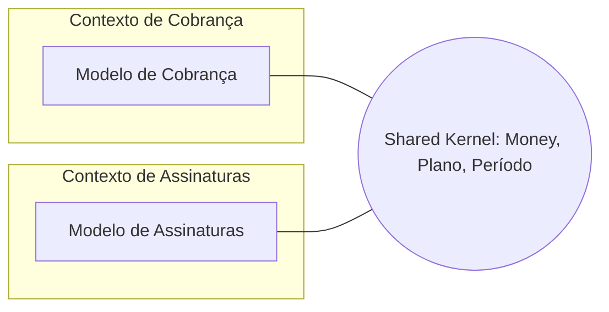

# Shared Kernel

## Descrição

O Shared Kernel é um subconjunto do modelo de domínio, e do código ou do esquema de dados associado, que dois ou mais times concordam em compartilhar. Esse subconjunto é explicitamente delimitado e só pode ser alterado com o acordo de todos os times envolvidos.

Os times designam a parte comum, geralmente pequena, e a mantêm sob integração contínua com testes que todos executam. Fora do kernel, cada contexto continua tendo o próprio modelo. O objetivo é reduzir duplicação e o custo de tradução onde dois contextos realmente precisam falar exatamente a mesma língua.

Exige disciplina: o kernel não pode ser alterado unilateralmente, e sua existência deve ser conhecida e registrada no Context Map.

## Problemas que resolve

- Duplicação de conceitos centrais mantidos de forma divergente por dois times, com custo alto de tradução.
- Integração entre contextos muito próximos em que um tradutor completo seria exagero.
- Inconsistência entre contextos que precisam compartilhar regras ou estruturas idênticas.

## Quando usar

- Dois contextos com times próximos e com forte sobreposição de conceitos de negócio.
- Quando os times conseguem manter integração contínua e uma comunicação frequente sobre o kernel.
- Quando o custo de duplicar e traduzir é maior que o custo de coordenar mudanças.

### Quando evitar

- Times com baixa comunicação, em locais ou organizações diferentes, sem como acordar mudanças.
- Quando o kernel tende a crescer sem controle e transforma os dois contextos em um só, na prática uma Big Ball of Mud.
- Quando um dos lados é um sistema legado ou de terceiros que não pode ser alterado.

## Trade-offs

| Ganho | Custo / Risco |
| --- | --- |
| Menos duplicação e menos tradução | Acoplamento forte entre os contextos e os times |
| Consistência garantida no trecho compartilhado | Qualquer mudança exige consenso entre todos |
| Linguagem comum reforçada no núcleo | Risco de o kernel crescer e engolir os contextos |
| Integração mais barata do que tradução completa | Testes e releases precisam ser coordenados |

- **Tamanho:** mantenha o kernel o menor possível; o que não precisa ser comum deve sair.
- **Governança:** defina quem pode mudar o quê e como as mudanças são validadas.
- **Evolução:** se o custo de coordenação crescer, considere separar os modelos e adotar Customer/Supplier ou Anticorruption Layer.

## Diagrama

Os dois contextos mantêm modelos próprios, mas compartilham um núcleo delimitado, alterado apenas por acordo entre os times.

## Exemplo

Os times de Cobrança e de Assinaturas de uma empresa de software como serviço precisam usar exatamente a mesma definição de Plano, Período e Money. Eles extraem esses conceitos para um módulo compartilhado, mantido em um repositório comum, com testes executados nos pipelines dos dois times. Qualquer alteração exige revisão de ambos. Todo o resto do modelo, como faturas e renovações, permanece em cada contexto.

## Padrões relacionados

- [Context Map](./context-map.md) — o kernel e seus participantes devem aparecer no mapa.
- [Partnership](./partnership.md) — o Shared Kernel costuma nascer de uma parceria próxima.
- [Customer/Supplier Development](./customer-supplier-development.md) — alternativa quando o acoplamento deve ser unilateral.
- [Separate Ways](./separate-ways.md) — extremo oposto: nenhum compartilhamento.
- [Continuous Integration](../model-in-practice/continuous-integration.md) — prática necessária para manter o kernel coerente.
- [Value Object](../../poeaa/base/value-object.md) — tipos como Money costumam compor o kernel.
- [Shared Database](../../../architecture/microservices/service-collaboration/shared-database.md) — forma de compartilhamento ainda mais forte, no nível dos dados.

## Referência

- [DDD Reference, Eric Evans (2015)](https://www.domainlanguage.com/ddd/reference/)
- *Domain-Driven Design: Tackling Complexity in the Heart of Software*, Eric Evans (Addison-Wesley, 2003), cap. 14
- [DDD Crew: Context Mapping](https://github.com/ddd-crew/context-mapping)
