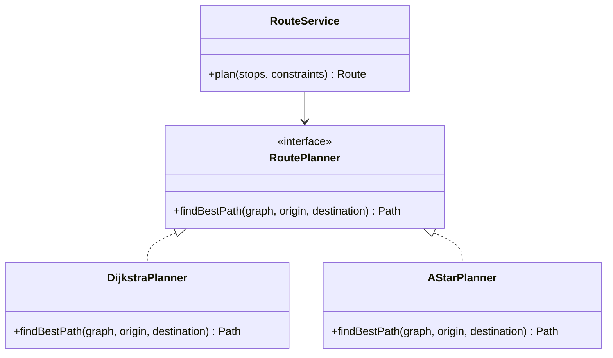

# Cohesive Mechanisms

## Descrição

Cohesive Mechanisms são mecanismos computacionais complexos, como algoritmos de grafos, motores de regras ou resolução de restrições, que se infiltram no modelo de domínio e o enchem de detalhes procedimentais. O padrão propõe extrair esse mecanismo para uma estrutura separada, com uma interface que revela a intenção.

O modelo de domínio passa a expressar o quê (conceitos e regras de negócio) enquanto o mecanismo cuida do como (a mecânica do cálculo). O mecanismo é coeso, tem uma responsabilidade clara e pode ser testado e evoluído sem tocar nas regras do negócio.

É diferente de um [Generic Subdomain](./generic-subdomains.md): o subdomínio genérico trata de conceitos de negócio sem diferencial, enquanto o mecanismo é uma questão técnica de computação que, às vezes, é publicada como framework ou biblioteca.

## Problemas que resolve

- Algoritmos complexos misturados às entidades e aos serviços do domínio, que escondem as regras de negócio.
- Dificuldade de testar a lógica de domínio isolada da mecânica do cálculo.
- Modelo difícil de ler porque a intenção se perde em detalhes de implementação.
- Impossibilidade de trocar ou otimizar o algoritmo sem alterar o domínio.

## Quando usar

- Quando uma parte do código é principalmente computação (grafos, otimização, regras, cálculo numérico) e não conhecimento de negócio.
- Quando o mecanismo pode ser descrito por uma interface simples orientada à intenção.
- Quando o mesmo algoritmo pode servir a mais de um ponto do modelo ou ser substituído no futuro.

### Quando evitar

- Quando o cálculo faz parte da regra de negócio e deve ser conhecimento explícito do domínio; extraí-lo esconderia o core.
- Quando a lógica é simples demais para justificar uma estrutura separada.
- Quando a abstração teria de expor tantos detalhes internos que a interface não ficaria enxuta.

## Trade-offs

| Ganho | Custo / Risco |
| --- | --- |
| Domínio mais legível e focado em conceitos | Mais uma estrutura para manter |
| Mecanismo testável e evoluível por conta própria | A fronteira entre regra e mecanismo pode ser difícil de traçar |
| Troca ou otimização do algoritmo sem afetar o domínio | Risco de abstrair demais e esconder regras de negócio |
| Possibilidade de reuso por vários componentes | Pode exigir conhecimento técnico especializado |

- **Interface:** deve ser expressa em termos do domínio ([Intention-Revealing Interfaces](../supple-design/intention-revealing-interfaces.md)), não dos detalhes do algoritmo.
- **Fronteira:** é o ponto mais sensível; o mecanismo resolve o como, e decisões do quê permanecem no modelo.
- **Reuso:** frequentemente se transforma em uma biblioteca ou em um framework interno.

## Diagrama



O serviço de domínio `RouteService` expressa o problema em termos de negócio e delega a busca de caminho a um mecanismo substituível por trás de `RoutePlanner`.

## Exemplo

Uma transportadora calcula rotas considerando janelas de entrega e capacidade dos veículos. A busca de menor caminho em um grafo viário é um problema computacional clássico; colocá-lo dentro de `Shipment` ou `Route` tornaria essas classes ilegíveis.

A equipe extrai o algoritmo para um mecanismo com uma interface voltada à intenção, e o domínio apenas o invoca com seus próprios conceitos.

```java
public interface RoutePlanner {
    Path findBestPath(RoadNetwork network, Location origin, Location destination);
}

public class RouteService {
    private final RoutePlanner planner;

    public RouteService(RoutePlanner planner) {
        this.planner = planner;
    }

    public Route plan(Shipment shipment, RoadNetwork network) {
        Path path = planner.findBestPath(
            network, shipment.origin(), shipment.destination());
        return Route.from(shipment, path);   // regra de negócio
    }
}
```

## Padrões relacionados

- [Generic Subdomains](./generic-subdomains.md) — vizinho conceitual, mas voltado a conceitos de negócio e não a mecanismos de computação.
- [Core Domain](./core-domain.md) — o mecanismo é retirado para manter o core expressivo.
- [Intention-Revealing Interfaces](../supple-design/intention-revealing-interfaces.md) — dá ao mecanismo uma interface em termos do domínio.
- [Domain Service](../building-blocks/domain-service.md) — o ponto do modelo que normalmente invoca o mecanismo.
- [Strategy](../../../coding/gof/behavioral/strategy.md) — forma comum de tornar o algoritmo substituível.
- [Separated Interface](../../poeaa/base/separated-interface.md) — separa a interface da implementação em pacotes distintos.

## Referência

- [DDD Reference, Eric Evans (2015)](https://www.domainlanguage.com/ddd/reference/)
- *Domain-Driven Design: Tackling Complexity in the Heart of Software*, Eric Evans (Addison-Wesley, 2003)
