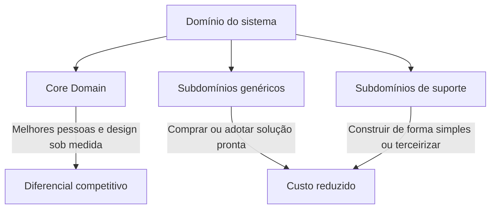

# Core Domain

## Descrição

O Core Domain é a parte do modelo que é mais central para o sucesso do negócio: aquilo que diferencia a organização dos concorrentes e justifica a existência do software. Em um sistema grande, nem todas as partes do modelo têm o mesmo valor estratégico, e tratá-las como iguais dilui o esforço da equipe.

O padrão pede que o core seja identificado de forma explícita, mantido o menor possível e declarado como prioridade de investimento. Os melhores modeladores e desenvolvedores são alocados nele, e o design recebe mais cuidado, mais refatoração e mais conhecimento do domínio do que o restante do sistema.

A distilação é o processo de separar o essencial do que é apenas suporte. O Core Domain é o resultado dessa decisão: um recorte pequeno e valioso que orienta onde construir sob medida, onde comprar e onde terceirizar.

## Problemas que resolve

- Esforço de modelagem espalhado de forma uniforme, sobrando pouco cuidado para o que realmente diferencia o negócio.
- Os desenvolvedores mais experientes alocados em partes periféricas ou em tarefas de manutenção.
- Modelo grande demais para ser compreendido, em que o essencial se perde entre detalhes de suporte.
- Falta de critério para decidir o que construir, o que comprar e o que terceirizar.

## Quando usar

- Quando o sistema é grande e há partes de valor estratégico muito diferente.
- Quando o software é uma vantagem competitiva e não apenas uma ferramenta de apoio.
- Quando é preciso priorizar investimento de modelagem, pessoas e tempo.

### Quando evitar

- Sistemas pequenos ou simples, em que todo o modelo cabe na cabeça da equipe e não há o que destilar.
- Software de apoio sem diferencial competitivo, em que a decisão correta é comprar ou adotar uma solução pronta.
- Quando a organização não consegue concordar sobre o que é estratégico; antes é preciso resolver essa discussão.

## Trade-offs

| Ganho | Custo / Risco |
| --- | --- |
| Foco do melhor talento no que gera diferencial | Exige decisão difícil sobre o que fica fora do core |
| Critério claro para construir, comprar ou terceirizar | O core pode mudar com a estratégia e exigir reavaliação |
| Modelo central menor e mais fácil de compreender | Partes não-core podem ficar com design negligenciado |
| Alinhamento entre negócio e tecnologia | Requer conhecimento de negócio para identificar o core |

- **Organização:** a escolha tem consequências sobre alocação de pessoas, o que costuma gerar atrito político.
- **Evolução:** o core de hoje pode virar commodity amanhã; a revisão periódica faz parte do padrão.
- **Documentação:** o core precisa ser comunicado, por exemplo com um [Domain Vision Statement](/application/ddd/distillation/domain-vision-statement) e um [Highlighted Core](/application/ddd/distillation/highlighted-core).

## Diagrama

O domínio é dividido por valor estratégico: o core recebe o investimento mais alto, enquanto os demais subdomínios são tratados com custo contido.

## Exemplo

Uma empresa de logística disputa mercado com entregas mais rápidas e baratas. Seu Core Domain é a otimização de rotas e a alocação dinâmica de frota, onde estão os algoritmos e as regras que ninguém mais tem. Os melhores engenheiros trabalham nesse modelo, com especialistas de operações sentados ao lado.

Faturamento, folha de pagamento, autenticação e envio de e-mails são necessários, mas não diferenciam a empresa. A equipe adota um ERP e um provedor de identidade prontos para essas áreas, preservando a capacidade de investimento para o motor de roteirização.

## Padrões relacionados

- [Generic Subdomains](/application/ddd/distillation/generic-subdomains) — o que sobra fora do core e pode ser comprado ou terceirizado.
- [Domain Vision Statement](/application/ddd/distillation/domain-vision-statement) — descreve o core e seu valor em poucas linhas.
- [Highlighted Core](/application/ddd/distillation/highlighted-core) — torna o core visível no repositório e na documentação.
- [Segregated Core](/application/ddd/distillation/segregated-core) — separa o core estruturalmente do restante.
- [Cohesive Mechanisms](/application/ddd/distillation/cohesive-mechanisms) — retira mecanismos técnicos do core para mantê-lo expressivo.
- [Abstract Core](/application/ddd/distillation/abstract-core) — extrai o núcleo conceitual quando o core é grande.
- [Bounded Context](/application/ddd/model-in-practice/bounded-context) — o core normalmente vive em um contexto próprio.
- [Context Map](/application/ddd/context-mapping/context-map) — situa o core em relação aos demais contextos.
- [Decompose by Subdomain](/architecture/microservices/service-boundaries/decompose-by-subdomain) — usa subdomínios, com o core entre eles, para delimitar serviços.

## Referência

- [DDD Reference, Eric Evans (2015)](https://www.domainlanguage.com/ddd/reference/)
- *Domain-Driven Design: Tackling Complexity in the Heart of Software*, Eric Evans (Addison-Wesley, 2003)
