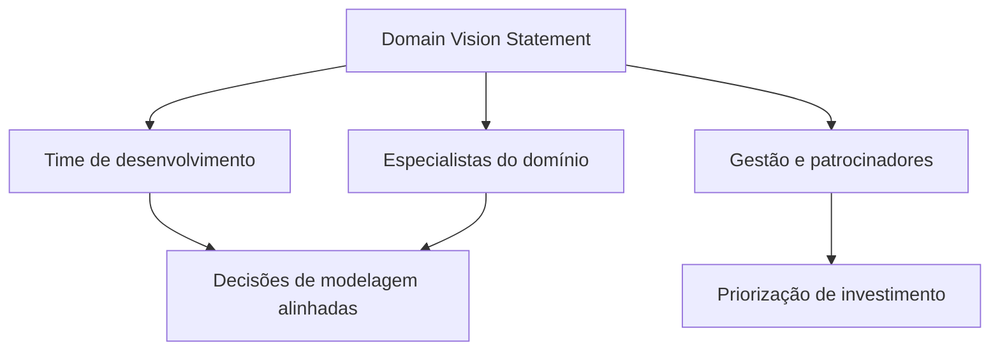

# Domain Vision Statement

## Descrição

O Domain Vision Statement é um documento curto, de uma página ou menos, que descreve o [Core Domain](/application/ddd/distillation/core-domain) e o valor que ele entrega, sem entrar em detalhes técnicos. Ele mostra o que torna o modelo especial e como ele atende aos interesses do negócio.

Escrito cedo no projeto e revisado quando o entendimento amadurece, ele serve como uma narrativa de alto nível para desenvolvedores, gestores e especialistas do domínio. O texto deve evitar o que não seja essencial, destacar o valor para o negócio e não depender de decisões de implementação que mudam com frequência.

Quando há vários contextos ou times, o documento ajuda a manter todos alinhados com a mesma intenção, mesmo quando os detalhes do modelo divergem. Ele não substitui a documentação do modelo; apenas aponta a direção.

## Problemas que resolve

- Ausência de uma descrição compartilhada do que o modelo central deve alcançar.
- Equipes novas ou externas que não entendem por que o core importa.
- Decisões de design tomadas sem referência ao valor de negócio.
- Esforço dissipado em melhorias que não reforçam o diferencial.

## Quando usar

- No início do projeto ou quando o core é identificado.
- Quando há múltiplos times ou contextos que precisam de um norte comum.
- Quando é preciso explicar a gestores e patrocinadores o que justifica o investimento no modelo.

### Quando evitar

- Quando o documento viraria um texto genérico, sem informação específica do domínio.
- Quando ninguém se compromete a mantê-lo atualizado, pois uma visão desatualizada confunde mais do que orienta.
- Em projetos pequenos, em que a equipe já compartilha o contexto de forma natural.

## Trade-offs

| Ganho | Custo / Risco |
| --- | --- |
| Alinhamento rápido entre pessoas técnicas e de negócio | Pode virar texto vazio, sem utilidade prática |
| Referência para priorizar mudanças no core | Precisa ser revisado conforme o entendimento evolui |
| Onboarding de novos membros mais rápido | Exige síntese e clareza, que são difíceis de obter |
| Baixo custo de produção | Pode ser ignorado se não for integrado ao dia a dia |

- **Escopo:** descreve o valor e a direção, não a implementação; detalhes técnicos pertencem a outros artefatos.
- **Tamanho:** deve caber em uma página; se crescer, perde o poder de síntese.
- **Governança:** precisa de um responsável claro, normalmente o líder de modelagem ou o dono do produto.

## Diagrama

O documento único alimenta diferentes públicos, que passam a decidir e priorizar com base na mesma descrição do valor do core.

## Exemplo

Uma empresa de logística escreve o seguinte resumo para seu core de roteirização: "O modelo permite ao despachante planejar rotas que respeitam janelas de entrega, capacidade de veículos e restrições de motoristas, recalculando-as em minutos quando o trânsito ou os pedidos mudam. O objetivo é reduzir o custo por entrega mantendo o cumprimento dos prazos prometidos."

O texto não menciona banco de dados, filas nem frameworks. Ele é fixado na wiki, revisto a cada trimestre e usado em reuniões de planejamento para decidir se uma proposta, como um recurso de relatórios financeiros, reforça o core ou apenas o distrai.

## Padrões relacionados

- [Core Domain](/application/ddd/distillation/core-domain) — o objeto que a declaração descreve.
- [Highlighted Core](/application/ddd/distillation/highlighted-core) — complemento, que aponta onde o core está dentro do modelo e do código.
- [Ubiquitous Language](/application/ddd/model-in-practice/ubiquitous-language) — o vocabulário da declaração deve ser o mesmo usado no modelo e no código.
- [Context Map](/application/ddd/context-mapping/context-map) — mostra como os contextos se relacionam com o core descrito.
- [Evolving Order](/application/ddd/large-scale-structure/evolving-order) — outra forma leve de orientar a evolução do modelo sem impor regras rígidas.

## Referência

- [DDD Reference, Eric Evans (2015)](https://www.domainlanguage.com/ddd/reference/)
- *Domain-Driven Design: Tackling Complexity in the Heart of Software*, Eric Evans (Addison-Wesley, 2003)
