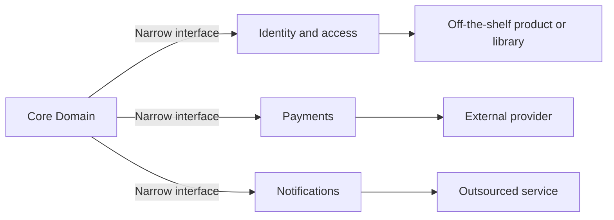

# Generic Subdomains

## Descrição

Generic Subdomains são partes do modelo que não são o diferencial do negócio e nem são específicas dele: problemas que muitas organizações compartilham, como contabilidade, controle de acesso, agendamento ou notificações. Embora necessárias, elas não devem competir com o [Core Domain](./core-domain.md) por atenção e talento.

O padrão orienta a identificar esses subdomínios, isolá-los em módulos ou contextos separados e tratá-los com o menor custo possível. As alternativas, em ordem de preferência, são adotar uma solução pronta (produto ou biblioteca), reaproveitar um modelo publicado, terceirizar a construção ou, por último, implementar internamente com uma equipe júnior e com design simples.

Como o modelo é genérico, ele não deve conter conceitos do core, e o core não deve depender de detalhes dele. A integração é feita por interfaces estreitas, preservando a liberdade de trocar a solução no futuro.

## Problemas que resolve

- Tempo de modelagem gasto em problemas já resolvidos pelo mercado.
- Conceitos genéricos misturados ao core, tornando-o maior e menos expressivo.
- Dependência do core em detalhes de produtos de terceiros.
- Uma equipe forte desperdiçada em funcionalidades sem diferencial competitivo.

## Quando usar

- Quando existe solução madura no mercado para a necessidade (identidade, pagamento, cálculo de impostos, contabilidade).
- Quando o subdomínio é necessário, mas não distingue a empresa dos concorrentes.
- Quando se quer liberar capacidade da equipe para concentrar-se no core.

### Quando evitar

- Quando o subdomínio, apesar de parecer genérico, contém regras que de fato diferenciam o negócio; nesse caso ele pertence ao core.
- Quando as soluções prontas impõem um modelo incompatível, forçando contorcer o core para se adaptar a elas.
- Quando requisitos de conformidade, custo de licença ou risco de fornecedor tornam a dependência inaceitável.

## Trade-offs

| Ganho | Custo / Risco |
| --- | --- |
| Menos código próprio e menos manutenção | Dependência de fornecedor ou de projeto externo |
| Equipe de elite liberada para o core | Ajustes limitados ao que a solução permite |
| Soluções maduras e testadas pelo mercado | Modelo de terceiros pode vazar para o core sem uma camada de proteção |
| Custo previsível e menor | Pode ser tentador classificar como genérico algo que é estratégico |

- **Fronteira:** a integração deve passar por uma interface própria, como uma [Anticorruption Layer](../../../cloud/cloud-design-patterns/integration-and-modernization/anti-corruption-layer.md), para o modelo externo não contaminar o core.
- **Reversibilidade:** a escolha não é definitiva; um subdomínio genérico pode ser trocado ou internalizado depois.
- **Classificação:** a decisão de o que é genérico depende do negócio; o mesmo subdomínio pode ser core em outra empresa.

## Diagrama

O core consome subdomínios genéricos por interfaces estreitas, e cada um deles é atendido por uma solução externa substituível.

## Exemplo

Uma seguradora tem como core a precificação de apólices e a análise de risco. Para emitir boletos, cobrar cartões, autenticar corretores e enviar notificações, ela não escreve modelos próprios: usa um provedor de pagamentos, um serviço de identidade e uma plataforma de mensageria.

O código do core fala apenas com interfaces internas (`PaymentGateway`, `NotificationSender`), implementadas por adaptadores. Quando o provedor de pagamentos é trocado por outro mais barato, só o adaptador muda e o modelo de apólices permanece intacto.

## Padrões relacionados

- [Core Domain](./core-domain.md) — o contraponto: onde o investimento deve se concentrar.
- [Cohesive Mechanisms](./cohesive-mechanisms.md) — extração de mecanismos técnicos, que lembra os subdomínios genéricos, mas para algoritmos em vez de conceitos de negócio.
- [Anticorruption Layer](../../../cloud/cloud-design-patterns/integration-and-modernization/anti-corruption-layer.md) — protege o modelo do core da solução genérica adotada.
- [Conformist](../context-mapping/conformist.md) — alternativa quando se adota o modelo do fornecedor como está.
- [Published Language](../context-mapping/published-language.md) — linguagem padronizada que facilita integrar soluções prontas.
- [Module](../building-blocks/module.md) — forma mais simples de isolar um subdomínio genérico dentro do mesmo contexto.
- [Decompose by Subdomain](../../../architecture/microservices/service-boundaries/decompose-by-subdomain.md) — subdomínios genéricos costumam virar serviços ou ser substituídos por serviços externos.

## Referência

- [DDD Reference, Eric Evans (2015)](https://www.domainlanguage.com/ddd/reference/)
- *Domain-Driven Design: Tackling Complexity in the Heart of Software*, Eric Evans (Addison-Wesley, 2003)
