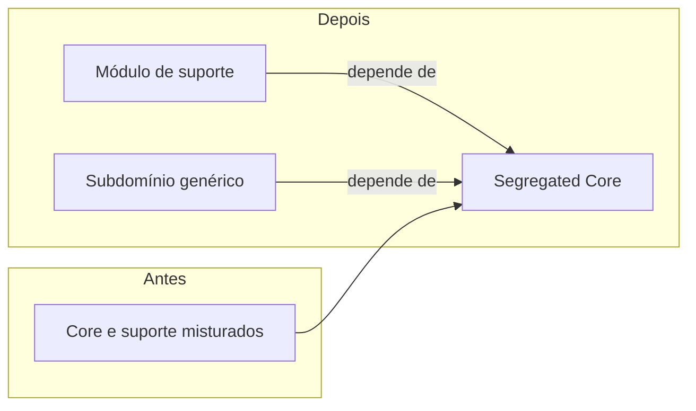

# Segregated Core

## Descrição

O Segregated Core é a reestruturação do modelo para separar fisicamente o [Core Domain](/application/ddd/distillation/core-domain) dos demais elementos, de modo que o core fique coeso e com poucas dependências. As classes centrais são movidas para seus próprios módulos, e o que for de suporte ou genérico fica fora, dependendo do core e não o contrário.

A separação reduz o acoplamento do core com as partes de suporte e permite que ele seja entendido, testado e evoluído de forma independente. Também facilita a alocação de uma equipe dedicada ao core, com liberdade de refatoração, sem arrastar o restante do sistema.

O custo é uma refatoração significativa. Elementos que servem tanto ao core quanto ao suporte precisam ser divididos ou ter suas responsabilidades redesenhadas, e a interface entre as partes precisa ser explicitada. Por isso, costuma ser adotado quando o [Highlighted Core](/application/ddd/distillation/highlighted-core) já não basta.

## Problemas que resolve

- O core emaranhado com elementos de suporte, tornando-o difícil de compreender e de alterar.
- Mudanças em partes periféricas que quebram ou atrasam o core.
- Impossibilidade de dedicar uma equipe ou um ritmo de evolução próprios ao core.
- Dependência do core em detalhes de infraestrutura ou de subdomínios genéricos.

## Quando usar

- Quando o acoplamento entre o core e o resto impede a evolução do core.
- Quando há uma equipe ou um investimento dedicados ao core e é preciso isolar o seu trabalho.
- Quando o core é grande e o destaque visual não é suficiente para gerenciá-lo.

### Quando evitar

- Quando o core é pequeno ou a separação não traz ganho perceptível de clareza.
- Quando o custo e o risco de refatorar superam o benefício, caso em que o [Highlighted Core](/application/ddd/distillation/highlighted-core) basta.
- Quando ainda não se tem clareza do que é core; separar cedo demais pode cristalizar uma escolha errada.

## Trade-offs

| Ganho | Custo / Risco |
| --- | --- |
| Core coeso, compreensível e com poucas dependências | Refatoração grande e arriscada |
| Evolução independente do core e do suporte | Elementos de uso misto são difíceis de dividir |
| Equipe dedicada trabalhando com autonomia | Possível duplicação ou necessidade de interfaces novas |
| Teste do core sem a infraestrutura periférica | Fronteira mal escolhida gera acoplamento disfarçado |

- **Direção das dependências:** o suporte depende do core, e o core não depende do suporte.
- **Custo de modelagem:** pode revelar conceitos novos, pois dividir obriga a pensar sobre responsabilidades.
- **Ritmo:** a reestruturação deve ser feita em passos pequenos, preservando o comportamento.

## Diagrama

O core é extraído para um módulo próprio, e os módulos de suporte e genéricos passam a depender dele, e não o contrário.

## Exemplo

Em um sistema de gestão de frota, o core é o planejamento de manutenção preditiva, mas suas classes estão no mesmo pacote que cadastro de veículos, relatórios e integração com o ERP. Qualquer alteração em relatórios exige recompilar e retestar o core.

A equipe move `MaintenancePlan`, `WearModel` e `FailureRisk` para um módulo `maintenance-core` sem dependências externas. Cadastro, relatórios e a integração com o ERP passam a depender dele, e os dados usados pelo core chegam por interfaces definidas dentro do próprio módulo. O time dedicado ao core ganha seu ritmo de entrega.

## Padrões relacionados

- [Core Domain](/application/ddd/distillation/core-domain) — o conteúdo que é isolado.
- [Highlighted Core](/application/ddd/distillation/highlighted-core) — alternativa mais leve, que apenas aponta onde o core está.
- [Abstract Core](/application/ddd/distillation/abstract-core) — pode ser combinado, extraindo as interfaces e conceitos centrais em um módulo próprio.
- [Generic Subdomains](/application/ddd/distillation/generic-subdomains) — o que é movido para fora do core.
- [Module](/application/ddd/building-blocks/module) — a unidade de organização usada na separação.
- [Layered Architecture](/application/ddd/building-blocks/layered-architecture) — outra forma de controlar a direção das dependências.
- [Separated Interface](/application/poeaa/base/separated-interface) — técnica para inverter dependências entre core e suporte.

## Referência

- [DDD Reference, Eric Evans (2015)](https://www.domainlanguage.com/ddd/reference/)
- *Domain-Driven Design: Tackling Complexity in the Heart of Software*, Eric Evans (Addison-Wesley, 2003)
