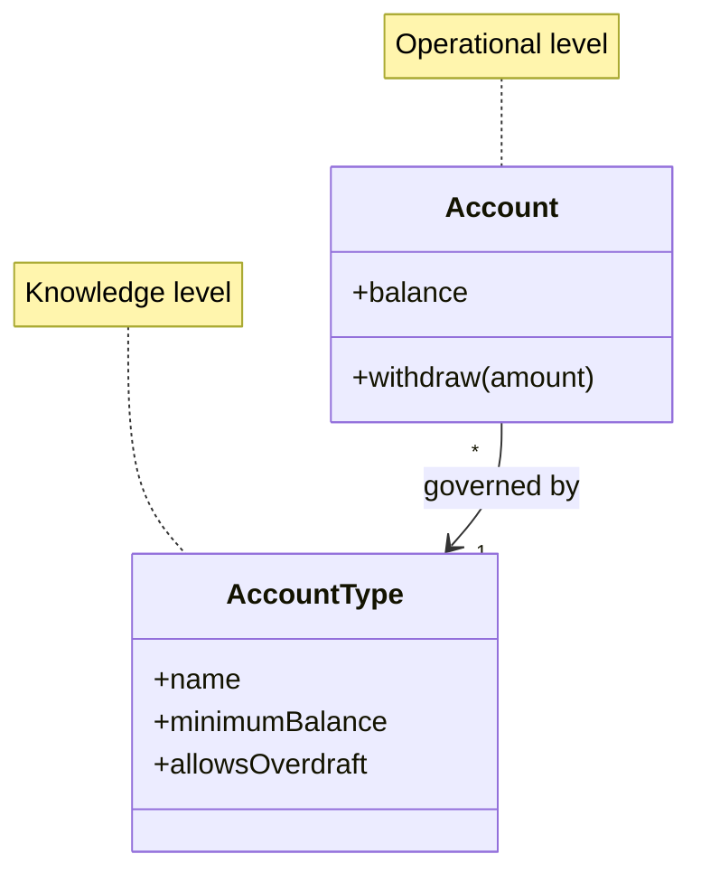

# Knowledge Level

## Descrição

Knowledge Level é uma estrutura de larga escala que separa o modelo em dois grupos de objetos: o nível operacional, que representa as coisas do dia a dia (contas, pedidos, empréstimos), e o nível de conhecimento, um conjunto de objetos que descreve e restringe a estrutura e o comportamento do primeiro (tipos de conta, regras de produto, políticas). O nível de conhecimento é, em essência, um modelo que configura o modelo.

O padrão tem origem no padrão de mesmo nome de Martin Fowler, em *Analysis Patterns* (1997), onde era chamado de Knowledge Level (ou Reflection). Evans o incorpora ao DDD como uma forma de lidar com requisitos em que as regras e a estrutura do domínio precisam variar sem alterar o código. O nível de conhecimento é um conjunto de objetos de domínio comuns, que podem ser alterados em tempo de execução pelos usuários.

Em vez de espalhar condicionais e subclasses para cada variação, as variações viram dados no nível de conhecimento, e os objetos operacionais consultam esse nível para saber o que é permitido. É uma forma de reflexão aplicada ao domínio, com a vantagem de ser um modelo de negócio, e não um mecanismo técnico genérico.

## Problemas que resolve

- Explosão de subclasses e de condicionais quando cada variante de produto ou cliente exige comportamento próprio.
- Regras de negócio que precisam mudar com frequência, sem nova versão do software.
- Código operacional misturado com a descrição de seus tipos e restrições.
- Requisitos de configurabilidade que viram "if" de tipo espalhados pelo sistema.

## Quando usar

- Quando usuários de negócio precisam definir ou alterar tipos, regras ou restrições sem intervenção de desenvolvedores.
- Quando as restrições do modelo variam por instância, por exemplo regras por tipo de produto ou por contrato.
- Quando os conceitos do nível de conhecimento são estáveis o bastante para serem modelados com clareza.

### Quando evitar

- Quando as variações são poucas e estáveis: subclasses ou Strategy resolvem com menos indireção.
- Quando a flexibilidade é especulativa: o nível de conhecimento vira um segundo sistema difícil de entender e de depurar.
- Quando a equipe acaba construindo uma linguagem de programação genérica dentro do domínio, em vez de um modelo do negócio.

## Trade-offs

| Ganho | Custo / Risco |
| --- | --- |
| Variações do negócio viram dados, sem alterar código | Mais indireção e um modelo de dois níveis, mais difícil de entender |
| Mudanças de regra feitas por usuários, em tempo de execução | Risco de criar uma "mini-linguagem" genérica e frágil |
| Menos subclasses e condicionais de tipo | Testes e validação são mais complexos, pois parte do comportamento está em dados |
| Consistência das restrições em um único lugar | Migrações de dados quando o nível de conhecimento muda |

- **Acoplamento:** o nível operacional depende do nível de conhecimento, nunca o contrário.
- **Validação:** é necessário validar as combinações permitidas, pois dados mal configurados quebram regras operacionais.
- **Escopo:** use apenas para as partes do modelo que realmente variam; o resto continua como objetos comuns.

## Diagrama



`Account` é o objeto operacional; `AccountType` pertence ao nível de conhecimento e define as restrições que cada conta precisa respeitar.

## Exemplo

Em um banco, cada tipo de conta tem regras diferentes de saldo mínimo e de cheque especial. Em vez de criar uma subclasse de `Account` para cada produto, as regras ficam em `AccountType`, que o time de produtos pode editar. A conta consulta seu tipo ao validar uma operação.

```java
public class AccountType {
    private final String name;
    private final Money minimumBalance;
    private final boolean allowsOverdraft;

    public boolean permits(Money balanceAfter) {
        return allowsOverdraft || balanceAfter.isGreaterOrEqual(minimumBalance);
    }
}

public class Account {
    private Money balance;
    private final AccountType type;

    public void withdraw(Money amount) {
        Money after = balance.subtract(amount);
        if (!type.permits(after)) {
            throw new IllegalStateException("Operação não permitida para o tipo " + type.name());
        }
        balance = after;
    }
}
```

## Padrões relacionados

- [Evolving Order](./evolving-order.md) — o nível de conhecimento deve surgir de uma necessidade real, e não de especulação.
- [Responsibility Layers](./responsibility-layers.md) — estruturas distintas, que podem ser combinadas no mesmo domínio.
- [Pluggable Component Framework](./pluggable-component-framework.md) — outra forma de tornar partes do sistema configuráveis, com foco em componentes.
- [Entity](../building-blocks/entity.md) — as instâncias operacionais costumam ser entidades.
- [Value Object](../../poeaa/base/value-object.md) — descrições de tipos e regras costumam ser objetos de valor.
- [Strategy](../../../coding/gof/behavioral/strategy.md) — alternativa mais simples para variar comportamento quando há poucas variantes.
- [Domain Model](../../poeaa/domain-logic/domain-model.md) — o modelo que o nível de conhecimento configura.

## Referência

- [DDD Reference, Eric Evans (2015)](https://www.domainlanguage.com/ddd/reference/)
- *Domain-Driven Design: Tackling Complexity in the Heart of Software*, Eric Evans (Addison-Wesley, 2003)
- *Analysis Patterns: Reusable Object Models*, Martin Fowler (Addison-Wesley, 1997), origem do Knowledge Level
