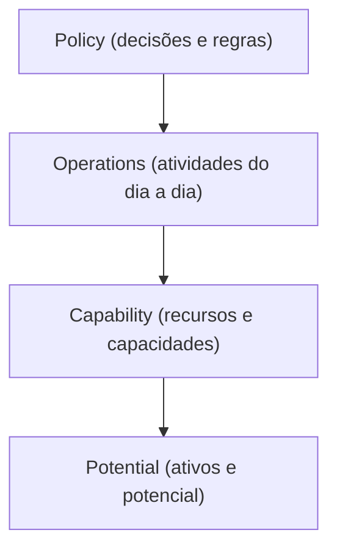

# Responsibility Layers

## Descrição

Responsibility Layers é uma estrutura de larga escala em que o domínio inteiro é organizado em poucas camadas conceituais, cada uma com uma responsabilidade ampla e bem definida. Cada módulo e cada objeto do modelo pertence a uma camada, e as dependências entre camadas seguem uma única direção: as camadas de nível mais alto podem conhecer as de nível mais baixo, mas não o contrário.

Não se trata da divisão técnica em interface, aplicação, domínio e infraestrutura (veja Layered Architecture). Aqui as camadas dividem o próprio domínio por papel conceitual. Evans cita exemplos como Potential, Operations, Policy, Commitment e Capability em sistemas de logística e finanças, em que as camadas surgem do estudo do negócio, e não de uma receita pronta.

Ao sugerir onde cada novo conceito deve ficar e quem pode depender de quem, a estrutura dá coerência ao modelo e facilita o entendimento do todo. Costuma emergir por refatoração, quando os desenvolvedores percebem que as responsabilidades do domínio se agrupam de forma natural, e deve evoluir junto com o modelo.

## Problemas que resolve

- Modelos grandes em que as dependências entre módulos viram uma teia sem direção, e qualquer mudança tem efeitos imprevisíveis.
- Dificuldade de decidir em que módulo um novo conceito deve morar.
- Falta de uma visão do todo que permita a novos membros navegarem o domínio.
- Regras de políticas de negócio misturadas com operações do dia a dia, o que dificulta mudá-las em separado.

## Quando usar

- Domínios grandes, em que as responsabilidades dos módulos já se agrupam naturalmente em níveis de abstração.
- Quando as partes do modelo mudam em ritmos diferentes, por exemplo políticas que mudam com frequência sobre operações estáveis.
- Quando é possível nomear camadas com significado de negócio e ter a maioria dos módulos encaixados nelas.

### Quando evitar

- Sistemas pequenos ou com poucos módulos, em que a estrutura vira cerimônia.
- Quando as camadas são artificiais e muitos conceitos ficam sem lugar claro ou são forçados a se encaixar.
- Quando as camadas se parecem com a divisão técnica comum, sem acrescentar entendimento do domínio.

## Trade-offs

| Ganho | Custo / Risco |
| --- | --- |
| Dependências com direção clara, o que reduz acoplamento | Exige definir as camadas com conhecimento profundo do domínio |
| Orientação sobre onde colocar cada conceito | Alguns conceitos não se encaixam e geram exceções |
| Visão de conjunto fácil de explicar | Camadas rígidas podem restringir o modelo |
| Permite mudanças em ritmos diferentes por camada | Camadas mal escolhidas viram um peso e precisam ser refatoradas |

- **Quantidade:** poucas camadas (de quatro a seis) é o recomendado; muitas camadas perdem a clareza.
- **Dependência:** a regra de dependência é o ponto central; sem ela as camadas são apenas rótulos.
- **Evolução:** as camadas devem ser revistas conforme o conhecimento do domínio se aprofunda, em linha com Evolving Order.

## Diagrama

Cada camada depende apenas das camadas abaixo dela: políticas conhecem operações, operações conhecem capacidades, e assim por diante, nunca no sentido inverso.

## Exemplo

Uma transportadora modela seu domínio em quatro camadas de responsabilidade. Potential reúne o que a empresa possui (veículos, galpões, motoristas). Operations cuida do que está acontecendo (entregas em andamento, rotas ativas). Policy guarda as regras de decisão (priorização de cargas, tabelas de preço), e é a camada que mais muda.

Ao incluir um novo conceito, "janela de entrega prioritária", a equipe pergunta qual a sua responsabilidade: é uma regra de decisão, portanto fica em Policy, e pode consultar Operations para saber o estado das rotas. Se um módulo de Operations passasse a depender de uma classe de Policy, a regra de dependência seria violada e o design seria revisto para que Operations recebesse a decisão por parâmetro.

## Padrões relacionados

- [Layered Architecture](/application/ddd/building-blocks/layered-architecture) — divisão técnica em camadas; Responsibility Layers divide o domínio por papel conceitual.
- [Evolving Order](/application/ddd/large-scale-structure/evolving-order) — a estrutura em camadas deve emergir e ser refatorada conforme o entendimento.
- [Module](/application/ddd/building-blocks/module) — cada módulo é alocado a uma camada de responsabilidade.
- [Knowledge Level](/application/ddd/large-scale-structure/knowledge-level) — estrutura que pode coexistir quando parte do modelo configura o restante.
- [System Metaphor](/application/ddd/large-scale-structure/system-metaphor) — alternativa de organização do conjunto por analogia.
- [Conceptual Contours](/application/ddd/supple-design/conceptual-contours) — alinha as divisões do modelo às linhas naturais de mudança do domínio.
- [Core Domain](/application/ddd/distillation/core-domain) — as camadas ajudam a manter o foco do domínio central.

## Referência

- [DDD Reference, Eric Evans (2015)](https://www.domainlanguage.com/ddd/reference/)
- *Domain-Driven Design: Tackling Complexity in the Heart of Software*, Eric Evans (Addison-Wesley, 2003)
