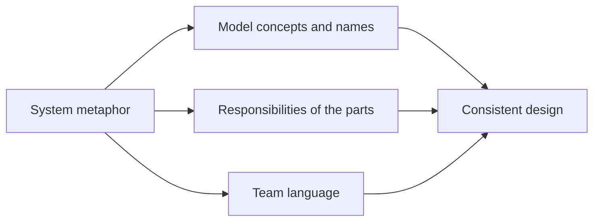

# System Metaphor

## Descrição

System Metaphor é uma estrutura de larga escala em que uma analogia concreta e fácil de entender passa a organizar o design do sistema inteiro. Quando um modelo é difícil de visualizar no todo, uma metáfora dá à equipe uma imagem compartilhada para raciocinar sobre o sistema, e orienta tanto o desenho dos objetos quanto a linguagem usada para falar deles.

A metáfora é adotada em conjunto por desenvolvedores e especialistas do domínio e passa a influenciar os nomes, as responsabilidades e as relações entre as partes. Ela é uma ferramenta de comunicação e de consistência: dado um novo requisito, a equipe pergunta "o que a metáfora sugere?" para decidir onde ele se encaixa.

Evans trata a metáfora com cautela. Ela é útil quando se ajusta naturalmente ao domínio, mas toda metáfora tem limites e pode distorcer o modelo quando levada além deles. Por isso é um padrão de uso raro, que deve ser abandonado quando deixar de ajudar.

## Problemas que resolve

- Dificuldade da equipe de compartilhar uma visão geral de um sistema abstrato ou complexo.
- Decisões de design inconsistentes entre partes do sistema por falta de um princípio unificador.
- Dificuldade de explicar a arquitetura a novos membros da equipe e a não técnicos.

## Quando usar

- Quando existe uma analogia natural que os desenvolvedores e os especialistas já usam espontaneamente para falar do sistema.
- Quando a metáfora explica de forma correta o comportamento essencial do domínio e orienta decisões de design.
- Em sistemas cujo domínio é abstrato e se beneficia de uma imagem concreta.

### Quando evitar

- Quando a metáfora é forçada ou só enfeita a documentação, sem de fato guiar o modelo.
- Quando ela leva a conclusões erradas sobre o domínio, porque a analogia não vale em todos os casos.
- Quando especialistas do domínio não a reconhecem: o vocabulário do negócio, via Ubiquitous Language, deve prevalecer.

## Trade-offs

| Ganho | Custo / Risco |
| --- | --- |
| Visão compartilhada simples e memorável | Toda metáfora tem limites e pode distorcer o modelo |
| Consistência entre decisões de design em módulos diferentes | Pode competir com a linguagem do negócio se não for bem alinhada |
| Facilita o aprendizado de quem entra no projeto | Equipe pode "forçar" requisitos para caber na metáfora |
| Orienta nomes e responsabilidades | Raramente existe uma metáfora realmente adequada |

- **Substituição:** uma metáfora que deixa de servir deve ser substituída, não esticada.
- **Linguagem:** os termos da metáfora devem se incorporar à Ubiquitous Language apenas se também fizerem sentido para o negócio.
- **Frequência:** Evans nota que poucos projetos têm metáforas realmente úteis; o padrão é uma ferramenta, não uma meta.

## Diagrama

A metáfora influencia conceitos, responsabilidades e linguagem, e esses três elementos convergem para um design mais consistente.

## Exemplo

Um sistema de roteirização de pacotes foi descrito pela equipe como uma "rede de correio pneumático": cada centro de distribuição é uma estação, cada pacote viaja em uma cápsula e os trechos são tubos com capacidade limitada. A imagem ajudou a decidir que cada centro só conhece o próximo trecho e que o roteamento é uma propriedade da rede, e não do pacote.

Mais tarde, a metáfora começou a atrapalhar: no correio pneumático não existem pacotes retidos para inspeção fiscal nem rotas por tipo de cliente. A equipe passou a evitar o termo "cápsula" nas regras de negócio, manteve a imagem apenas como apoio para explicar o fluxo básico e usou os termos do domínio de logística para as regras novas.

## Padrões relacionados

- [Ubiquitous Language](../model-in-practice/ubiquitous-language.md) — a metáfora pode alimentar a linguagem, mas o vocabulário do negócio é soberano.
- [Evolving Order](./evolving-order.md) — a metáfora deve emergir e ser revista, nunca imposta.
- [Responsibility Layers](./responsibility-layers.md) — estrutura alternativa, baseada em responsabilidades e não em analogia.
- [Model-Driven Design](../model-in-practice/model-driven-design.md) — a metáfora só vale se for refletida no código.
- [Intention-Revealing Interfaces](../supple-design/intention-revealing-interfaces.md) — nomes que revelam intenção ajudam a manter a metáfora legível no código.

## Referência

- [DDD Reference, Eric Evans (2015)](https://www.domainlanguage.com/ddd/reference/)
- *Domain-Driven Design: Tackling Complexity in the Heart of Software*, Eric Evans (Addison-Wesley, 2003)
- *Extreme Programming Explained*, Kent Beck (Addison-Wesley, 1999), origem do termo System Metaphor
