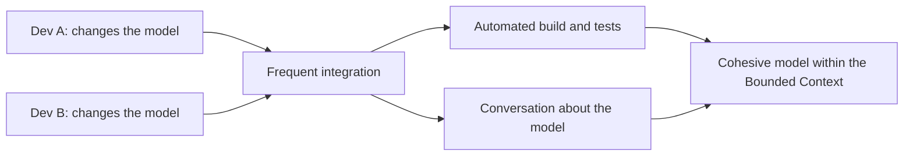

# Continuous Integration

## Descrição

No DDD, Continuous Integration é o processo de integrar continuamente todo o trabalho feito dentro de um Bounded Context, para que o modelo permaneça coeso e todos os membros do time o entendam da mesma forma. Quando várias pessoas trabalham no mesmo contexto, os conceitos tendem a se fragmentar: duas pessoas modelam a mesma ideia de formas incompatíveis, ou um termo ganha sentidos distintos.

A integração acontece em dois níveis. No código, há integração frequente, build automatizado e testes que detectam inconsistências rapidamente. No modelo, o time conversa o tempo todo, mantém a Ubiquitous Language viva e compartilha o entendimento das mudanças em reuniões e discussões, não só no repositório.

A prática vale apenas dentro de um Bounded Context; entre contextos, a integração é tratada por outros padrões, como os do Context Mapping.

## Problemas que resolve

- Fragmentação do modelo: partes do mesmo contexto passam a divergir sem que ninguém perceba.
- Conceitos duplicados ou conflitantes criados por membros diferentes do time.
- Integração tardia e dolorosa de mudanças feitas em isolamento.
- Perda do entendimento compartilhado conforme o time cresce.

## Quando usar

- Quando mais de uma pessoa altera o modelo de um mesmo Bounded Context.
- Quando o time cresce e o modelo começa a ganhar sinais de inconsistência.
- Em conjunto com testes automatizados que protejam o comportamento do modelo.

### Quando evitar

- Como substituto da definição de fronteiras: se o time é grande demais para integrar o modelo de forma contínua, o contexto deve ser dividido.
- Reduzida a um pipeline de build, sem conversa sobre o modelo, a prática perde seu principal valor.

## Trade-offs

| Ganho | Custo / Risco |
| --- | --- |
| Modelo único e coerente dentro do contexto | Exige comunicação frequente e disciplina |
| Divergências detectadas cedo, enquanto são baratas | Investimento em automação e em testes |
| Entendimento compartilhado entre os membros | Não escala para times muito grandes |

- **Tamanho do contexto:** o limite prático da técnica é o tamanho do time; acima dele, convém dividir o Bounded Context.
- **Testes:** a suíte automatizada funciona como rede de segurança para as mudanças no modelo.
- **Cultura:** exige disposição para integrar cedo e discutir mudanças de modelo abertamente.

## Diagrama

Mudanças de várias pessoas passam por integração frequente, validada por testes automatizados e por conversa sobre o modelo.

## Exemplo

Um time de cinco pessoas trabalha no contexto de Reservas de uma companhia aérea. Duas pessoas modelaram, em semanas diferentes, o conceito de "assento bloqueado": uma como uma reserva temporária, outra como uma restrição operacional. Como o time integra o código várias vezes ao dia e faz uma conversa curta sobre o modelo toda manhã, a divergência apareceu em dois dias, e não depois de um mês.

Eles escolheram um único termo, `SeatHold`, para a reserva temporária e `SeatRestriction` para o outro caso, atualizaram os testes e registraram a decisão no glossário. Sem a integração contínua do modelo, as duas versões teriam coexistido no código e causado bugs de regra.

## Padrões relacionados

- [Bounded Context](./bounded-context.md) — define o escopo em que a integração contínua se aplica.
- [Ubiquitous Language](./ubiquitous-language.md) — a conversa contínua mantém a linguagem alinhada.
- [Model-Driven Design](./model-driven-design.md) — o código reflete o modelo integrado.
- [Shared Kernel](../context-mapping/shared-kernel.md) — o trecho compartilhado entre contextos também exige integração frequente.
- [Context Map](../context-mapping/context-map.md) — trata da integração entre contextos, onde esta prática não se aplica.

## Referência

- [DDD Reference, Eric Evans (2015)](https://www.domainlanguage.com/ddd/reference/)
- *Domain-Driven Design: Tackling Complexity in the Heart of Software*, Eric Evans (Addison-Wesley, 2003)
