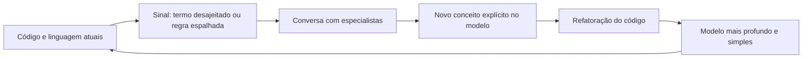

# Refactoring Toward Deeper Insight

## Descrição

Refactoring Toward Deeper Insight é a prática de refatorar o modelo e o código não apenas para limpar a implementação, mas para incorporar novo entendimento do domínio. Modelos úteis raramente surgem na primeira tentativa; eles emergem de ciclos de exploração, feedback e descoberta, com a participação constante de especialistas.

O processo é contínuo e guiado por sinais: termos desajeitados na linguagem, código que ficou difícil de explicar, conceitos implícitos que aparecem repetidamente na conversa. Quando um conceito importante estava escondido em um fragmento de código ou em uma regra espalhada, tornar o conceito explícito costuma gerar uma ruptura (breakthrough), um modelo mais profundo e mais simples.

O esforço deve ser dirigido ao Core Domain, onde a diferença competitiva do negócio está e onde o modelo mais compensa. Outras partes podem merecer apenas refatoração técnica.

## Problemas que resolve

- Modelo superficial que atende aos casos atuais, mas se torna rígido a cada nova exigência.
- Conceitos importantes escondidos em condicionais, flags e utilitários.
- Código que cresce em complexidade sem ganhar entendimento do domínio.
- Estagnação do modelo, tratado como pronto após a primeira versão.

## Quando usar

- Quando a linguagem fica desajeitada ou os especialistas dizem coisas que o modelo não consegue expressar.
- Quando novos requisitos exigem remendos repetidos no mesmo ponto do código.
- No Core Domain, onde vale a pena investir em um modelo mais profundo.

### Quando evitar

- Em subdomínios genéricos ou de suporte, em que uma solução pronta ou simples basta.
- Sem testes que protejam o comportamento: a refatoração em larga escala fica arriscada.
- Como refatoração por estética, sem relação com um novo entendimento do domínio.

## Trade-offs

| Ganho | Custo / Risco |
| --- | --- |
| Modelo mais expressivo, simples e flexível | Investimento contínuo de tempo e de atenção |
| Código e linguagem que acompanham o negócio | Mudanças profundas podem afetar muitos pontos do código |
| Vantagem competitiva no Core Domain | Resultado difícil de prever e de planejar |

- **Descoberta:** rupturas de modelo não podem ser agendadas; o que se faz é criar as condições para que aconteçam.
- **Testes:** a rede de segurança dos testes automatizados é o que torna a prática viável.
- **Escopo:** a refatoração profunda deve ser concentrada onde o negócio mais se diferencia.

## Diagrama

Um ciclo contínuo: sinais na linguagem e no código levam à conversa, ao novo conceito explícito, à refatoração e a um modelo mais profundo.

## Exemplo

Em um sistema de aluguel de equipamentos, a regra de multa por atraso estava espalhada em vários métodos, com flags como `isPremium` e `isWeekend`. Em uma conversa com a gerente de operações, o time ouviu o termo "política de tolerância", que não existia no código. Ao torná-lo explícito, criaram um conceito `GracePolicy` que encapsula quando e quanto cobrar.

As flags desapareceram, a regra ficou em um só lugar e novas políticas, como a de clientes corporativos, passaram a ser apenas novas variações. A mudança só foi segura porque os testes existentes foram mantidos e estendidos durante a refatoração.

## Padrões relacionados

- [Ubiquitous Language](/application/ddd/model-in-practice/ubiquitous-language) — termos desajeitados na linguagem sinalizam onde refatorar.
- [Model-Driven Design](/application/ddd/model-in-practice/model-driven-design) — o modelo refinado se reflete diretamente no código.
- [Hands-on Modelers](/application/ddd/model-in-practice/hands-on-modelers) — quem modela refina o modelo junto com o código.
- [Core Domain](/application/ddd/distillation/core-domain) — onde concentrar o esforço de refinamento.
- [Conceptual Contours](/application/ddd/supple-design/conceptual-contours) — o design flexível emerge de refatorações guiadas pelo domínio.
- [Intention-Revealing Interfaces](/application/ddd/supple-design/intention-revealing-interfaces) — conceitos explícitos pedem nomes que revelam a intenção.

## Referência

- [DDD Reference, Eric Evans (2015)](https://www.domainlanguage.com/ddd/reference/)
- *Domain-Driven Design: Tackling Complexity in the Heart of Software*, Eric Evans (Addison-Wesley, 2003)
