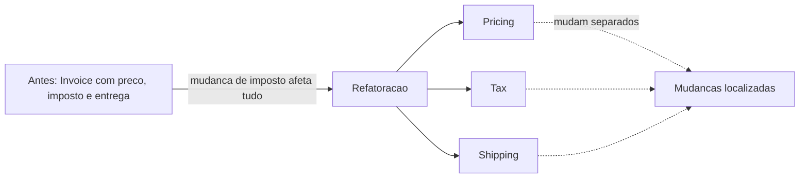

# Conceptual Contours

## Descrição

Conceptual Contours consiste em decompor o design em unidades coesas (operações, interfaces, classes e Aggregates) alinhadas aos contornos naturais do domínio. A divisão não é arbitrária: ela acompanha o que muda junto e o que muda separado, de forma que cada unidade tem uma responsabilidade coerente.

Quando os contornos estão corretos, uma mudança de requisito tende a afetar apenas uma unidade, e extensões usam as peças existentes. Quando estão errados, cada mudança exige alterar muitas partes ao mesmo tempo, ou se descobre que conceitos separados estão misturados em um único.

Os contornos raramente são encontrados na primeira tentativa. A equipe os descobre refatorando, observando onde a mudança dói, e testando o modelo contra cenários variados. O padrão orienta a reflexão: unidades pequenas demais fragmentam o conceito, grandes demais perdem coesão.

## Problemas que resolve

- Mudanças simples que exigem alterações espalhadas por muitas classes.
- Classes que misturam conceitos que evoluem em ritmos diferentes.
- Conceitos divididos em fragmentos que só fazem sentido juntos.
- Interfaces que forçam o cliente a conhecer detalhes de várias peças.

## Quando usar

- Ao notar que mudanças pequenas de requisito geram refatorações grandes.
- Ao revisar o modelo após novos entendimentos do domínio.
- Em Aggregates e classes cuja fronteira parece arbitrária.

### Quando evitar

- Antes de conhecer razoavelmente o domínio: a divisão feita cedo tende a ser reformulada.
- Como desculpa para refatorações sem fim: aplique quando há dor concreta com a mudança.

## Trade-offs

| Ganho | Custo / Risco |
| --- | --- |
| Mudanças localizadas em poucas unidades | Descobrir os contornos exige iterações e refatoração |
| Reuso e composição das peças existentes | Divisão excessiva fragmenta o conceito |
| Modelo que reflete a estrutura natural do domínio | Os contornos mudam quando o domínio muda |

- **Coesão:** cada unidade expressa um conceito inteiro.
- **Observação:** o histórico de mudanças mostra onde estão as fronteiras reais.
- **Teste:** cenários variados revelam se o design acomoda extensões.

## Diagrama



Ao separar preço, imposto e entrega em unidades que mudam de forma independente, cada mudança de requisito fica restrita a uma delas.

## Exemplo

Uma classe `Invoice` calculava preço, imposto e frete em um único método. Como as regras de imposto mudam por legislação e as de frete por contrato logístico, cada mudança exigia mexer na mesma classe. A decomposição segue os contornos do domínio.

```java
public class Invoice {
    private final PricingPolicy pricing;
    private final TaxPolicy tax;
    private final ShippingPolicy shipping;

    public Invoice(PricingPolicy p, TaxPolicy t, ShippingPolicy s) {
        this.pricing = p; this.tax = t; this.shipping = s;
    }

    public Money total(Order order) {
        Money subtotal = pricing.priceOf(order);
        return subtotal
            .add(tax.taxOn(subtotal))
            .add(shipping.costFor(order));
    }
}
// Nova regra de imposto: só TaxPolicy muda.
```

## Padrões relacionados

- [Refactoring Toward Deeper Insight](/application/ddd/model-in-practice/refactoring-toward-deeper-insight) — meio principal para descobrir os contornos.
- [Aggregate](/application/ddd/building-blocks/aggregate) — fronteiras de Aggregate seguem os contornos de consistência.
- [Standalone Classes](/application/ddd/supple-design/standalone-classes) — contornos corretos facilitam classes independentes.
- [Intention-Revealing Interfaces](/application/ddd/supple-design/intention-revealing-interfaces) — cada unidade tem um nome que expressa seu conceito.
- [Drawing on Established Formalisms](/application/ddd/supple-design/drawing-on-established-formalisms) — formalismos sugerem divisões naturais.
- [Core Domain](/application/ddd/distillation/core-domain) — os contornos mais importantes vão onde está o valor do negócio.
- [Strategy](/coding/gof/behavioral/strategy) (GoF) — encapsula cada política que varia separadamente.

## Referência

- [DDD Reference, Eric Evans (2015)](https://www.domainlanguage.com/ddd/reference/)
- *Domain-Driven Design: Tackling Complexity in the Heart of Software*, Eric Evans (Addison-Wesley, 2003)
