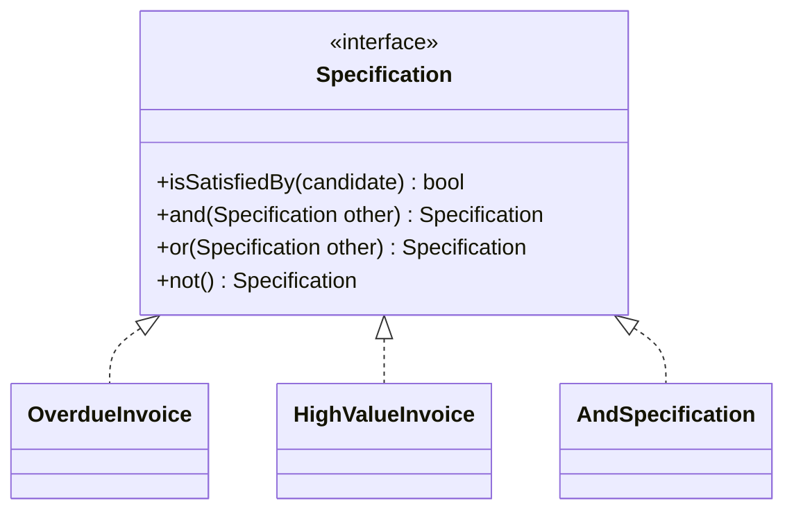

# Declarative Design

## Descrição

Declarative Design é um estilo em que o comportamento do software é controlado por uma especificação executável, que descreve propriedades e regras do domínio em vez de instruções passo a passo. Quem escreve declara o que deseja, e o framework ou o motor cuida de como realizar.

Há formas variadas: regras expressas em uma linguagem específica de domínio (DSL), tabelas de decisão, configuração por atributos e anotações, ou a composição de pequenos objetos com significado preciso. O estilo mais acessível é construir, com Intention-Revealing Interfaces, Side-Effect-Free Functions e Closure of Operations, um conjunto de elementos que podem ser combinados com clareza, como no padrão Specification.

O risco é a rigidez: uma linguagem declarativa limitada pode impedir o que o domínio exige. Por isso o estilo funciona melhor quando o modelo é maduro e as regras são estáveis o suficiente para justificar o investimento.

## Problemas que resolve

- Regras de negócio enterradas em código imperativo, difíceis de ler e de validar com especialistas.
- Distância entre o que o especialista descreve e o que o código faz.
- Duplicação de lógica em que a mesma regra aparece em validação, consulta e seleção.
- Dificuldade de combinar regras sem reescrever condicionais.

## Quando usar

- Quando as regras são numerosas, mudam com frequência e podem ser lidas pelos especialistas.
- Quando existe um modelo estável e conceitos que se combinam (por exemplo, Specifications).
- Quando o mesmo conjunto de regras serve para validar, selecionar e construir.

### Quando evitar

- Em domínios ainda mal entendidos, em que a linguagem declarativa vira camisa de força.
- Quando o custo de criar e manter o motor ou a DSL supera o ganho.
- Quando geração de código esconde a lógica e impede que o time evolua o modelo.

## Trade-offs

| Ganho | Custo / Risco |
| --- | --- |
| Regras legíveis por especialistas | Custo de criar e manter a linguagem ou o motor |
| Menos código imperativo e duplicado | Expressividade limitada pelo que a linguagem permite |
| Mesma regra para validar, selecionar e construir | Depuração mais difícil, longe do código gerado |

- **Linguagem compartilhada:** a especificação vira meio de comunicação com o negócio.
- **Evolução:** mudanças que a linguagem não suporta exigem alterar o próprio motor.
- **Maturidade:** depende de um modelo já aprofundado.

## Diagrama



As regras são pequenas implementações de `Specification`, combinadas com `and`, `or` e `not` para formar regras maiores de modo declarativo.

## Exemplo

Para cobrar faturas, a regra do negócio é "vencida e de alto valor". Em vez de condicionais, as regras são pequenos objetos combinados, e a mesma especificação serve para validar ou filtrar.

```typescript
interface Spec<T> {
  isSatisfiedBy(t: T): boolean;
  and(o: Spec<T>): Spec<T>;
}

const spec = <T>(f: (t: T) => boolean): Spec<T> => ({
  isSatisfiedBy: f,
  and: (o) => spec((t) => f(t) && o.isSatisfiedBy(t)),
});

const overdue = spec<Invoice>((i) => i.dueDate < new Date());
const highValue = spec<Invoice>((i) => i.amount > 10_000);

const toCollect = overdue.and(highValue);
const pending = invoices.filter((i) => toCollect.isSatisfiedBy(i));
```

## Padrões relacionados

- [Intention-Revealing Interfaces](./intention-revealing-interfaces.md) — nomes que fazem o estilo declarativo ser legível.
- [Side-Effect-Free Functions](./side-effect-free-functions.md) — regras puras podem ser combinadas sem risco.
- [Closure of Operations](./closure-of-operations.md) — `and`, `or` e `not` devolvem uma Specification.
- [Interpreter](../../../coding/gof/behavioral/interpreter.md) (GoF) — técnica para executar uma linguagem de regras.
- [Query Object](../../poeaa/object-relational-metadata-mapping/query-object.md) (PoEAA) — consulta expressa como objeto declarativo.
- [Domain Service](../building-blocks/domain-service.md) — alternativa quando a regra não cabe em uma especificação.

## Referência

- [DDD Reference, Eric Evans (2015)](https://www.domainlanguage.com/ddd/reference/)
- *Domain-Driven Design: Tackling Complexity in the Heart of Software*, Eric Evans (Addison-Wesley, 2003)
