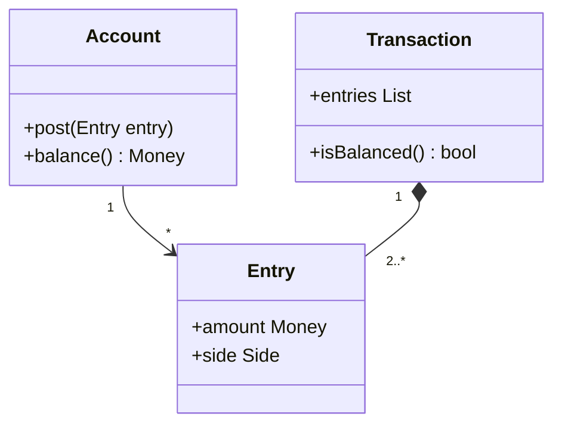

# Drawing on Established Formalisms

## Descrição

Drawing on Established Formalisms consiste em reaproveitar, no modelo de domínio, um sistema conceitual maduro e bem compreendido, como contabilidade, álgebra, teoria dos conjuntos, lógica, cálculo de datas ou regras tributárias. Esses formalismos foram refinados por muitos anos e já trazem conceitos, regras e vocabulário comprovados.

Em vez de inventar um modelo do zero, a equipe adapta a estrutura existente ao seu contexto. O vocabulário é compartilhado com especialistas, e as propriedades matemáticas (associatividade, fechamento, identidade) são herdadas, o que ajuda a garantir consistência e a prever comportamentos.

A técnica não exige aplicar o formalismo por inteiro. Muitas vezes basta uma parte, ou adaptá-la ao domínio. O essencial é que o modelo se apoie em algo que o negócio já reconhece e que resistiu ao teste do tempo.

## Problemas que resolve

- Reinventar conceitos já bem resolvidos, com erros que a literatura já corrigiu.
- Modelos próprios que ninguém além da equipe entende.
- Regras que se contradizem em casos de borda por falta de uma base rigorosa.
- Dificuldade de convencer especialistas e auditores de que o modelo está correto.

## Quando usar

- Quando o domínio tem uma teoria estabelecida (finanças, tributos, geometria, álgebra de conjuntos).
- Quando o formalismo se encaixa no problema com poucos ajustes.
- Quando auditoria e rastreabilidade exigem conceitos reconhecidos pelo mercado.

### Quando evitar

- Quando o formalismo não se aplica bem e é forçado, distorcendo o domínio.
- Quando a equipe não domina o formalismo e o custo de aprendizado supera o benefício.
- Quando o negócio usa um vocabulário próprio que diverge do formalismo.

## Trade-offs

| Ganho | Custo / Risco |
| --- | --- |
| Base conceitual testada e vocabulário reconhecido | Exige estudar o formalismo |
| Propriedades previsíveis, menos defeitos de borda | Pode ser rígido ou excessivo para o problema |
| Comunicação fácil com especialistas e auditoria | Ajustar o formalismo ao contexto pede cuidado |

- **Consistência:** propriedades do formalismo valem automaticamente no modelo.
- **Adaptação:** use só a parte útil, sem importar complexidade desnecessária.
- **Evolução:** o formalismo estabiliza o modelo, mas muda se o negócio mudar.

## Diagrama



O modelo adota a contabilidade de partidas dobradas: uma `Transaction` só é válida se seus lançamentos (`Entry`) se equilibram.

## Exemplo

Um sistema financeiro adota a partida dobrada em vez de manter saldos soltos. A regra "débitos iguais a créditos" vem do formalismo contábil e garante a integridade.

```python
from dataclasses import dataclass
from decimal import Decimal

@dataclass(frozen=True)
class Entry:
    account: str
    amount: Decimal   # positivo = débito, negativo = crédito

class Transaction:
    def __init__(self, entries: list[Entry]):
        if sum(e.amount for e in entries) != 0:
            raise ValueError("Débitos e créditos devem se equilibrar")
        self.entries = tuple(entries)

tx = Transaction([
    Entry("caixa", Decimal("100")),
    Entry("receita", Decimal("-100")),
])
```

## Padrões relacionados

- [Conceptual Contours](./conceptual-contours.md) — o formalismo ajuda a achar divisões naturais do modelo.
- [Refactoring Toward Deeper Insight](../model-in-practice/refactoring-toward-deeper-insight.md) — formalismos costumam surgir como parte desse aprofundamento.
- [Ubiquitous Language](../model-in-practice/ubiquitous-language.md) — o vocabulário do formalismo passa a ser a linguagem comum.
- [Closure of Operations](./closure-of-operations.md) — formalismos matemáticos trazem operações fechadas.
- [Value Object](../../poeaa/base/value-object.md) — conceitos formais costumam ser modelados como valores.
- [Money](../../poeaa/base/money.md) (PoEAA) — exemplo de conceito formal bem estabelecido.

## Referência

- [DDD Reference, Eric Evans (2015)](https://www.domainlanguage.com/ddd/reference/)
- *Domain-Driven Design: Tackling Complexity in the Heart of Software*, Eric Evans (Addison-Wesley, 2003)
