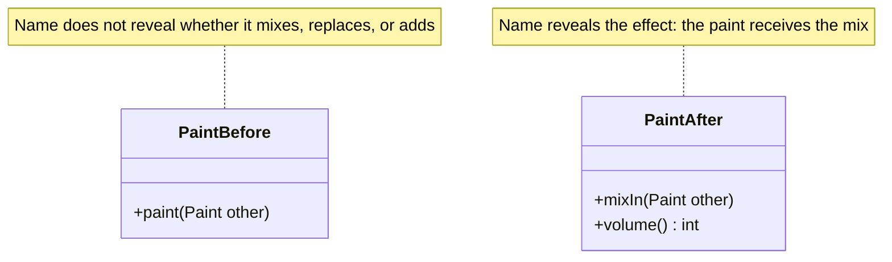

# Intention-Revealing Interfaces

## Descrição

Intention-Revealing Interfaces consiste em nomear classes, métodos e argumentos de modo que expressem o propósito e o efeito observável, e não o modo como o resultado é obtido. O nome vem da Ubiquitous Language: quem usa o componente entende o que ele faz sem precisar ler a implementação.

Na prática, o contrato é escrito primeiro, por exemplo com um teste que mostra como o cliente quer usar a operação. Depois a implementação é escrita por trás dessa interface. Se o desenvolvedor precisa abrir o código para saber o que um método faz, o encapsulamento foi perdido: o cliente passa a depender dos detalhes internos.

O padrão é a base do Supple Design. Interfaces que revelam intenção tornam as demais técnicas (funções sem efeito colateral, assertions, operações fechadas) mais fáceis de aplicar e de comunicar.

## Problemas que resolve

- Nomes genéricos (`process`, `handle`, `calculate`) que obrigam a ler a implementação para entender o efeito.
- Clientes acoplados ao mecanismo interno, e não ao propósito da operação.
- Desenvolvedores que reimplementam algo que já existe porque não perceberam o que o método fazia.
- Distância entre o vocabulário do negócio e o vocabulário do código.

## Quando usar

- Em qualquer classe ou método público do modelo de domínio.
- Quando especialistas do negócio e desenvolvedores precisam ler o mesmo código ou os mesmos testes.
- Ao refatorar métodos cujo nome descreve o "como" em vez do "quê".

### Quando evitar

- Em detalhes internos privados e voláteis, onde o nome prolixo traz pouco valor.
- Quando o conceito ainda não foi entendido: um nome "bonito" para um modelo errado só dá falsa confiança. Primeiro aprofunde o modelo.

## Trade-offs

| Ganho | Custo / Risco |
| --- | --- |
| Código legível por quem não conhece a implementação | Exige conhecer bem o domínio para dar bons nomes |
| Menos duplicação e menos leitura de código interno | Renomear APIs públicas pode afetar muitos clientes |
| Testes que servem como documentação | Nomes ruins mantidos por inércia perdem o benefício |

- **Linguagem compartilhada:** o vocabulário do código e o da conversa evoluem juntos.
- **Encapsulamento:** o cliente depende do contrato, não do mecanismo.
- **Manutenção:** nomes precisam ser revisados quando o entendimento do domínio muda.

## Diagrama



Em `PaintBefore`, o método não diz o que acontece com a tinta; em `PaintAfter`, `mixIn` revela a intenção e o efeito.

## Exemplo

Um módulo de tintas tinha o método `paint(Paint other)`, que na verdade misturava a outra tinta ao volume atual. O cliente precisava ler o corpo do método para descobrir o efeito. Renomeado para `mixIn`, o contrato fica claro e o teste diz o que se espera.

```java
public class Paint {
    private int volume;
    private PigmentColor color;

    // Antes: public void paint(Paint other)
    public void mixIn(Paint other) {
        color = color.mixedWith(other.color, volume, other.volume);
        volume += other.volume;
    }

    public int volume() { return volume; }
}

// O teste escreve o contrato antes da implementação
Paint blue = new Paint(100, PigmentColor.BLUE);
blue.mixIn(new Paint(50, PigmentColor.YELLOW));
assertEquals(150, blue.volume());
```

## Padrões relacionados

- [Side-Effect-Free Functions](./side-effect-free-functions.md) — separa consultas de comandos, deixando o efeito explícito.
- [Assertions](./assertions.md) — declaram os efeitos e invariantes que o nome apenas sugere.
- [Ubiquitous Language](../model-in-practice/ubiquitous-language.md) — fonte dos nomes usados nas interfaces.
- [Model-Driven Design](../model-in-practice/model-driven-design.md) — liga o modelo ao código por meio dessas interfaces.
- [Refactoring Toward Deeper Insight](../model-in-practice/refactoring-toward-deeper-insight.md) — novos entendimentos geram novos nomes.

## Referência

- [DDD Reference, Eric Evans (2015)](https://www.domainlanguage.com/ddd/reference/)
- *Domain-Driven Design: Tackling Complexity in the Heart of Software*, Eric Evans (Addison-Wesley, 2003)
