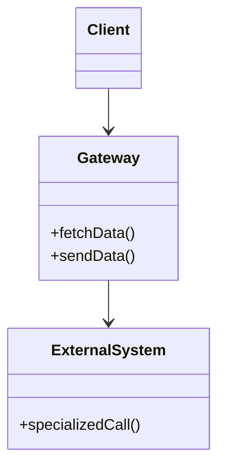

# Gateway

## Descrição

O Gateway é um objeto que encapsula o acesso a um sistema ou recurso externo, como um banco de dados, um serviço de pagamento, uma fila ou um arquivo XML. Recursos externos costumam ter APIs especializadas (JDBC, SDKs, clientes HTTP) que refletem a natureza do recurso, e quem as usa precisa aprender os detalhes de cada uma.

A solução é envolver todo o código dessa API especializada em uma classe cuja interface se parece com a de um objeto comum, expressa na linguagem do domínio da aplicação. O restante do código fala apenas com o Gateway, que traduz chamadas simples de método nas chamadas específicas do recurso.

Como o cliente depende apenas da interface do Gateway, o recurso pode ser trocado, simulado em testes ou substituído por outra tecnologia sem alterar o restante da aplicação.

## Problemas que resolve

- Código de negócio misturado com detalhes de APIs externas (SQL, HTTP, SDKs, XML).
- Mudar o recurso externo (por exemplo, de banco relacional para mensagem XML) exige alterações espalhadas pelo código.
- Dificuldade de testar lógica que depende diretamente de um recurso externo.
- Cada desenvolvedor precisa aprender a API especializada para tocar no código.

## Quando usar

- Quando a aplicação acessa um recurso externo com API complexa ou específica e se quer escondê-la do resto do sistema.
- Quando há chance de trocar o recurso ou o fornecedor no futuro.
- Quando se quer substituir o recurso por um [Service Stub](./service-stub.md) em testes.
- Em conjunto com [Separated Interface](./separated-interface.md), para que a interface fique no código cliente e a implementação em outro pacote.

### Quando evitar

- Quando o recurso tem uma API já simples e estável, e o Gateway apenas repassaria chamadas sem agregar valor.
- Quando a camada acabaria expondo toda a API original, apenas renomeada.
- Quando o acesso é tão pontual que a indireção custa mais que o ganho.

## Trade-offs

| Ganho | Custo / Risco |
| --- | --- |
| Isola o código de negócio da API do recurso | Mais uma camada para escrever e manter |
| Facilita testes com dublês ou stubs | Pode ocultar capacidades específicas do recurso |
| Permite trocar o recurso externo com impacto localizado | Risco de vazar abstrações do recurso para a interface do Gateway |
| Concentra tratamento de erros e tradução de dados | O Gateway pode crescer demais se agregar muitas operações |

- **Acoplamento:** o cliente passa a depender de uma interface do domínio, e não da tecnologia externa.
- **Testabilidade:** simples de substituir por um stub ou mock.
- **Desempenho:** custo de uma chamada extra; a atenção maior fica em não esconder chamadas remotas caras atrás de métodos aparentemente baratos.

## Diagrama



O `Client` usa somente o `Gateway`, que traduz suas chamadas em operações específicas do `ExternalSystem`. O sistema externo não é visível para o restante da aplicação.

## Exemplo

Uma loja precisa consultar a cotação de moedas em um serviço HTTP de terceiros. Um `ExchangeRateGateway` esconde a URL, o JSON e o cliente HTTP, e expõe uma operação em termos do domínio.

```python
import json
import urllib.request
from decimal import Decimal

class ExchangeRateGateway:
    def __init__(self, base_url: str):
        self._base_url = base_url

    def rate(self, source: str, target: str) -> Decimal:
        url = f"{self._base_url}/rates?from={source}&to={target}"
        with urllib.request.urlopen(url) as response:
            payload = json.load(response)
        return Decimal(str(payload["rate"]))

class PriceConverter:
    def __init__(self, gateway: ExchangeRateGateway):
        self._gateway = gateway

    def convert(self, amount: Decimal, source: str, target: str) -> Decimal:
        return amount * self._gateway.rate(source, target)
```

Exemplos comuns: clientes de pagamento encapsulados, wrappers de SDKs de nuvem e as próprias variantes [Table Data Gateway](../data-source-architectural/table-data-gateway.md) e [Row Data Gateway](../data-source-architectural/row-data-gateway.md) para banco de dados.

## Padrões relacionados

- [Service Stub](./service-stub.md) — substitui o Gateway em testes, evitando o serviço remoto real.
- [Separated Interface](./separated-interface.md) — costuma ser o ponto de encaixe do Gateway: a interface fica perto do cliente e a implementação em outro pacote.
- [Table Data Gateway](../data-source-architectural/table-data-gateway.md) — Gateway especializado para uma tabela do banco.
- [Row Data Gateway](../data-source-architectural/row-data-gateway.md) — Gateway especializado para uma linha do banco.
- [Mapper](./mapper.md) — também separa dois lados, mas o Mapper isola dois subsistemas entre si, e o Gateway isola a aplicação de um recurso externo.
- [Facade](../../../coding/gof/structural/facade.md) — simplifica um subsistema, em geral em direção ao cliente; o Gateway adapta um recurso externo ao vocabulário da aplicação.
- [Adapter](../../../coding/gof/structural/adapter.md) — o Gateway costuma ser implementado como um Adapter sobre a API do recurso.
- [API Gateway](../../../architecture/microservices/external-api/api-gateway.md) — não confundir: aquele é um componente de infraestrutura na borda do sistema que recebe requisições de clientes externos; o Gateway do PoEAA é uma classe dentro da aplicação que acessa um recurso externo.
- [Gateway Routing](../../../cloud/cloud-design-patterns/gateways-and-edge/gateway-routing.md), [Gateway Aggregation](../../../cloud/cloud-design-patterns/gateways-and-edge/gateway-aggregation.md) e [Gateway Offloading](../../../cloud/cloud-design-patterns/gateways-and-edge/gateway-offloading.md) — padrões de nuvem que rodam como serviço na frente de backends; nada têm a ver com a classe de encapsulamento do PoEAA.

## Referência

- [Página do padrão no catálogo do Fowler](https://martinfowler.com/eaaCatalog/gateway.html)
- *Patterns of Enterprise Application Architecture*, Martin Fowler (Addison-Wesley, 2002)
- [Gateway, Martin Fowler](https://martinfowler.com/articles/gateway-pattern.html)
