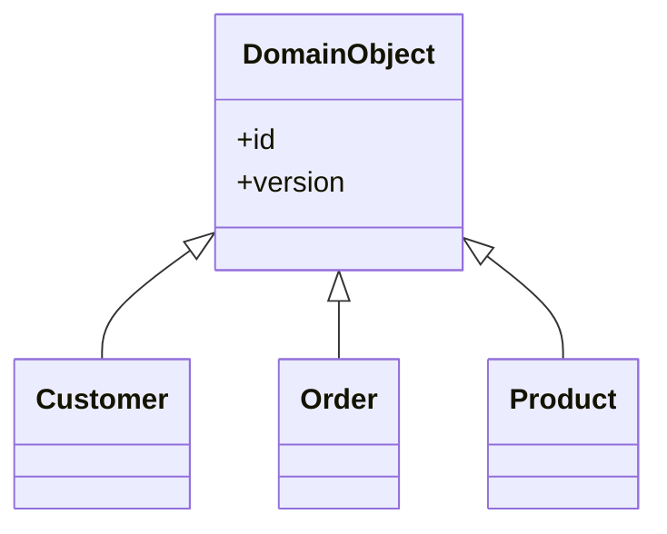

# Layer Supertype

## Descrição

O Layer Supertype é um tipo que atua como supertipo de todos os tipos de uma camada. Comportamento comum que todos os objetos da camada precisariam, como identificador, controle de versão, auditoria ou utilitários, vai para uma classe base única, da qual as demais herdam.

Isso evita duplicar o mesmo código em dezenas de classes e dá um ponto central para evoluir esse comportamento. O padrão é simples, e Fowler o descreve como algo que muitos desenvolvedores já fazem de forma natural: basta criar, por exemplo, uma classe `DomainObject` com o campo de identidade e fazer todas as entidades herdarem dela.

Cada camada pode ter o seu próprio Layer Supertype (por exemplo, um para o domínio e outro para os mappers), sem que um conheça o outro.

## Problemas que resolve

- Métodos e campos repetidos em todas as classes de uma mesma camada.
- Falta de um lugar único para comportamento transversal da camada (identidade, auditoria, versão).
- Dificuldade de aplicar uma mudança comum a todas as classes da camada.

## Quando usar

- Quando os objetos de uma camada compartilham campos ou métodos que seriam duplicados.
- Para manter identidade, versão ou auditoria em um só lugar, em conjunto com [Identity Field](../object-relational-structural/identity-field.md).
- Para dar a todos os mappers ou repositórios um comportamento comum de acesso ao banco.

### Quando evitar

- Quando a linguagem ou o framework já provê a base necessária e a nova classe só duplicaria isso.
- Quando o comportamento compartilhado é pequeno e a herança acrescentaria acoplamento desnecessário; composição pode bastar.
- Quando a classe base vira um depósito de utilitários sem relação com o papel da camada.

## Trade-offs

| Ganho | Custo / Risco |
| --- | --- |
| Elimina duplicação de código comum da camada | Herança acopla todas as classes à classe base |
| Ponto central para evoluir o comportamento comum | A base pode crescer e virar um "god object" |
| Garante consistência (identidade, auditoria) entre os objetos | Restringe a hierarquia em linguagens de herança simples |
| Implementação simples e conhecida | Mudanças na base afetam toda a camada |

- **Consistência:** todos os objetos da camada se comportam igual nos pontos comuns.
- **Testabilidade:** o comportamento comum pode ser testado uma única vez.

## Diagrama



`Customer`, `Order` e `Product` herdam o identificador e a versão de `DomainObject`, o supertipo da camada de domínio.

## Exemplo

Todas as entidades do domínio precisam de `id` e de comparação por identidade. Uma classe base evita repetir isso.

```python
from uuid import UUID, uuid4

class DomainObject:
    def __init__(self, id: UUID | None = None):
        self.id = id or uuid4()

    def __eq__(self, other: object) -> bool:
        return isinstance(other, type(self)) and self.id == other.id

    def __hash__(self) -> int:
        return hash(self.id)

class Customer(DomainObject):
    def __init__(self, name: str, id: UUID | None = None):
        super().__init__(id)
        self.name = name

class Order(DomainObject):
    def __init__(self, customer: Customer, id: UUID | None = None):
        super().__init__(id)
        self.customer = customer
```

Exemplos conhecidos: `BaseEntity` em projetos Hibernate, `ApplicationRecord` no Rails e `Entity<TId>` em bibliotecas de DDD.

## Padrões relacionados

- [Identity Field](../object-relational-structural/identity-field.md) — o campo de identidade costuma viver no Layer Supertype.
- [Domain Model](../domain-logic/domain-model.md) — as entidades do domínio normalmente compartilham uma classe base.
- [Data Mapper](../data-source-architectural/data-mapper.md) — mappers costumam ter seu próprio Layer Supertype com lógica comum de acesso a dados.
- [Active Record](../data-source-architectural/active-record.md) — frameworks de Active Record fornecem um Layer Supertype pronto para os modelos.
- [Template Method](../../../coding/gof/behavioral/template-method.md) — a classe base pode definir esqueletos de algoritmo que as subclasses completam.

## Referência

- [Página do padrão no catálogo do Fowler](https://martinfowler.com/eaaCatalog/layerSupertype.html)
- *Patterns of Enterprise Application Architecture*, Martin Fowler (Addison-Wesley, 2002)
