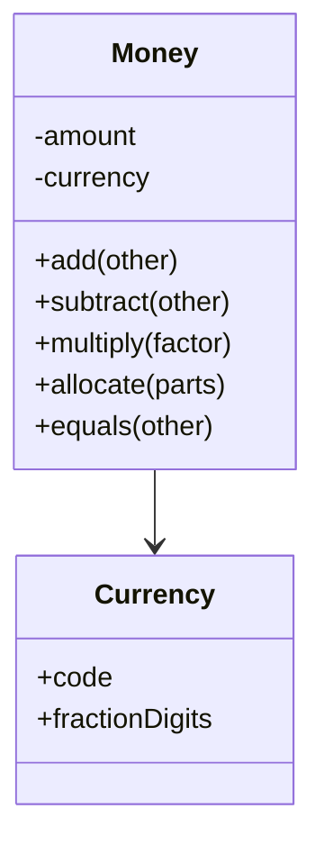

# Money

## Descrição

O Money representa um valor monetário. A maioria das linguagens não tem um tipo de primeira classe para dinheiro, e isso gera dois problemas recorrentes: somar valores de moedas diferentes sem considerar a conversão, e perder centavos por arredondamento ao dividir valores na menor unidade da moeda.

A solução é encapsular o valor em uma classe `Money` que carrega quantia e moeda, rejeita operações entre moedas distintas e concentra as regras de arredondamento. Tipicamente a quantia é guardada como inteiro na menor unidade (centavos) ou como decimal de precisão fixa, nunca como ponto flutuante binário.

Uma operação-chave é a alocação (`allocate`): dividir um valor em partes sem perder ou criar centavos, distribuindo o resto entre as partes. Money é uma especialização de [Value Object](./value-object.md): imutável e comparado por valor.

## Problemas que resolve

- Soma ou comparação de valores em moedas diferentes sem conversão.
- Erros de arredondamento com `float` e `double` (por exemplo, 0,1 + 0,2).
- Centavos perdidos ou criados ao ratear um valor (dividir 100,00 por 3).
- Regras de formatação e arredondamento duplicadas pelo código.

## Quando usar

- Em qualquer sistema que faça cálculos monetários: faturamento, pagamentos, carrinho de compras, contabilidade.
- Quando há mais de uma moeda no sistema.
- Quando é necessário ratear valores exatamente (parcelamento, divisão de despesas).

### Quando evitar

- Quando o sistema só exibe valores e nunca calcula com eles, e um decimal comum bastaria.
- Quando já existe uma biblioteca madura de dinheiro (por exemplo, `javax.money`, `Joda-Money`, `py-moneyed`) que atende aos requisitos; nesses casos, use-a em vez de escrever a sua.
- Quando é preciso precisão além da menor unidade da moeda (taxas de câmbio, preços unitários fracionários), que podem exigir outro tipo.

## Trade-offs

| Ganho | Custo / Risco |
| --- | --- |
| Evita mistura acidental de moedas | Exige converter explicitamente nas fronteiras (banco, JSON, APIs) |
| Arredondamento e alocação corretos e centralizados | Mais um tipo para mapear na persistência (valor e moeda) |
| Código mais expressivo que decimais soltos | Decisões de arredondamento precisam ser explícitas |
| Imutável, seguro e fácil de testar | Moedas com 0, 2 ou 3 casas decimais exigem tratamento |

- **Consistência:** o dinheiro nunca "some" nem "aparece" em rateios.
- **Persistência:** costuma ser mapeado com [Embedded Value](../object-relational-structural/embedded-value.md) em duas colunas (quantia e moeda).

## Diagrama



`Money` combina a quantia e a `Currency`, e expõe operações que respeitam a moeda e o arredondamento.

## Exemplo

Um parcelamento de 100,00 em 3 vezes não pode perder centavos: o `allocate` distribui o resto.

```typescript
class Money {
  private constructor(readonly cents: number, readonly currency: string) {}

  static of(cents: number, currency: string): Money {
    return new Money(Math.round(cents), currency);
  }

  add(other: Money): Money {
    this.assertSameCurrency(other);
    return new Money(this.cents + other.cents, this.currency);
  }

  allocate(parts: number): Money[] {
    const base = Math.floor(this.cents / parts);
    let remainder = this.cents - base * parts;
    return Array.from({ length: parts }, () => {
      const extra = remainder-- > 0 ? 1 : 0;
      return new Money(base + extra, this.currency);
    });
  }

  private assertSameCurrency(other: Money) {
    if (other.currency !== this.currency) throw new Error("Moedas diferentes");
  }
}

Money.of(10000, "BRL").allocate(3); // 33,34 / 33,33 / 33,33
```

## Padrões relacionados

- [Value Object](./value-object.md) — Money é o exemplo canônico: imutável e comparado por valor.
- [Embedded Value](../object-relational-structural/embedded-value.md) — mapeia a quantia e a moeda para colunas da tabela dona.
- [Special Case](./special-case.md) — pode representar valores especiais, como "sem preço definido" ou dinheiro zero.
- [Domain Model](../domain-logic/domain-model.md) — usa Money nos atributos monetários das entidades.
- [Flyweight](../../../coding/gof/structural/flyweight.md) — instâncias imutáveis comuns (como zero) podem ser compartilhadas.

## Referência

- [Página do padrão no catálogo do Fowler](https://martinfowler.com/eaaCatalog/money.html)
- *Patterns of Enterprise Application Architecture*, Martin Fowler (Addison-Wesley, 2002)
