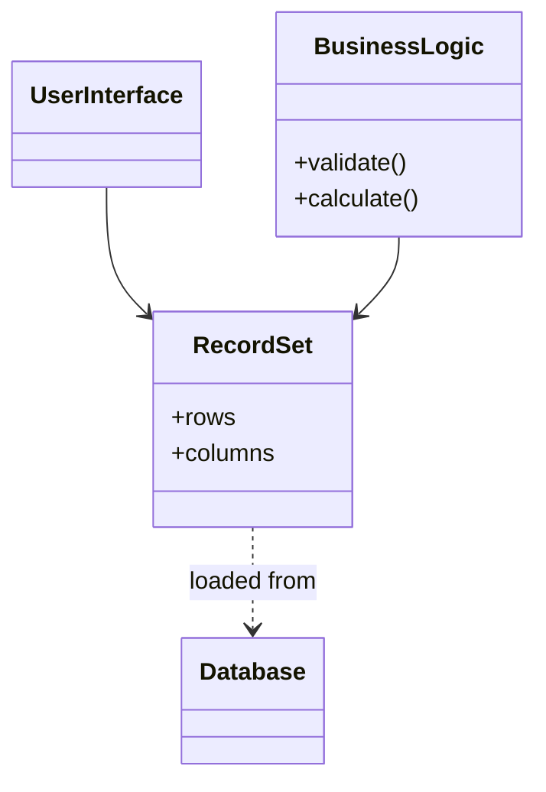

# Record Set

## Descrição

O Record Set é uma representação em memória de dados tabulares. Ele tem a mesma forma do resultado de uma consulta SQL (linhas e colunas), mas pode ser criado, lido e modificado por qualquer parte do sistema, sem depender de uma conexão aberta com o banco.

Ferramentas de interface de usuário com vínculo a dados (data-aware UI) esperam estruturas nesse formato. Com um Record Set, a aplicação mantém essa conveniência e, ao mesmo tempo, ganha um lugar onde regras de negócio e validações podem operar sobre os dados, em vez de ficarem em stored procedures ou espalhadas pela interface.

É o padrão por trás de estruturas como `DataSet` e `DataTable` do .NET, `ResultSet` desconectado do JDBC (`RowSet`) e dataframes em linguagens de análise de dados.

## Problemas que resolve

- Interfaces data-aware precisam de dados tabulares, mas a lógica de negócio não deve ficar na própria tela.
- Validações e cálculos mais ricos que checagens simples não têm onde viver sem stored procedures.
- Resultados de consulta presos a uma conexão aberta não podem ser passados adiante nem modificados com segurança.

## Quando usar

- Quando a aplicação é centrada em dados relacionais e usa componentes de UI vinculados a dados.
- Em conjunto com [Table Module](../domain-logic/table-module.md) ou [Transaction Script](../domain-logic/transaction-script.md), que operam naturalmente sobre dados tabulares.
- Para relatórios e telas de manutenção simples (CRUD) em que um modelo de objetos seria exagero.

### Quando evitar

- Quando a lógica de domínio é complexa e se beneficia de um [Domain Model](../domain-logic/domain-model.md), pois o Record Set empurra para um estilo orientado a tabelas.
- Quando a camada de domínio não deve conhecer a estrutura do banco, já que o Record Set a reproduz.
- Quando os conjuntos de dados são muito grandes e o custo de mantê-los todos em memória é inaceitável.

## Trade-offs

| Ganho | Custo / Risco |
| --- | --- |
| Integração direta com ferramentas de UI vinculadas a dados | Lógica de negócio fica com estrutura de tabela, sem objetos de domínio expressivos |
| Dados desconectados que podem ser manipulados e repassados | Acesso por nome de coluna tende a ser frágil e pouco tipado |
| Rapidez de desenvolvimento em aplicações centradas em dados | Camada de domínio acoplada ao esquema do banco |
| Permite regras de negócio fora de stored procedures | Pode consumir muita memória com grandes volumes |

- **Consistência:** muitas implementações rastreiam alterações de linhas para sincronizar com o banco, o que ajuda na atualização, mas exige cuidado com concorrência.
- **Desempenho:** um conjunto desconectado evita ir ao banco repetidamente.

## Diagrama



A interface e a lógica de negócio operam sobre o mesmo `RecordSet`, que é carregado do `Database`, mas existe em memória de forma independente.

## Exemplo

Uma tela de pedidos exibe linhas vindas do banco e uma regra de negócio calcula o total sobre elas antes de a tela ser vinculada ao mesmo conjunto.

```csharp
using System.Data;

DataTable orders = new DataTable("Orders");
orders.Columns.Add("Id", typeof(int));
orders.Columns.Add("Quantity", typeof(int));
orders.Columns.Add("UnitPrice", typeof(decimal));

orders.Rows.Add(1, 2, 10.50m);
orders.Rows.Add(2, 5, 3.00m);

// Regra de negócio operando sobre o Record Set
decimal total = 0;
foreach (DataRow row in orders.Rows)
    total += (int)row["Quantity"] * (decimal)row["UnitPrice"];

// A mesma tabela pode ser vinculada a uma grade de UI
// grid.DataSource = orders;
```

## Padrões relacionados

- [Table Module](../domain-logic/table-module.md) — organiza a lógica de domínio por tabela e consome o Record Set como estrutura de dados.
- [Transaction Script](../domain-logic/transaction-script.md) — scripts também operam bem sobre dados tabulares.
- [Domain Model](../domain-logic/domain-model.md) — a alternativa orientada a objetos, que substitui o Record Set por objetos ricos.
- [Table Data Gateway](../data-source-architectural/table-data-gateway.md) — costuma devolver um Record Set como resultado das consultas.
- [Data Transfer Object](../distribution/data-transfer-object.md) — também transporta dados, mas com estrutura fixa e voltada à transferência entre processos.

## Referência

- [Página do padrão no catálogo do Fowler](https://martinfowler.com/eaaCatalog/recordSet.html)
- *Patterns of Enterprise Application Architecture*, Martin Fowler (Addison-Wesley, 2002)
