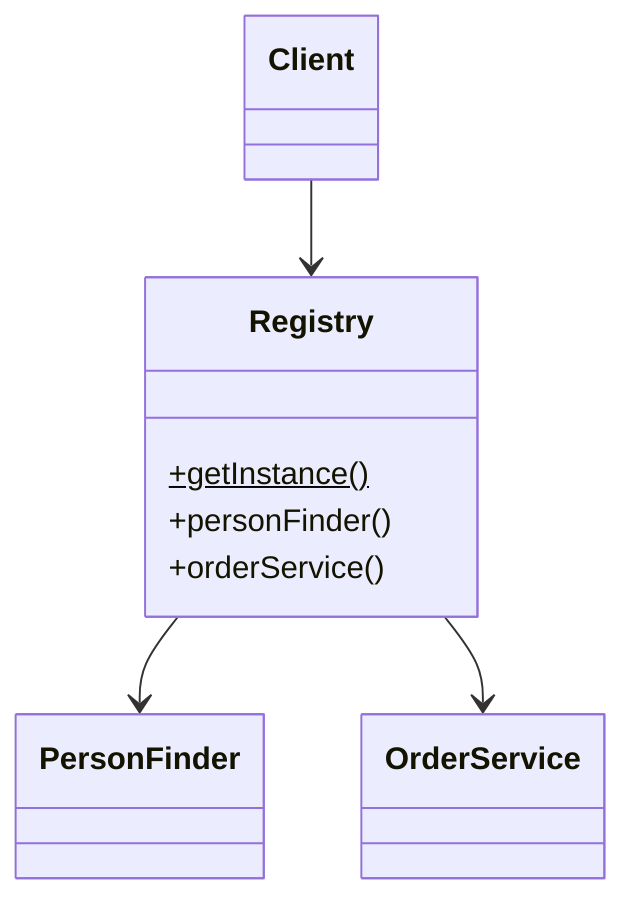

# Registry

## Descrição

O Registry é um objeto bem conhecido que outros objetos usam para encontrar objetos e serviços comuns. Normalmente se chega a objetos relacionados navegando a partir de outro que já se tem (de um cliente, chega-se aos pedidos). Isso falha quando só se possui um identificador, sem nenhuma referência: é preciso um objeto localizador, e surge a pergunta de como alcançar o próprio localizador.

O Registry responde a essa pergunta: é um ponto de acesso conhecido, que se comporta como um objeto global, mas que pode ser menos global do que parece (por exemplo, restrito a uma thread, a uma requisição ou a uma sessão). Quem precisa de um serviço ou de um finder pergunta ao Registry.

O Registry é um padrão de último recurso: quando possível, passar as dependências explicitamente (por parâmetro ou injeção de dependência) é preferível.

## Problemas que resolve

- Objetos precisam alcançar serviços ou finders comuns sem ter referência a eles.
- Passar a mesma dependência por muitas camadas intermediárias polui as assinaturas.
- Falta de um ponto de entrada conhecido para localizar objetos compartilhados.

## Quando usar

- Quando muitos pontos do sistema precisam de acesso a objetos ou serviços comuns e passá-los adiante seria impraticável.
- Quando se tem apenas um identificador e é preciso resolvê-lo para um objeto, por exemplo via [Repository](../object-relational-metadata-mapping/repository.md) ou finder.
- Em código legado ou frameworks onde não há injeção de dependência disponível.

### Quando evitar

- Quando a injeção de dependência é viável: dependências explícitas deixam o código mais claro e testável.
- Quando o Registry viraria um estado global mutável compartilhado, o que dificulta testes e concorrência.
- Quando as dependências ocultas tornam o código difícil de entender, pois a assinatura não revela o que a classe usa.

## Trade-offs

| Ganho | Custo / Risco |
| --- | --- |
| Acesso simples a serviços comuns de qualquer ponto | Dependências ocultas: a assinatura não mostra o que o código usa |
| Evita passar parâmetros por muitas camadas | Comporta-se como estado global, dificultando o isolamento |
| Ponto único para trocar implementações (testes, ambientes) | Testes em paralelo podem interferir entre si |
| Fácil de implementar | Risco de acoplamento a um ponto central e de uso excessivo |

- **Testabilidade:** exige que o Registry permita substituir as implementações (por exemplo, um método para instalar um stub) e que os testes o restaurem.
- **Concorrência:** Fowler discute registries por thread, por sessão ou por requisição para evitar compartilhamento indevido.

## Diagrama



O `Client` pede ao `Registry` o `PersonFinder` ou o `OrderService` de que precisa, sem ter recebido nenhum deles por parâmetro.

## Exemplo

Um código legado precisa do finder de pessoas em vários pontos. O Registry expõe um acesso estático e permite trocar a implementação em testes.

```java
public class Registry {
    private static Registry instance = new Registry();
    private PersonFinder personFinder = new DatabasePersonFinder();

    public static PersonFinder personFinder() {
        return instance.personFinder;
    }

    // Uso em testes: instala um stub e reinicia o estado
    public static void initializeForTests(PersonFinder stub) {
        instance = new Registry();
        instance.personFinder = stub;
    }

    public static void reset() {
        instance = new Registry();
    }
}

// Cliente
Person person = Registry.personFinder().find(42L);
```

Localizadores de serviço (`ServiceLocator`) e contextos de aplicação consultados manualmente são variações do Registry.

## Padrões relacionados

- [Singleton](../../../coding/gof/creational/singleton.md) — o Registry costuma ser implementado como Singleton, mas o Singleton garante uma instância, e o Registry fornece um ponto de acesso para localizar vários objetos.
- [Service Registry](../../../architecture/microservices/service-discovery/service-registry.md) — não confundir: aquele é um banco de dados de instâncias de serviços na rede para descoberta; o Registry do PoEAA é um objeto dentro de um processo que localiza objetos locais.
- [Separated Interface](./separated-interface.md) — o Registry pode devolver a implementação associada à interface.
- [Plugin](./plugin.md) — alternativa baseada em configuração para escolher implementações.
- [Gateway](./gateway.md) — gateways são exemplos típicos do que se obtém por um Registry.
- [Repository](../object-relational-metadata-mapping/repository.md) — finders e repositórios são objetos frequentemente localizados por um Registry.
- [Factory Method](../../../coding/gof/creational/factory-method.md) — também centraliza a obtenção de objetos, mas cria instâncias em vez de localizar objetos existentes.

## Referência

- [Página do padrão no catálogo do Fowler](https://martinfowler.com/eaaCatalog/registry.html)
- *Patterns of Enterprise Application Architecture*, Martin Fowler (Addison-Wesley, 2002)
