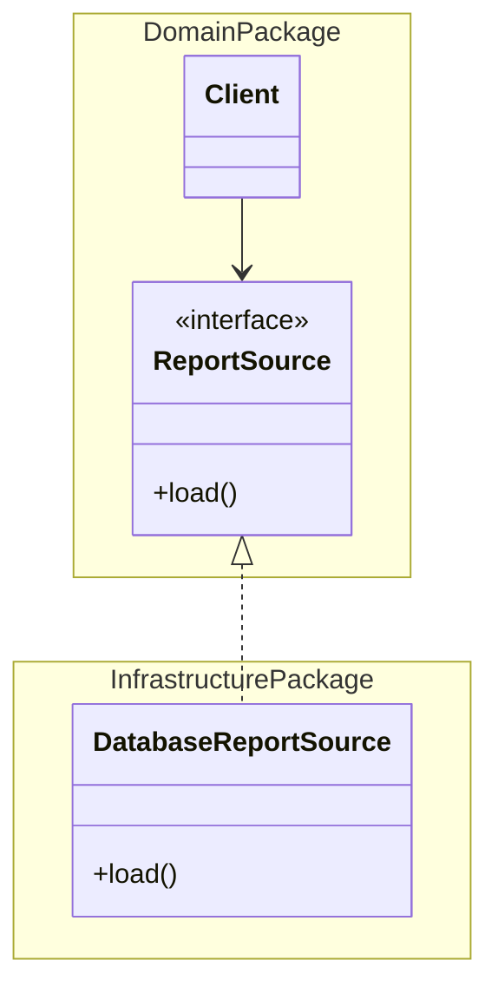

# Separated Interface

## Descrição

O Separated Interface coloca uma interface em um pacote diferente do pacote da sua implementação. Assim, o cliente depende apenas da interface e não sabe nada sobre a implementação, reduzindo o acoplamento entre partes do sistema.

Equipes costumam organizar classes em pacotes ou módulos e definir regras de dependência, como "o domínio não pode depender da apresentação" ou "o domínio não depende da infraestrutura". Às vezes uma chamada necessária viola essas regras. Com o Separated Interface, a interface fica em um pacote do qual o cliente pode depender, e a implementação fica em outro, que depende da interface.

É a base do princípio da inversão de dependência e o ponto de encaixe natural para um [Gateway](./gateway.md), para um [Service Stub](./service-stub.md) e para o [Plugin](./plugin.md).

## Problemas que resolve

- Uma dependência necessária viola as regras de dependência entre pacotes ou camadas.
- O código cliente fica acoplado a uma implementação concreta.
- Dificuldade de trocar a implementação ou de substituí-la em testes.
- Ciclos de dependência entre pacotes.

## Quando usar

- Quando uma camada precisa chamar outra sem poder depender dela (por exemplo, o domínio chamando a persistência).
- Quando se quer que o cliente ignore como a dependência é implementada.
- Como ponto de extensão para um Gateway com várias implementações (real, stub, em memória).

### Quando evitar

- Quando há uma única implementação e nenhuma restrição de dependência, pois a interface só acrescenta indireção.
- Em código pequeno ou em um único pacote, em que a separação não traz benefício.
- Quando a proliferação de interfaces dificulta a navegação e a leitura do código.

## Trade-offs

| Ganho | Custo / Risco |
| --- | --- |
| Reduz o acoplamento entre pacotes e camadas | Mais interfaces e pacotes para manter |
| Permite várias implementações e troca fácil | Exige uma forma de instanciar a implementação (factory, Plugin, injeção de dependência) |
| Facilita testes com dublês | Indireção pode dificultar a navegação no código |
| Respeita as regras de dependência da arquitetura | A interface precisa ser bem projetada, pois muda com dificuldade |

- **Acoplamento:** o cliente conhece só o contrato.
- **Complexidade:** o ponto difícil é decidir quem instancia a implementação; veja [Plugin](./plugin.md) e [Registry](./registry.md).

## Diagrama



O `Client` e a interface `ReportSource` ficam no pacote de domínio; a implementação `DatabaseReportSource` fica no pacote de infraestrutura e depende da interface, invertendo a dependência.

## Exemplo

A camada de domínio precisa buscar a taxa de câmbio, mas não pode depender da camada de infraestrutura. A interface fica no domínio.

```java
// pacote: domain
public interface ExchangeRates {
    java.math.BigDecimal rate(String from, String to);
}

public class PriceCalculator {
    private final ExchangeRates rates;
    public PriceCalculator(ExchangeRates rates) { this.rates = rates; }

    public java.math.BigDecimal convert(java.math.BigDecimal value, String from, String to) {
        return value.multiply(rates.rate(from, to));
    }
}

// pacote: infrastructure (depende de domain, não o contrário)
public class HttpExchangeRates implements domain.ExchangeRates {
    public java.math.BigDecimal rate(String from, String to) {
        // chamada HTTP ao provedor
        return new java.math.BigDecimal("5.10");
    }
}
```

Em frameworks como Spring, o contêiner de injeção de dependência faz o papel de ligar a implementação à interface.

## Padrões relacionados

- [Gateway](./gateway.md) — a interface do Gateway costuma ser um Separated Interface.
- [Service Stub](./service-stub.md) — uma segunda implementação da mesma interface, usada em testes.
- [Plugin](./plugin.md) — escolhe a implementação da interface por configuração, em tempo de execução.
- [Registry](./registry.md) — outra forma de localizar a implementação a partir da interface.
- [Strategy](../../../coding/gof/behavioral/strategy.md) — também usa uma interface com várias implementações, mas com foco em variar algoritmos, não em separar pacotes.
- [Abstract Factory](../../../coding/gof/creational/abstract-factory.md) — pode criar a implementação correta sem que o cliente a conheça.
- [Repository](../object-relational-metadata-mapping/repository.md) — normalmente é definido como interface no domínio, com implementação na infraestrutura.

## Referência

- [Página do padrão no catálogo do Fowler](https://martinfowler.com/eaaCatalog/separatedInterface.html)
- *Patterns of Enterprise Application Architecture*, Martin Fowler (Addison-Wesley, 2002)
