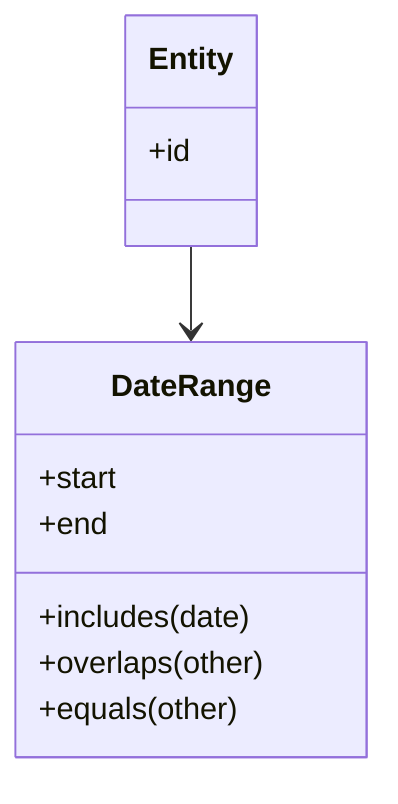

# Value Object

## Descrição

O Value Object é um objeto pequeno e simples, como um valor monetário ou um intervalo de datas, cuja igualdade não se baseia em identidade. Dois Value Objects com os mesmos valores são intercambiáveis: o que importa é o valor, não qual instância específica está em uso.

Isso o diferencia dos objetos de referência (entidades), identificados por uma chave ou por identidade de objeto. O Value Object se parece com os tipos primitivos das linguagens, só que modelando conceitos do domínio, como `Money`, `DateRange`, `Email` ou `Address`.

Na prática, um bom Value Object é imutável, compara por valor (implementando igualdade e hash a partir dos campos) e concentra a validação e o comportamento do conceito que representa. No Domain-Driven Design, o Value Object é um bloco de construção do modelo, ao lado de [Entity](../../ddd/building-blocks/entity.md) e de [Aggregate](../../ddd/building-blocks/aggregate.md). Evans recomenda preferir Value Objects sempre que o conceito não exigir identidade, pois são mais simples de raciocinar, testar e compartilhar. Dentro de um Aggregate, eles descrevem a raiz e as entidades internas e podem ser copiados ou substituídos livremente, sem cuidado com ciclo de vida.

## Problemas que resolve

- "Obsessão por primitivos": strings e números soltos representando conceitos do domínio, sem validação ou comportamento.
- Aliasing: duas partes do código compartilhando e alterando o mesmo objeto sem perceber.
- Comparações incorretas por identidade de objeto quando se queria comparar valores.
- Regras de validação e formatação duplicadas em vários lugares.

## Quando usar

- Quando o conceito é definido apenas por seus atributos (valor monetário, intervalo, coordenada, e-mail, CEP).
- Quando se quer garantir invariantes na construção, de forma que o objeto seja sempre válido.
- Quando se quer imutabilidade para evitar efeitos colaterais e facilitar concorrência.
- Em conjunto com [Embedded Value](../object-relational-structural/embedded-value.md) para persisti-lo dentro da linha do dono.

### Quando evitar

- Quando o objeto tem ciclo de vida e identidade próprios, que precisam ser rastreados (use uma entidade com [Identity Field](../object-relational-structural/identity-field.md)).
- Quando o conceito muda com frequência e a imutabilidade geraria muita criação de objetos sem benefício.
- Quando o valor é realmente trivial e o encapsulamento acrescentaria apenas cerimônia.

## Trade-offs

| Ganho | Custo / Risco |
| --- | --- |
| Elimina aliasing e efeitos colaterais, graças à imutabilidade | Mais objetos criados (custo de alocação) |
| Validação e comportamento concentrados no conceito | Mais classes pequenas para escrever e manter |
| Igualdade por valor, simples de comparar e testar | Mapeamento para banco exige atenção (Embedded Value, colunas) |
| Código mais expressivo que primitivos soltos | Linguagens sem suporte nativo exigem implementar igualdade e hash à mão |

- **Consistência:** invariantes garantidas na construção.
- **Testabilidade:** objetos puros, sem dependências, são triviais de testar.
- **Concorrência:** imutáveis são seguros para compartilhar entre threads.

## Diagrama



A entidade `Entity` possui um `DateRange`. O `DateRange` não tem identidade: é comparado e substituído por valor.

## Exemplo

Um sistema de reservas representa o período de hospedagem como um Value Object imutável que valida a si mesmo.

```python
from dataclasses import dataclass
from datetime import date

@dataclass(frozen=True)
class DateRange:
    start: date
    end: date

    def __post_init__(self):
        if self.end < self.start:
            raise ValueError("end deve ser maior ou igual a start")

    def includes(self, day: date) -> bool:
        return self.start <= day <= self.end

    def overlaps(self, other: "DateRange") -> bool:
        return self.start <= other.end and other.start <= self.end

a = DateRange(date(2026, 1, 1), date(2026, 1, 10))
b = DateRange(date(2026, 1, 1), date(2026, 1, 10))
assert a == b  # igualdade por valor
```

Records do Java e do C#, `dataclass(frozen=True)` no Python e `Struct` no Ruby são formas idiomáticas de declarar Value Objects.

## Padrões relacionados

- [Money](./money.md) — o exemplo clássico de Value Object.
- [Embedded Value](../object-relational-structural/embedded-value.md) — mapeia um Value Object para colunas da tabela do objeto dono.
- [Serialized LOB](../object-relational-structural/serialized-lob.md) — alternativa para persistir um Value Object complexo como bloco serializado.
- [Special Case](./special-case.md) — um valor especial (como "sem desconto") pode ser modelado como Value Object ou como Special Case.
- [Entity](../../ddd/building-blocks/entity.md) — contraparte do DDD, definida por identidade e não por valor.
- [Aggregate](../../ddd/building-blocks/aggregate.md) — Value Objects compõem os agregados e descrevem a raiz.
- [Domain Model](../domain-logic/domain-model.md) — Value Objects compõem o modelo de domínio ao lado das entidades.
- [Flyweight](../../../coding/gof/structural/flyweight.md) — objetos imutáveis podem ser compartilhados com segurança, o que viabiliza o Flyweight.
- [Data Transfer Object](../distribution/data-transfer-object.md) — também é um objeto de dados, mas sem comportamento nem invariantes, voltado à transferência.

## Referência

- [DDD Reference, Eric Evans (2015)](https://www.domainlanguage.com/ddd/reference/)
- [Página do padrão no catálogo do Fowler](https://martinfowler.com/eaaCatalog/valueObject.html)
- [Value Object (bliki)](https://martinfowler.com/bliki/ValueObject.html)
- *Patterns of Enterprise Application Architecture*, Martin Fowler (Addison-Wesley, 2002)
