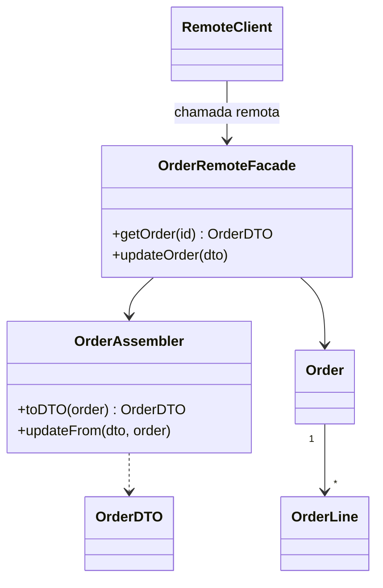

# Remote Facade

## Descrição

O Remote Facade oferece uma interface de granularidade grossa sobre objetos de granularidade fina, para tornar eficiente o acesso por rede. Os objetos de domínio continuam pequenos, com muitos métodos simples (getters, setters, operações pontuais), pensados para uso dentro do mesmo processo. Chamadas entre processos, porém, são muito mais caras: envolvem serialização, roteamento, verificações de segurança e latência de rede.

A fachada fica na fronteira da aplicação e expõe poucos métodos que fazem muito: por exemplo, em vez de buscar um pedido e depois cada item, o cliente remoto obtém ou atualiza o pedido inteiro em uma única chamada. Cada método da fachada traduz a requisição grossa em chamadas locais aos objetos finos.

A fachada não contém lógica de domínio: apenas traduz, delega e, em geral, cuida de aspectos de fronteira como segurança e transação. Costuma trabalhar em conjunto com o [Data Transfer Object](./data-transfer-object.md), que carrega os dados trafegados entre as duas pontas.

## Problemas que resolve

- Clientes remotos precisam fazer dezenas de chamadas pequenas para concluir uma tarefa, e a latência de rede domina o tempo total.
- Objetos de domínio de granularidade fina não podem ser expostos diretamente pela rede sem custo e acoplamento excessivos.
- O modelo de domínio fica preso a protocolos e requisitos de distribuição (serialização, segurança de acesso remoto).
- Mudanças no domínio quebram clientes remotos que dependem de sua estrutura interna.

## Quando usar

- Quando objetos da aplicação são acessados de outro processo ou máquina (cliente rico, outra aplicação, API pública).
- Quando a interação fina exigiria muitas chamadas remotas para uma única tarefa de negócio.
- Quando se quer manter o domínio fino e testável, isolando as preocupações de distribuição em uma camada de borda.

### Quando evitar

- Quando todos os clientes rodam no mesmo processo; a interface grossa só atrapalha e esconde a intenção dos métodos.
- Quando a fachada começa a receber regras de negócio; isso a transforma em um segundo modelo de domínio.
- Quando uma [Service Layer](../domain-logic/service-layer.md) local já basta e o acesso remoto não é requisito real.

## Trade-offs

| Ganho | Custo / Risco |
| --- | --- |
| Menos viagens pela rede e melhor desempenho | Interface grossa é menos expressiva e mais difícil de programar |
| Domínio permanece fino e sem preocupações de distribuição | Mais uma camada, com métodos que precisam acompanhar os casos de uso dos clientes |
| Ponto único para segurança, transação e serialização | Risco de vazar lógica de domínio para a fachada |
| Contrato remoto estável, independente do modelo interno | Dados desnecessários podem ser trafegados quando o método devolve mais do que o cliente precisa |

- **Desempenho:** o ganho vem de reduzir chamadas, não de acelerar cada uma.
- **Testabilidade:** a fachada é fina e fácil de testar; o domínio é testado sem rede.
- **Acoplamento:** clientes dependem do contrato da fachada, não do domínio.
- **Complexidade:** exige desenhar métodos por caso de uso, o que pode gerar interfaces específicas demais.

## Diagrama



O `RemoteClient` faz uma única chamada à `OrderRemoteFacade`, que usa o `OrderAssembler` e os objetos finos (`Order`, `OrderLine`) para montar ou aplicar um `OrderDTO` completo.

## Exemplo

Um aplicativo móvel precisa exibir um pedido com seus itens. Em vez de expor `Order` e `OrderLine` pela rede, um endpoint grosso devolve o pedido completo em uma chamada, e a fachada apenas delega.

```typescript
class OrderRemoteFacade {
  constructor(
    private orders: OrderRepository,
    private assembler: OrderAssembler,
  ) {}

  // Uma chamada remota, vários objetos locais
  getOrder(id: string): OrderDTO {
    const order = this.orders.find(id);
    return this.assembler.toDTO(order); // pedido + itens
  }

  // Atualiza várias partes de uma vez, em uma transação
  updateOrder(dto: OrderDTO): void {
    const order = this.orders.find(dto.id);
    this.assembler.updateFrom(dto, order);
    this.orders.save(order);
  }
}
```

Em Java EE, um session bean remoto sobre entidades era a implementação clássica; hoje o mesmo papel aparece em controllers de API REST e serviços gRPC que agregam dados.

## Padrões relacionados

- [Data Transfer Object](./data-transfer-object.md) — carrega os dados trocados na chamada grossa da fachada.
- [Service Layer](../domain-logic/service-layer.md) — também define uma fronteira de casos de uso, mas local e com lógica de coordenação; a fachada remota pode ficar sobre ela.
- [Gateway](../base/gateway.md) — o Gateway encapsula o acesso a um sistema externo do lado do cliente; o Remote Facade expõe o sistema do lado do servidor.
- [Facade](../../../coding/gof/structural/facade.md) — a versão geral do GoF, voltada a simplificar; o Remote Facade foca em reduzir chamadas de rede.
- [API Gateway](../../../architecture/microservices/external-api/api-gateway.md) — leva a ideia de ponto de entrada grosso para a borda de um sistema de microsserviços.
- [Gateway Aggregation](../../../cloud/azure/gateways-and-edge/gateway-aggregation.md) — agrega várias chamadas de backend em uma só para o cliente.
- [Remote Procedure Invocation](../../../architecture/microservices/communication-styles/remote-procedure-invocation.md) — o estilo de comunicação cujo custo motiva o padrão.

## Referência

- [Página do padrão no catálogo do Fowler](https://martinfowler.com/eaaCatalog/remoteFacade.html)
- *Patterns of Enterprise Application Architecture*, Martin Fowler (Addison-Wesley, 2002)
