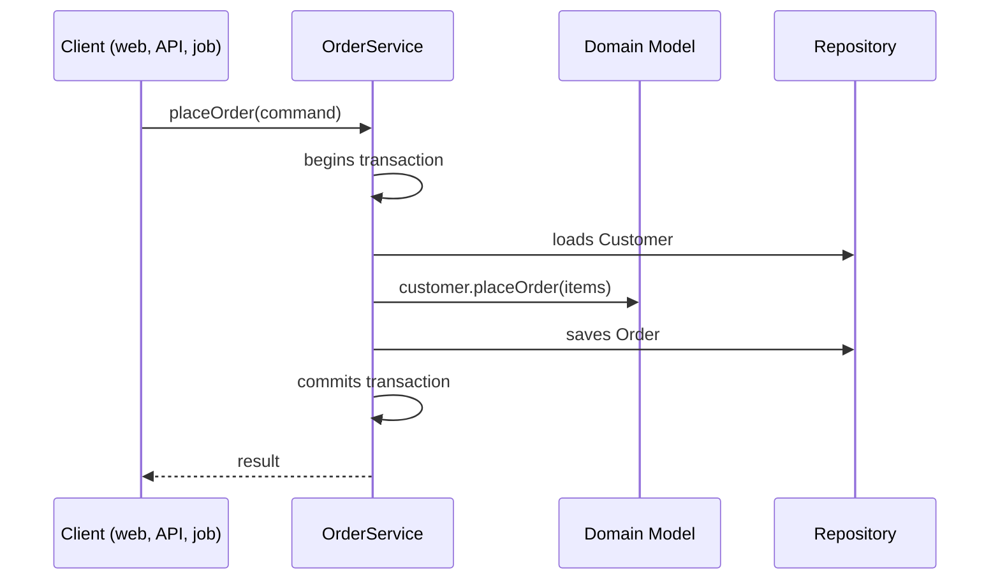

# Service Layer

## Descrição

O Service Layer define a fronteira de uma aplicação como um conjunto de serviços que expõem as operações disponíveis e coordenam as respostas. Ele fica entre os clientes (interface web, API, carga de dados, mensageria) e a lógica de domínio.

Aplicações corporativas têm várias interfaces para os mesmos dados e regras, e todas precisam das mesmas interações, que podem envolver várias transações e recursos. Sem uma camada comum, essa orquestração é duplicada em cada interface.

O Service Layer encapsula a coordenação do caso de uso, controla transações e segurança, e delega as regras de negócio ao domínio. Pode ser fino (apenas orquestra) ou carregar parte da lógica de aplicação, mas as regras centrais ficam no Domain Model.

## Problemas que resolve

- Lógica de coordenação duplicada entre interfaces diferentes (web, API, jobs).
- Controle de transação e segurança espalhado pelos controladores.
- Clientes acoplados diretamente ao modelo de domínio e à persistência.
- Dificuldade de testar casos de uso sem passar pela interface.

## Quando usar

- Quando a aplicação tem mais de um tipo de cliente que executa as mesmas operações.
- Quando casos de uso envolvem várias etapas, transações ou recursos.
- Quando se quer um ponto único para transação, autorização e eventos.

### Quando evitar

- Aplicações simples com um único cliente e lógica trivial, em que a camada só repassa chamadas.
- Quando serviços acumulam regras de negócio e esvaziam o domínio (modelo anêmico).
- Quando a camada vira um "god object" de operações não relacionadas.

## Trade-offs

| Ganho | Custo / Risco |
| --- | --- |
| Orquestração em um só lugar, reutilizada por todos os clientes | Camada extra que pode ser só indireção |
| Fronteira transacional clara | Risco de concentrar regras e gerar modelo anêmico |
| Domínio isolado de interfaces e persistência | Serviços podem crescer demais |
| Casos de uso testáveis sem interface | Exige disciplina para manter a camada fina |

- **Consistência:** a transação por operação garante que o caso de uso seja atômico.
- **Acoplamento:** os clientes dependem dos serviços, não do modelo.
- **Variantes:** a camada pode ser de domain facade (fina) ou de operation script (com lógica de aplicação).

## Diagrama



O serviço abre a transação, carrega objetos, delega a regra ao domínio, persiste o resultado e devolve a resposta ao cliente.

## Exemplo

Um `OrderService` é usado tanto por um controlador REST quanto por um consumidor de fila, concentrando transação e orquestração.

```java
@Service
public class OrderService {
    private final CustomerRepository customers;
    private final OrderRepository orders;
    private final PaymentGateway payments;

    @Transactional
    public OrderId placeOrder(PlaceOrderCommand cmd) {
        Customer customer = customers.get(cmd.customerId());
        Order order = customer.placeOrder(cmd.items());   // regra no domínio
        orders.save(order);
        payments.authorize(order.id(), order.total());
        return order.id();
    }
}
```

No Spring, serviços anotados com `@Service` e `@Transactional` são a forma comum desse padrão.

## Padrões relacionados

- [Domain Model](./domain-model.md) — o Service Layer coordena o modelo, que contém as regras.
- [Transaction Script](./transaction-script.md) — pode ser a implementação dos serviços quando a lógica é simples.
- [Table Module](./table-module.md) — também pode ficar atrás da camada de serviço.
- [Remote Facade](../distribution/remote-facade.md) — fachada de granularidade grossa para acesso remoto, geralmente sobre o Service Layer.
- [Repository](../object-relational-metadata-mapping/repository.md) — usado pelos serviços para obter e salvar agregados.
- [Facade](../../../coding/gof/structural/facade.md) — o Service Layer é uma fachada para as operações da aplicação.

## Referência

- [Página do padrão no catálogo do Fowler](https://martinfowler.com/eaaCatalog/serviceLayer.html)
- *Patterns of Enterprise Application Architecture*, Martin Fowler (Addison-Wesley, 2002)
