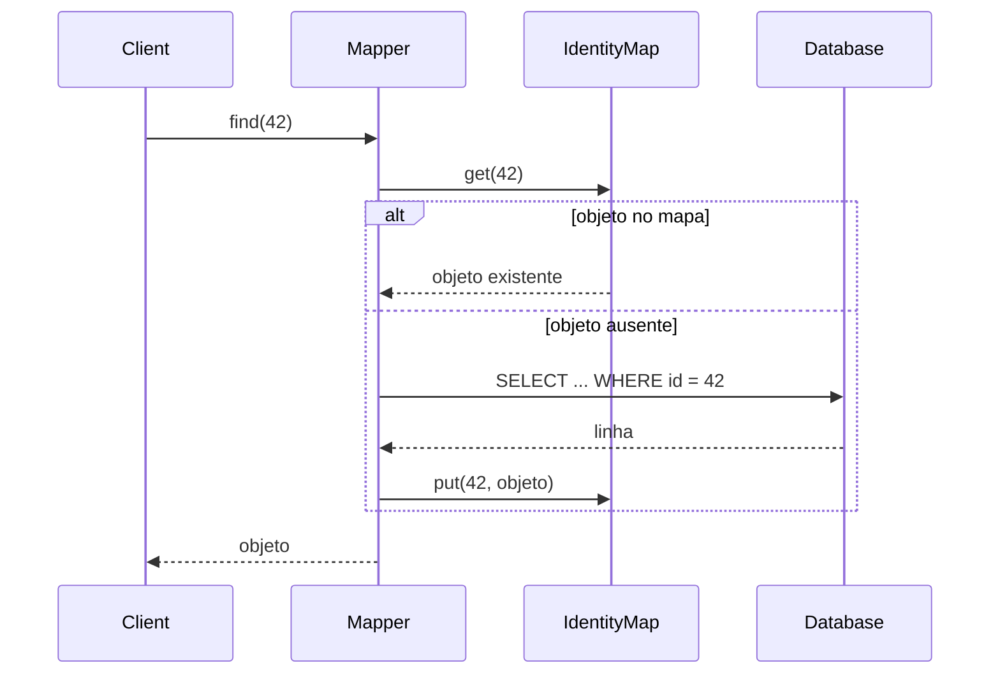

# Identity Map

## Descrição

O Identity Map garante que cada objeto seja carregado do banco de dados uma única vez por sessão, mantendo um mapa de objetos já lidos indexado pela chave primária. Antes de buscar um registro, o sistema consulta o mapa; se o objeto já estiver lá, ele é devolvido em vez de criar uma nova instância.

Isso evita que duas referências distintas representem a mesma linha do banco. Sem o padrão, alterações feitas em uma cópia não aparecem na outra, e a gravação de ambas gera conflitos e perda de atualizações.

Normalmente há um mapa por classe (ou por tabela) e ele vive no escopo de uma sessão ou de um Unit of Work. Não se trata de um cache global compartilhado entre requisições, e sim de um mecanismo de identidade dentro de uma transação de negócio.

## Problemas que resolve

- Dois objetos em memória representando o mesmo registro, com estados divergentes.
- Conflitos de gravação entre cópias da mesma entidade na mesma sessão.
- Consultas repetidas ao banco para o mesmo registro durante uma operação.
- Referências circulares no grafo de objetos que levariam a carregamentos infinitos.

## Quando usar

- Quando se usa um domain model com Data Mapper e várias partes do código podem carregar a mesma entidade.
- Quando se quer garantir que a identidade do objeto em memória corresponda à identidade da linha.
- Em conjunto com Unit of Work, para controlar o que foi lido e alterado.

### Quando evitar

- Com objetos imutáveis, como Value Objects, em que várias cópias não causam inconsistência.
- Em operações somente de leitura e muito curtas, em que a duplicidade não oferece risco.
- Quando se confunde o mapa com cache de longa duração; para isso, outras estratégias são mais adequadas.

## Trade-offs

| Ganho | Custo / Risco |
| --- | --- |
| Uma única instância por registro na sessão | Memória cresce com o número de objetos carregados |
| Menos consultas repetidas ao banco | Dados podem ficar defasados se a sessão for longa |
| Evita atualizações conflitantes na mesma sessão | Exige gerenciar o escopo e o descarte do mapa |
| Resolve referências cíclicas no grafo | Complexidade extra em ambientes concorrentes ou distribuídos |

- **Escopo:** um mapa por sessão evita problemas de concorrência entre threads; mapas globais exigem sincronização.
- **Consultas:** consultas por critérios diferentes da chave ainda vão ao banco, mas os resultados passam pelo mapa para reaproveitar instâncias.
- **Testabilidade:** o comportamento é transparente e fácil de verificar comparando identidades de objetos.

## Diagrama



O `Mapper` consulta o `IdentityMap` antes de ir ao `Database`; se o objeto não existir, carrega a linha, registra no mapa e o devolve. Chamadas seguintes com o mesmo id retornam a mesma instância.

## Exemplo

Em um pedido, tanto o módulo de cobrança quanto o de entrega buscam o mesmo `Customer`. Com o Identity Map, ambos recebem a mesma instância.

```typescript
class IdentityMap<T extends { id: number }> {
  private items = new Map<number, T>();
  get(id: number): T | undefined { return this.items.get(id); }
  put(entity: T): void { this.items.set(entity.id, entity); }
}

class CustomerMapper {
  private map = new IdentityMap<Customer>();

  constructor(private db: Database) {}

  find(id: number): Customer {
    const cached = this.map.get(id);
    if (cached) return cached;
    const row = this.db.queryOne("SELECT * FROM customers WHERE id = ?", [id]);
    const customer = new Customer(row.id, row.name);
    this.map.put(customer);
    return customer;
  }
}

// mapper.find(1) === mapper.find(1)  // true
```

O Hibernate (cache de primeiro nível da `Session`) e o Entity Framework (rastreamento do `DbContext`) aplicam o padrão automaticamente.

## Padrões relacionados

- [Unit of Work](/application/poeaa/object-relational-behavioral/unit-of-work) — costuma conter o Identity Map e usá-lo para saber quais objetos foram carregados.
- [Lazy Load](/application/poeaa/object-relational-behavioral/lazy-load) — o carregamento sob demanda consulta o mapa para evitar objetos duplicados.
- [Identity Field](/application/poeaa/object-relational-structural/identity-field) — fornece a chave que indexa o mapa.
- [Data Mapper](/application/poeaa/data-source-architectural/data-mapper) — consulta o mapa antes de acessar o banco.
- [Cache-Aside](/cloud/cloud-design-patterns/data-management/cache-aside) — também evita leituras repetidas, mas como cache compartilhado e não como garantia de identidade.

## Referência

- [Página do padrão no catálogo do Fowler](https://martinfowler.com/eaaCatalog/identityMap.html)
- *Patterns of Enterprise Application Architecture*, Martin Fowler (Addison-Wesley, 2002)
- [Identity map pattern na Wikipedia](https://en.wikipedia.org/wiki/Identity_map_pattern)
