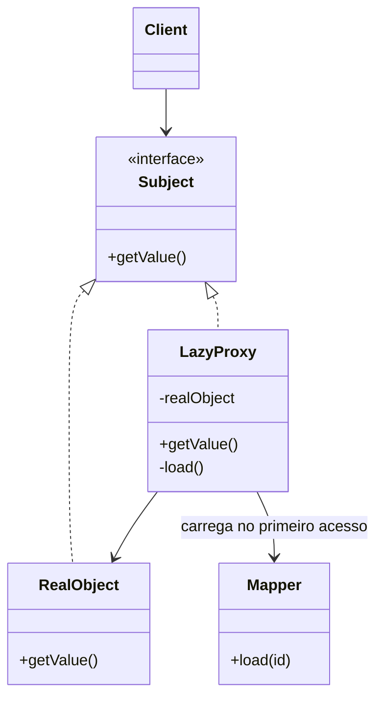

# Lazy Load

## Descrição

O Lazy Load é um objeto que não contém todos os dados de que precisa, mas sabe como obtê-los quando forem necessários. Ao carregar um objeto, associações e campos pesados não são lidos de imediato; o acesso a eles dispara a consulta apenas no momento do uso.

Isso evita carregar grafos inteiros de objetos quando só uma parte será usada. Carregar um pedido, por exemplo, não precisa trazer todos os itens, o cliente e o histórico se a tela só exibe o total.

Fowler descreve quatro variantes: **lazy initialization** (o campo é nulo até o primeiro acesso, quando é carregado), **virtual proxy** (um objeto com a mesma interface do real que carrega o verdadeiro ao ser usado), **value holder** (um objeto que encapsula o valor e o carrega em `getValue()`) e **ghost** (o objeto real, parcialmente carregado, que se completa no primeiro acesso a qualquer campo).

## Problemas que resolve

- Carregar grafos grandes de objetos quando só uma pequena parte é utilizada.
- Consultas lentas e uso excessivo de memória por associações raramente acessadas.
- Campos pesados (LOBs, coleções grandes) lidos sem necessidade.
- Acoplamento entre a lógica de domínio e a decisão de quando carregar dados.

## Quando usar

- Quando associações ou campos grandes são acessados apenas em alguns fluxos.
- Quando o custo de carregar o grafo completo supera o custo de consultas pontuais.
- Quando se quer manter o domínio ignorante de como e quando os dados são buscados.

### Quando evitar

- Quando os dados relacionados são sempre usados; o carregamento adiantado (eager) com `JOIN` é mais eficiente.
- Quando o acesso tardio ocorre fora da sessão ou transação, gerando erros como `LazyInitializationException`.
- Em laços que acessam a associação de muitos objetos, causando o problema de N+1 consultas.

## Trade-offs

| Ganho | Custo / Risco |
| --- | --- |
| Menos dados lidos e menos memória no carregamento inicial | Consultas adicionais espalhadas pelo uso, difíceis de prever |
| Domínio desacoplado da lógica de carregamento | Risco do problema de N+1 consultas |
| Início mais rápido para casos em que os dados extras não são usados | Falhas se a sessão já estiver fechada no momento do acesso |
| Carregamento transparente para o chamador (proxy, ghost) | Proxies complicam igualdade, serialização e depuração |

- **Variantes:** lazy initialization é simples, mas exige o código de carga no domínio; value holder expõe o mecanismo à API; virtual proxy e ghost são transparentes, porém mais complexos.
- **Identidade:** ghosts e proxies devem passar pelo Identity Map para não duplicar objetos.
- **Testabilidade:** o comportamento exige testes com o contexto de persistência ativo para validar quando as consultas ocorrem.

## Diagrama



Na variante virtual proxy, o `Client` usa a interface `Subject` sem saber se recebeu o objeto real ou o `LazyProxy`. No primeiro acesso, o proxy usa o `Mapper` para carregar o `RealObject` e passa a delegar a ele.

## Exemplo

Um `Customer` tem uma lista de pedidos que só é necessária na tela de histórico. Com value holder, a consulta ocorre no primeiro acesso.

```java
class ValueHolder<T> {
    private final Supplier<T> loader;
    private T value;
    private boolean loaded;

    ValueHolder(Supplier<T> loader) { this.loader = loader; }

    T getValue() {
        if (!loaded) { value = loader.get(); loaded = true; }
        return value;
    }
}

class Customer {
    private final ValueHolder<List<Order>> orders;

    Customer(long id, OrderMapper mapper) {
        this.orders = new ValueHolder<>(() -> mapper.findByCustomer(id));
    }

    List<Order> getOrders() { return orders.getValue(); }
}
```

No Hibernate, associações `@OneToMany(fetch = LAZY)` usam proxies e coleções lazy; no Entity Framework, o lazy loading é habilitado por proxies de carregamento.

## Padrões relacionados

- [Identity Map](/application/poeaa/object-relational-behavioral/identity-map) — garante que ghosts e proxies resolvam para a mesma instância.
- [Unit of Work](/application/poeaa/object-relational-behavioral/unit-of-work) — define o escopo em que o carregamento tardio deve ocorrer.
- [Data Mapper](/application/poeaa/data-source-architectural/data-mapper) — executa a consulta disparada pelo carregamento tardio.
- [Proxy](/coding/gof/structural/proxy) — a variante virtual proxy é uma aplicação direta do Proxy do GoF.
- [Cache-Aside](/cloud/cloud-design-patterns/data-management/cache-aside) — também adia a leitura até a necessidade, mas guarda o resultado em um cache compartilhado.

## Referência

- [Página do padrão no catálogo do Fowler](https://martinfowler.com/eaaCatalog/lazyLoad.html)
- *Patterns of Enterprise Application Architecture*, Martin Fowler (Addison-Wesley, 2002)
- [Lazy loading na Wikipedia](https://en.wikipedia.org/wiki/Lazy_loading)
