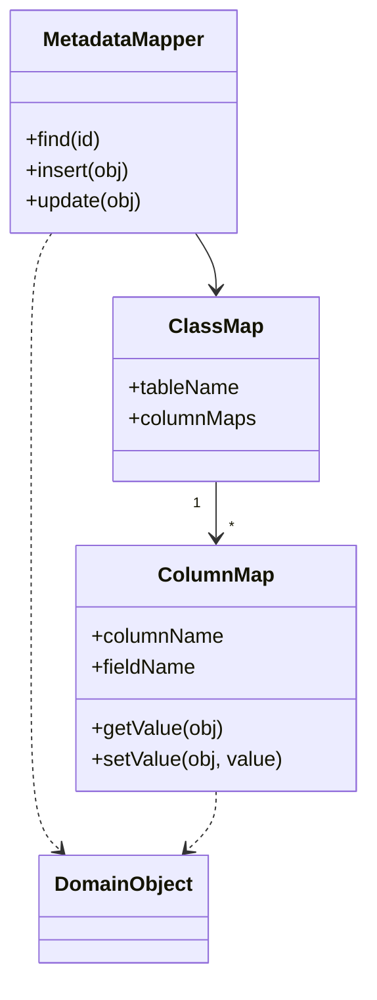

# Metadata Mapping

## Descrição

O Metadata Mapping mantém os detalhes do mapeamento objeto-relacional em metadados, em vez de espalhá-los em código escrito à mão. Cada correspondência entre campo do objeto e coluna da tabela é descrita em uma estrutura declarativa (um arquivo, anotações ou uma tabela).

Um código genérico lê esses metadados e executa as operações de leitura, inserção e atualização. Para mapear uma nova classe, basta acrescentar uma entrada de metadados; o código de acesso não muda. A geração de código a partir dos metadados e a reflexão em tempo de execução são as duas formas de implementação mais comuns.

É a base da maioria dos frameworks de ORM, que combinam o padrão com [Data Mapper](/application/poeaa/data-source-architectural/data-mapper) e [Unit of Work](/application/poeaa/object-relational-behavioral/unit-of-work).

## Problemas que resolve

- Código de mapeamento repetitivo e tedioso, escrito para cada classe do domínio.
- Mudanças no esquema que exigem alterar vários trechos de código de persistência.
- Erros de digitação e inconsistências entre mapeadores escritos manualmente.

## Quando usar

- Quando há muitas classes mapeadas e o mapeamento segue regras uniformes.
- Quando se quer adotar ou construir um ORM em vez de escrever mapeadores um a um.
- Quando é preciso gerar esquema, DDL ou consultas a partir de uma única descrição.

### Quando evitar

- Quando há poucas tabelas e o mapeamento manual é mais simples de entender.
- Quando o mapeamento é muito irregular e o motor genérico precisaria de tantas exceções que perderia o valor.
- Quando o custo de reflexão ou a dificuldade de depurar código gerado pesam mais que o ganho.

## Trade-offs

| Ganho | Custo / Risco |
| --- | --- |
| Menos código repetitivo de mapeamento | Motor genérico é mais complexo de construir e depurar |
| Mudanças de mapeamento viram edição de metadados | Casos fora do padrão são difíceis de expressar |
| Mapeamento descrito em um só lugar | Reflexão pode custar desempenho; geração de código adiciona etapa de build |
| Facilita geração de esquema e ferramentas | Erros só aparecem em execução se não houver validação dos metadados |

- **Acoplamento:** o domínio fica livre de detalhes de SQL, mas passa a depender do formato dos metadados.
- **Testabilidade:** o motor genérico é testado uma vez; cada mapeamento exige verificação de configuração.
- **Complexidade:** alta no início do projeto, baixa por classe adicional.

## Diagrama



O `MetadataMapper` genérico consulta o `ClassMap` da classe, que contém um `ColumnMap` por campo, e usa essas informações para ler e gravar o `DomainObject` sem código específico.

## Exemplo

Uma aplicação mapeia `Customer` para a tabela `customers`. Em vez de escrever SQL manual, as anotações JPA servem como metadados, e o Hibernate lê esses dados por reflexão para gerar os comandos.

```java
@Entity
@Table(name = "customers")
public class Customer {
    @Id
    @GeneratedValue
    private Long id;

    @Column(name = "full_name", nullable = false)
    private String name;

    @Embedded
    private Address address;

    @OneToMany(mappedBy = "customer")
    private List<Order> orders;
}
```

Hibernate, Entity Framework (fluent API) e Doctrine seguem essa abordagem, com anotações, XML ou configuração em código.

## Padrões relacionados

- [Data Mapper](/application/poeaa/data-source-architectural/data-mapper) — o Metadata Mapping é a forma de implementar um Data Mapper genérico, sem mapeadores escritos à mão.
- [Query Object](/application/poeaa/object-relational-metadata-mapping/query-object) — usa os metadados para traduzir classes e campos em tabelas e colunas.
- [Repository](/application/poeaa/object-relational-metadata-mapping/repository) — costuma ser construído sobre um mapeamento orientado por metadados.
- [Unit of Work](/application/poeaa/object-relational-behavioral/unit-of-work) — coordena a gravação dos objetos mapeados.
- [Lazy Load](/application/poeaa/object-relational-behavioral/lazy-load) — o motor genérico pode inserir proxies a partir dos metadados.

## Referência

- [Página do padrão no catálogo do Fowler](https://martinfowler.com/eaaCatalog/metadataMapping.html)
- *Patterns of Enterprise Application Architecture*, Martin Fowler (Addison-Wesley, 2002)
