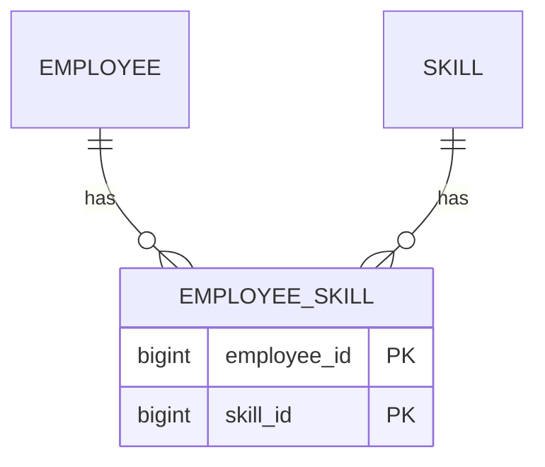

# Association Table Mapping

## Descrição

O Association Table Mapping salva uma associação como uma tabela com chaves estrangeiras para as tabelas ligadas pela associação. É a forma de representar relações muitos-para-muitos no modelo relacional, que não aceita campos multivalorados.

A tabela de associação contém apenas as duas chaves estrangeiras, e a chave primária é a combinação delas. Ao carregar um objeto, o mapeador consulta a tabela de associação para achar os relacionados; ao salvar, insere ou remove linhas nela conforme a coleção mudou.

Se a relação tiver atributos próprios (data, papel), a tabela de associação passa a ser uma entidade completa.

## Problemas que resolve

- Representar associações muitos-para-muitos em um banco relacional.
- Representar coleções em que nenhum dos lados pode guardar a chave do outro.

## Quando usar

- Em relações muitos-para-muitos entre entidades.
- Quando a associação existe de forma independente das duas pontas.

### Quando evitar

- Em associações um-para-muitos simples: use Foreign Key Mapping.
- Quando a relação tem comportamento próprio: modele-a como entidade.

## Trade-offs

| Ganho | Custo / Risco |
| --- | --- |
| Suporta muitos-para-muitos sem duplicar dados | Exige joins adicionais nas consultas |
| Esquema normalizado | Salvar coleções exige calcular diferenças |
| Pontas independentes entre si | Tabela extra sem significado de domínio |

- **Consistência:** a chave composta evita pares duplicados; chaves estrangeiras garantem integridade.
- **Desempenho:** índices nas duas colunas são importantes.

## Diagrama



A tabela `EMPLOYEE_SKILL` liga `EMPLOYEE` e `SKILL`, com chave primária composta pelas duas chaves estrangeiras.

## Exemplo

Funcionários possuem várias habilidades e uma habilidade pertence a vários funcionários.

```java
@Entity
public class Employee {
    @Id @GeneratedValue
    private Long id;

    @ManyToMany
    @JoinTable(
        name = "employee_skill",
        joinColumns = @JoinColumn(name = "employee_id"),
        inverseJoinColumns = @JoinColumn(name = "skill_id"))
    private Set<Skill> skills = new HashSet<>();
}
```

## Padrões relacionados

- [Foreign Key Mapping](./foreign-key-mapping.md) — usado nas associações um-para-muitos; a tabela de associação generaliza a ideia.
- [Identity Field](./identity-field.md) — as chaves referenciadas pela tabela de associação.
- [Dependent Mapping](./dependent-mapping.md) — alternativa quando um dos lados é dependente do outro.
- [Lazy Load](../object-relational-behavioral/lazy-load.md) — adia a carga dos objetos relacionados.

## Referência

- [Página do padrão no catálogo do Fowler](https://martinfowler.com/eaaCatalog/associationTableMapping.html)
- *Patterns of Enterprise Application Architecture*, Martin Fowler (Addison-Wesley, 2002)
