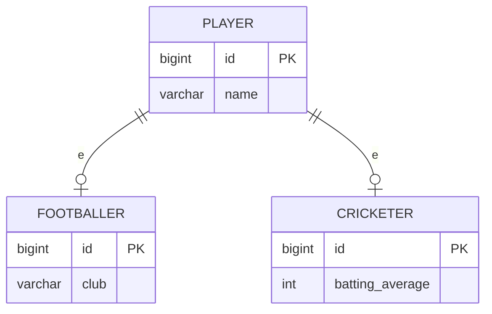

# Class Table Inheritance

## Descrição

O Class Table Inheritance representa uma hierarquia de herança com uma tabela por classe. Cada tabela guarda apenas os campos declarados na própria classe, e as subclasses se ligam à tabela da superclasse por chave primária compartilhada.

Para carregar um objeto completo, o mapeador junta (join) as tabelas ao longo da cadeia de herança. Para saber o tipo concreto, usa-se um discriminador ou o resultado dos joins.

O esquema espelha o modelo de objetos, mantém o banco normalizado e permite `NOT NULL` nos campos de cada classe.

## Problemas que resolve

- Mapear herança com esquema normalizado e sem colunas nulas.
- Manter a relação direta entre classes do domínio e tabelas.
- Aplicar restrições de integridade por subclasse.

## Quando usar

- Quando as subclasses têm muitos campos próprios.
- Quando a integridade do esquema é prioridade.
- Quando referências para a superclasse (chave estrangeira) devem funcionar para qualquer subtipo.

### Quando evitar

- Quando o número de joins por consulta prejudica o desempenho.
- Quando a hierarquia muda de forma frequente, movendo campos entre tabelas.

## Trade-offs

| Ganho | Custo / Risco |
| --- | --- |
| Esquema normalizado, espelha o modelo | Joins em toda carga de objeto |
| `NOT NULL` por subclasse | Refatorar a hierarquia exige alterar tabelas |
| Chave estrangeira para a superclasse funciona | Hierarquias profundas geram consultas pesadas |

- **Desempenho:** custo cresce com a profundidade da hierarquia.
- **Manutenção:** uma alteração em uma classe toca a tabela correspondente.

## Diagrama



`PLAYER` guarda os campos comuns; `FOOTBALLER` e `CRICKETER` guardam os específicos, compartilhando a mesma chave primária.

## Exemplo

Cada classe tem a própria tabela; o JPA une as tabelas com `JOINED`.

```java
@Entity
@Inheritance(strategy = InheritanceType.JOINED)
public abstract class Player {
    @Id @GeneratedValue
    private Long id;
    private String name;
}

@Entity
public class Footballer extends Player {
    @Column(nullable = false)
    private String club;
}
```

No EF Core, é o Table-per-Type (TPT).

## Padrões relacionados

- [Single Table Inheritance](./single-table-inheritance.md) — alternativa com uma tabela só.
- [Concrete Table Inheritance](./concrete-table-inheritance.md) — alternativa com uma tabela por classe concreta.
- [Inheritance Mappers](./inheritance-mappers.md) — organiza os mapeadores da hierarquia.
- [Foreign Key Mapping](./foreign-key-mapping.md) — a ligação entre tabelas usa o mesmo princípio.
- [Identity Field](./identity-field.md) — a chave compartilhada entre as tabelas.

## Referência

- [Página do padrão no catálogo do Fowler](https://martinfowler.com/eaaCatalog/classTableInheritance.html)
- *Patterns of Enterprise Application Architecture*, Martin Fowler (Addison-Wesley, 2002)
