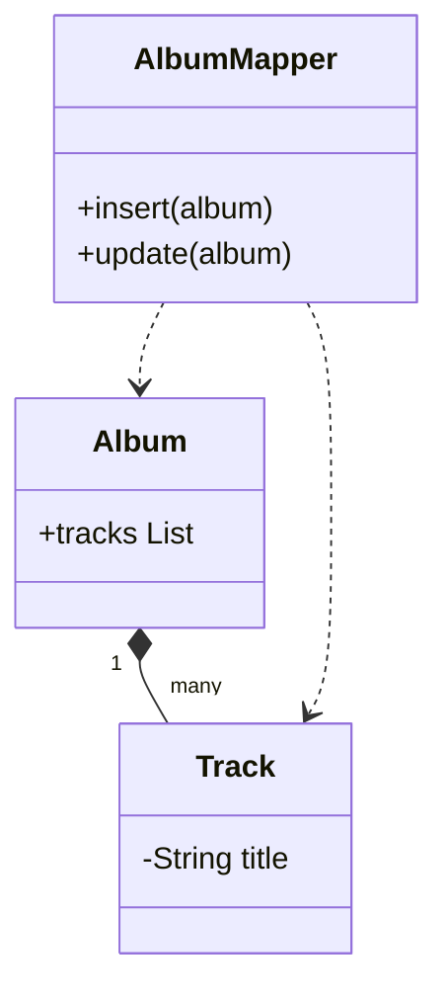

# Dependent Mapping

## Descrição

O Dependent Mapping faz uma classe ser responsável por salvar e carregar os filhos que dependem dela. Um objeto dependente só tem sentido no contexto do seu dono: nenhuma outra classe o referencia e ele não tem identidade própria fora do dono.

Por isso o dependente não tem mapeador próprio. O mapeador do dono carrega os filhos junto com ele e, ao salvar, apaga e reinsere os filhos (ou calcula as diferenças). Os dependentes também não precisam de Identity Field nem de Identity Map.

O ciclo de vida é controlado pelo dono: quando ele é removido, os filhos também são.

## Problemas que resolve

- Simplificar o mapeamento de objetos que existem apenas em função de outro.
- Evitar mapeadores, identidades e travas para objetos subordinados.

## Quando usar

- Quando o dependente é referenciado por um único dono.
- Quando o dependente não é consultado de forma independente.
- Em Aggregates de DDD, para os objetos internos ao agregado.

### Quando evitar

- Quando outros objetos precisam referenciar o dependente diretamente.
- Quando a coleção é muito grande e regravá-la a cada alteração é caro.

## Trade-offs

| Ganho | Custo / Risco |
| --- | --- |
| Menos classes de mapeamento | O dono precisa conhecer o esquema dos filhos |
| Sem necessidade de identidade para o filho | Não se pode referenciar o filho de fora |
| Ciclo de vida simples (cascata) | Regravar a coleção pode ser custoso |

- **Acoplamento:** o dono fica acoplado ao mapeamento dos dependentes.
- **Consistência:** o dono é a única porta de entrada para alterar os filhos.

## Diagrama



O `AlbumMapper` salva e carrega o `Album` e as `Track` dependentes; `Track` não tem mapeador próprio.

## Exemplo

Um `Order` possui `OrderLine`. As linhas só existem dentro do pedido e são apagadas com ele.

```java
@Entity
public class Order {
    @Id @GeneratedValue
    private Long id;

    @OneToMany(cascade = CascadeType.ALL, orphanRemoval = true)
    @JoinColumn(name = "order_id")
    private List<OrderLine> lines = new ArrayList<>();
}
```

`cascade` e `orphanRemoval` no JPA implementam o comportamento: o dono controla o ciclo de vida dos filhos.

## Padrões relacionados

- [Foreign Key Mapping](./foreign-key-mapping.md) — é a forma geral de mapear associação; o Dependent Mapping é o caso em que o filho não tem vida própria.
- [Association Table Mapping](./association-table-mapping.md) — outra associação que o dono pode controlar.
- [Embedded Value](./embedded-value.md) — para dependentes de relação um-para-um, sem tabela própria.
- [Unit of Work](../object-relational-behavioral/unit-of-work.md) — coordena a gravação do dono e dos dependentes.
- [Data Mapper](../data-source-architectural/data-mapper.md) — o mapeador do dono cuida dos dependentes.

## Referência

- [Página do padrão no catálogo do Fowler](https://martinfowler.com/eaaCatalog/dependentMapping.html)
- *Patterns of Enterprise Application Architecture*, Martin Fowler (Addison-Wesley, 2002)
