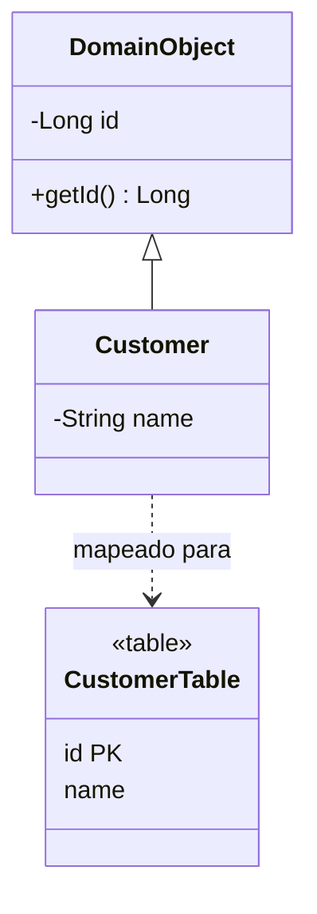

# Identity Field

## Descrição

O Identity Field guarda no objeto a chave primária da linha do banco de dados, para manter a identidade entre o objeto em memória e a linha correspondente. Em memória, dois objetos são o mesmo se forem a mesma referência. No banco, duas linhas são a mesma se tiverem a mesma chave. O campo de identidade liga essas duas noções.

Com o campo no objeto, o mapeador consegue saber se o objeto já foi inserido (chave preenchida) ou é novo (chave vazia), fazer `UPDATE` e `DELETE` na linha certa e montar chaves estrangeiras nas associações.

As decisões principais são o tipo da chave (simples ou composta, significativa ou substituta), a unicidade (por tabela ou global) e como gerar o valor (sequence, auto-increment, GUID, geração pela aplicação).

## Problemas que resolve

- Distinguir se um objeto já existe no banco para escolher entre `INSERT` e `UPDATE`.
- Ler o mesmo registro duas vezes e obter dois objetos sem relação entre si.
- Mapear associações entre objetos para chaves estrangeiras.

## Quando usar

- Sempre que objetos de domínio são mapeados para linhas de tabelas com um mapeamento objeto-relacional.
- Quando a identidade do objeto precisa sobreviver ao ciclo de vida da sessão.

### Quando evitar

- Para Value Objects sem identidade, que podem ser mapeados como Embedded Value ou Serialized LOB.
- Quando o modelo é de leitura simples e não precisa de identidade entre linha e objeto.

## Trade-offs

| Ganho | Custo / Risco |
| --- | --- |
| Identidade clara entre objeto e linha | Expõe um detalhe de persistência no modelo de domínio |
| Base para associações e Identity Map | Chaves compostas ou significativas complicam o código |
| Permite `UPDATE` e `DELETE` precisos | Geração da chave pode exigir ida ao banco antes do `INSERT` |

- **Chave substituta vs. significativa:** substitutas (sem significado de negócio) são mais estáveis; chaves significativas podem mudar.
- **Consistência:** chaves únicas evitam duplicidade e permitem controle de concorrência.
- **Desempenho:** tipos numéricos indexam melhor que strings longas.

## Diagrama



O `DomainObject` guarda o campo `id`, que corresponde à chave primária da linha em `CustomerTable`. Os objetos de domínio herdam o campo.

## Exemplo

Uma loja mapeia `Customer` para a tabela `customer`. O campo `id` é gerado pelo banco e preenchido após o `INSERT`.

```java
@MappedSuperclass
public abstract class DomainObject {
    @Id
    @GeneratedValue(strategy = GenerationType.IDENTITY)
    private Long id;

    public Long getId() { return id; }
    public boolean isNew() { return id == null; }
}

@Entity
public class Customer extends DomainObject {
    private String name;
    protected Customer() {}
    public Customer(String name) { this.name = name; }
}
```

O JPA usa `@Id` como Identity Field; a superclasse segue o [Layer Supertype](../base/layer-supertype.md).

## Padrões relacionados

- [Identity Map](../object-relational-behavioral/identity-map.md) — usa o Identity Field como chave para evitar carregar o mesmo registro duas vezes.
- [Foreign Key Mapping](./foreign-key-mapping.md) — usa o Identity Field para representar referências entre objetos.
- [Layer Supertype](../base/layer-supertype.md) — superclasse comum que costuma conter o campo de identidade.
- [Value Object](../base/value-object.md) — objetos sem identidade, que não precisam do campo.
- [Embedded Value](./embedded-value.md) — alternativa para objetos pequenos sem identidade própria.

## Referência

- [Página do padrão no catálogo do Fowler](https://martinfowler.com/eaaCatalog/identityField.html)
- *Patterns of Enterprise Application Architecture*, Martin Fowler (Addison-Wesley, 2002)
